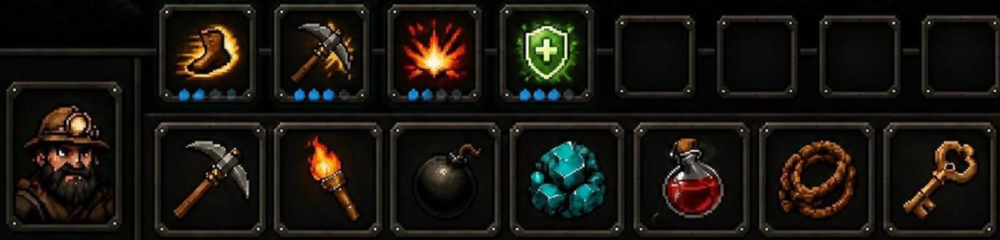

# DungeonEclipse

2D-рогалик-платформер (вид сбоку, пиксель-арт, тёмное фэнтези) на **Godot 4.3+ / GDScript**.
Каждый забег — новое процедурное подземелье; смерть героя заканчивает забег (permadeath).
Прогресс забега автоматически сохраняется в начале каждого этажа: «Продолжить» в главном
меню восстанавливает героя и этаж (этаж пересоздаётся из сида забега); смерть удаляет
сохранение.



## Запуск

1. Откройте папку проекта в Godot 4.3 или новее (Project → Import → `project.godot`).
2. Нажмите F5. Главная сцена — `scenes/ui/main_menu.tscn`.
3. Сцену `scenes/game/game.tscn` можно запускать напрямую (F6): герой создаётся из первой расы и первого класса.

Проверка без окна: `godot --headless --editor --quit` (импорт + проверка парсинга всех скриптов).

Тесты: `tests/ai_behaviour_test.tscn` (ИИ), `tests/loot_sim.tscn` (лут), `tests/net_game_sim.tscn`
(кооп: хост + гость, `NET_ROLE=host|client`). Старый сквозной smoke-тест удалён перед релизом.

## Управление (всё через InputMap, Project Settings → Input Map)

| Действие | Клавиатура / мышь | Геймпад |
|---|---|---|
| Ходьба | A / D, ← / → | левый стик, крестовина |
| Прыжок (coyote time + jump buffer, высота зависит от удержания) | Space, W, ↑ | A |
| Лестница / верёвка: лезть | W / ↑ (вверх), S / ↓ (вниз) | стик / крестовина |
| Спуск сквозь одностороннюю платформу | S / ↓ | стик вниз |
| Атака ближнего боя | J или ЛКМ (по игровому полю) | X |
| Предметы быстрого доступа | 1–7 | B — 5-й слот |
| Навыки (8 слотов) | Q, F, R, G, Z, X, C, V | LB, RB, LT, RT (слоты 1–4) |
| Дерево навыков | K | правый стик (нажатие) |
| Взаимодействие (сундук, дверь, подобрать) | E | Y |
| Инвентарь | I или Tab | Back |
| Пауза / настройки / закрыть книгу | Esc | Start |
| Карта этажа | M | левый стик (нажатие) |
| Отладка ИИ монстров (пути, зрение, состояния) | F3 | — |

Все клавиши клавиатуры и мыши переназначаются в «Настройки → Управление» (главное меню или
пауза) и сохраняются в `user://settings.cfg`, секция `[input]`. События геймпада заданы в
`project.godot` и при переназначении не меняются. Меню и книги навигируются стрелками /
крестовиной (встроенные `ui_*`); перетаскивание в инвентаре — только мышью.

**E и F** одновременно отвечают за взаимодействие и за 2-й/4-й навыки. Если рядом есть сундук,
предмет или дверь, срабатывает взаимодействие, иначе навык.

## Игровой процесс

- **Меню → создание героя**: раса (Человек, Гном, Эльф) и класс (Воин, Разбойник, Маг).
  Справа видно, как будет выглядеть портрет, итоговые характеристики, навыки и стартовые предметы.
- **Подземелье**: сетка комнат как в Spelunky. Гарантированный путь из верхней комнаты в нижнюю
  (проёмы в стенах и шахты с лестницами), боковые комнаты, замурованные «тайники» (туда нужно
  пробиться бомбой или навыком «Сокрушающий удар», внутри всегда железный или золотой сундук), односторонние
  платформы, кирпичные столбы. Всё, кроме внешней рамки, — разрушаемый кирпич.
  Выход — фиолетовая дверь (E). С каждым этажом карта растёт, монстров становится больше, они
  сильнее (+30% HP и +18% урона за этаж), а в луте чаще попадаются редкие и эпические вещи.
- **Сундуки**: деревянный, железный, золотой (заперт, тратит ключ). Лут берётся из
  `data/loot_tables/chest_*.tres`.
- **Монстры**: слизень (прыгает), скелет (наносит удар с выпадом), летучая мышь (пикирует),
  культист Затмения (стреляет, появляется со 2-го этажа). Состояния ИИ: патруль → преследование
  (при прямой видимости) → атака с замахом. После смерти монстр даёт опыт и иногда лут.
- **Бой**: удар оружием (урон × 0.85–1.15, крит ×2), навыки, бомбы. Броня снижает урон:
  `урон × 100 / (100 + броня × 4)`. Числа урона всплывают над целью.
- **Прогрессия**: опыт → уровень → рост характеристик по `growth_per_level` класса, полное
  лечение, +1 очко навыка. Очко тратится кликом по навыку на HUD (синие точки под иконкой —
  уровень навыка).
- **Смерть**: экран итогов → главное меню. Лучший этаж, число забегов и убийств сохраняются.

## Интерфейс

- **HUD** (внизу, в стиле книги): портрет (раса + головной убор класса), 8 слотов навыков с
  точками уровня и затемнением перезарядки, 7 быстрых слотов с количеством, полоски HP, маны и опыта.
  При наведении на портрет показываются все характеристики.
- **Инвентарь-книга** (`assets/ui/book.png`): на левой странице кукла со слотами экипировки и
  характеристиками, которые обновляются сразу; на правой — рюкзак 6×5. Игра на паузе.
  - перетаскивание: рюкзак ↔ экипировка ↔ быстрые слоты (HUD остаётся доступным под книгой);
  - ПКМ или двойной клик — надеть, снять или использовать;
  - предмет, брошенный за пределы книги, выпадает на пол; быстрый слот при этом очищается;
  - в подсказке видны редкость, описание, бонусы и сравнение с надетым предметом (+ зелёным, − красным).

## Структура проекта

```
assets/            картинки (заглушки), ui/ — книга, рамки, тема
data/              ВСЕ игровые данные в .tres
  items/{equipment,usable,materials}/
  races/  classes/  skills/  enemies/  loot_tables/  animations/  affixes/  biomes/
  traps/  bosses/  elites/  events/  meta/ (Святилище)  achievements/
  equipment_layout.tres   список слотов экипировки
scenes/            player/ enemies/ levels/ world/ ui/ game/
scripts/
  autoload/        EventBus, SaveManager, ItemDatabase, MetaProgress, Codex, GameState, Tooltip, AudioManager
  core/            Stats, Inventory, Equipment, QuickBar, SkillSet, Hero, AssetPaths, StatTypes,
                   ItemFactory, InputBindings, Leaderboard
  data/            классы ресурсов: ItemData, EquipmentItemData, UsableItemData, RaceData, ClassData,
                   SkillData, EnemyData, LootTable, LootEntry, EquipSlotDef, EquipmentLayout
  effects/         эффекты предметов (ItemEffect и наследники)
  skills/          эффекты навыков (SkillEffect и наследники)
  level/           LevelGenerator (чистые данные) → LevelLayout → DungeonLevel (TileMapLayer)
  player/ enemies/ world/ ui/ game/
tools/gen_placeholders.py  генератор пиксельных заглушек (Pillow)
```

### Архитектура

- **Hero** (`scripts/core/hero.gd`) — всё, что живёт весь забег: раса, класс, `Stats`, `Inventory`,
  `Equipment`, `QuickBar`, `SkillSet`, опыт. Узел `Player` — только тело героя в мире; при переходе
  на новый этаж пересоздаётся уровень, а `Hero` остаётся тем же.
- **Stats**: итог = база класса + рост за уровни + бонусы расы + сумма модификаторов
  (`"equipment"`, баффы навыков). При каждом `Equipment.changed` пересчитывается заново и посылает
  `stats_changed`. Производные значения: HP = 40 + Вын×8, мана = 20 + Инт×6,
  урон = базовый урон класса + главный атрибут×0.8, броня = Вын×0.5,
  скорость = 110 + Лов×1.5, крит = 5% + Лов×0.6%. К каждому из них предметы могут прибавлять напрямую.
- **Inventory / Equipment / QuickBar** — логика без UI, только сигналы `changed`; UI на них подписан.
  Быстрый слот хранит ссылку на предмет, количество берётся из рюкзака.
- **EventBus** — глобальные сигналы: всплывающий текст, сообщения, выпадение лута, смерть, смена
  этажа, тряска экрана.
- **ItemDatabase** при старте загружает все `.tres` из папок `data/...`, поэтому новый файл
  подхватывается без правки кода.
- **SaveManager**: `user://settings.cfg` (громкость, полный экран) и `user://meta.cfg`
  (лучший этаж, забеги, убийства). Сам забег не сохраняется.

## Как добавить контент

Всё делается в инспекторе Godot: ПКМ по папке → *New Resource…* → нужный класс, либо
*Duplicate* существующего `.tres` и правка полей.

### Новый предмет
- **Снаряжение**: `EquipmentItemData` в `data/items/equipment/`. Заполните `id` (уникальный),
  `display_name`, `description`, `icon`, `rarity`, `slot_type` (`weapon`, `helmet`, `chest`,
  `gloves`, `boots`, `ring`, `amulet`) и `stat_bonuses`, например
  `{"strength": 2, "armor": 5, "crit_chance": 0.05}`. Ключи перечислены в `scripts/core/stat_types.gd`.
- **Используемый**: `UsableItemData` в `data/items/usable/`. В `effects` добавьте один или несколько
  эффектов: `HealEffect`, `ManaEffect`, `ThrowBombEffect`, `RopeEffect`, `DigEffect`,
  `UnlockEffect`. Флаг `consume_on_use` тратит предмет при использовании, `cooldown` — задержка
  между использованиями.
- **Свой эффект**: создайте скрипт `extends ItemEffect` с `class_name`, переопределите
  `apply(user) -> bool` (`user` — это `Player`) и `describe()`. После этого эффект появится в
  инспекторе, ядро трогать не нужно.
- **Ресурс**: обычный `ItemData` с `item_type = MATERIAL` в `data/items/materials/`.
- Чтобы предмет выпадал, добавьте `LootEntry` в нужную таблицу в `data/loot_tables/`.

### Новое оружие
`WeaponItemData` в `data/items/equipment/` (ПКМ → New Resource → WeaponItemData или Duplicate
любого `*_sword.tres`):
- `weapon_type` — меч, топор, копьё, кинжал, лук, посох, булава; от него по умолчанию зависят
  анимация героя (`attack_animation` можно задать вручную) и `attack_pattern`
  (ARC — удар дугой, THRUST — выпад, SHOOT — выстрел снарядом, THROW — бросок);
- `base_damage`, `attack_speed` (ударов в секунду), `reach` (дальность в пикселях, у луков и
  посохов — дальность полёта), `knockback`, `two_handed`, `damage_type` (физический, огонь,
  лёд, яд, магия — задаёт цвет следа и вспышки; сопротивления появятся вместе со статусами);
- `projectile_*` — текстура, скорость, пробивание, радиус взрыва (для SHOOT/THROW);
- `on_hit_effects` — `StatusHitEffect` (яд, горение, кровотечение, оглушение, замедление) или
  `LifeStealHitEffect`; свой эффект — скрипт `extends HitEffect` с `on_hit(attacker, target, damage)`;
- `held_texture` / `held_angle` / `grip_pixel` — как оружие лежит в руке (по умолчанию иконка,
  остриём вверх-вправо, рукоять в (3, 12));
- `gender` (m/f/n) — род названия, чтобы префикс аффикса согласовался («Острая секира»);
- `has_durability` / `max_durability` — износ (по 1 за попадание).
Затем добавьте `LootEntry` в нужные таблицы лута. Какие типы оружия «родные» для класса —
`ClassData.allowed_weapon_types`; чужое оружие работает со штрафом −40% урона и −25% скорости
(видно в подсказке).

### Новый аффикс оружия
`AffixData` в `data/affixes/`: префикс (`prefix_forms` = {m, f, n}) или суффикс (`suffix`,
«… пламени»), `min_rarity`, `weight`, `allowed_types`, и эффекты: `stat_bonuses`,
`damage_mult`, `speed_mult`, `reach_add`, `knockback_add`, `damage_type`, `hit_effects`.
Редкое оружие получает 1 аффикс, эпическое — 2 (префикс + суффикс).

### Новый биом
`BiomeData` в `data/biomes/`: тайлсет (формат атласа — в docs/ANIMATION_GUIDE.md), три слоя
параллакса, палитра (`ambient` — мягкий общий свет для CanvasModulate, цвет задней стены, свечение настенных факелов,
пыли), туман и цветокоррекция (`fog_*`, `grade_tint`, `saturation`, `contrast`),
декорации (`DecorData`: текстура, пол/потолок, вес, свечение, покачивание), плотность
декораций, шанс и предмет рудных жил. Биомы чередуются по `order` каждые 3 этажа.
`EnemyData.biomes` ограничивает монстра нужными биомами (пусто — везде).

### Новый звук / музыка
Подробно — [docs/AUDIO_LIST.md](docs/AUDIO_LIST.md). Файл кладётся в `assets/audio/sfx/` или
`assets/audio/music/`, id и путь добавляются в `AssetPaths.SFX` / `AssetPaths.MUSIC`, затем id
указывается в данных (`UsableItemData.use_sound`, `EnemyData.sound_hurt/sound_death/sound_attack`,
`BiomeData.music`, `BiomeData.step_sound`) или вызывается из кода
`AudioManager.play_sfx(id, позиция)` / `play_ui(id)` / `play_music(id)`.

**Музыка по ситуации.** Меню → `menu`. Этаж → трек биома. Вход в арену → `BossData.music`
(у каждого босса своя тема, запасной вариант — `boss` через `AssetPaths.MUSIC_FALLBACK`).
Победа → короткая фанфара `victory`, затем возврат к биому. Гибель → `death`. Переходы —
кросс-фейд 1.5 с. Одноразовые треки играют через `AudioManager.play_sting(id, затем_id)` и
перечислены в `AssetPaths.MUSIC_ONE_SHOT`. Если файлов музыки нет совсем, игра работает в
тишине без ошибок. Музыку для нового босса задайте в его `.tres` (`music = &"мой_id"`) и
добавьте id в `AssetPaths.MUSIC`.

### Статус-эффекты и стихии
Компонент `StatusEffects` есть у героя и у монстров: яд, горение, кровотечение (урон каждые
0.5 с, без учёта брони), оглушение, замедление, регенерация, щит (поглощает урон), проклятие.
Иконки — над головой и в строке над HUD (негативные — в красной рамке).
- Стихии: огонь растапливает лёд (снимает замедление), лёд гасит огонь; яд вдвое ослабляет регенерацию.
- Сопротивления: у героя — статы `res_fire/res_ice/res_poison/res_magic` (бонусы предметов и рас),
  у монстра — `EnemyData.resistances`; они режут стихийный урон и длительность статусов.
  `EnemyData.status_immunities` — полный иммунитет (скелеты не травятся).
- Источники: `on_hit_effects` оружия и аффиксов, `EnemyData.on_hit_effects` (монстры → герой),
  предметы (`StatusSelfEffect`, `CureEffect` — противоядие), навыки (`StatusSkill`).
- Новый статус: строка в `StatusEffects.INFO` + иконка `assets/ui/status/<id>.png` (8×8).

### Новая ловушка
`TrapData` в `data/traps/`: `kind` задаёт поведение (SPIKES — шипы выезжают, когда на них
наступили; FALLING_ROCK — камень трескается и падает, когда герой под ним; ARROW_WALL —
стреляет вдоль ряда, когда герой на линии; ACID_POOL — урон и яд, пока стоишь в луже;
PRESSURE_PLATE — запускает связанную стреляющую стену или камнепад). Остальное — данные: урон и
его рост за этаж (`damage_per_floor`), тип урона, эффекты при попадании, перезарядка, дальность,
снаряд, сложность обезвреживания, лист анимации, `min_floor`, `weight`, `biomes`. Так сделаны
«Ядовитые шипы» и «Огненная стена». Ловушку можно перепрыгнуть или обезвредить клавишей E
(шанс = 1 − сложность + Ловкость × 2%, при неудаче она срабатывает).

### Золото и торговец
Золото — валюта (предмет с `currency_value > 0`, например `gold_coin`, при подборе превращается в
золото кошелька). Его дают монстры (`EnemyData.gold_min/max`), сундуки (`LootTable.gold_min/max`,
+25% за этаж) и продажа. С шансом 40% на этаже есть комната торговца: он продаёт базовые
расходники и товары из `data/loot_tables/merchant.tres`, покупает предметы за 40% цены,
чинит снаряжение и лечит. Цена предмета — `ItemData.price` (0 = автоматически по типу и редкости;
аффиксы и износ меняют цену экземпляра).

### Новый босс
`BossData` в `data/bosses/` (наследник `EnemyData`: все поля монстра + `title`, `order`, `music`,
`glow_color`, `reward_items`). Боссы ходят по очереди по `order`: этаж 5 — первый, 10 — второй,
15 — снова первый (сильнее). Поведение — список фаз `BossPhase` (порог HP, пауза между атаками,
скорость, оттенок, сообщение), в каждой — набор `BossAttack`:
CHARGE (рывок вдоль пола), JUMP_SLAM (прыжок с ударной волной), PROJECTILE_FAN (веер снарядов),
SUMMON (призыв монстров), TELEPORT (исчезает и появляется рядом, стреляя), FIRE_RAIN (огненный
дождь по отмеченным точкам). Перед каждой атакой есть телеграф: красное свечение и метки на полу
(`windup` секунд). Арена — один зал; после победы появляются дверь, эпический сундук и
«Печать Стража».

### Случайные события и комнаты
Генератор резервирует на каждом этаже 1–2 боковые комнаты под события; какое именно —
выбирается по весу из `data/events/*.tres` (`RoomEventData`: название, сцена, вес, `min_floor`).
Есть: кровавый алтарь (−20% HP за сокровище, +2 к случайной характеристике или золото),
целебный фонтан (полное исцеление и снятие негативных статусов), проклятый сундук (двойной
эпический лут + проклятие и засада), комната рун (рычаги нужно потянуть в порядке, показанном
на табличке, — тогда исчезает барьер перед золотым сундуком; ошибка бьёт током и сбрасывает
рычаги) и узник в клетке (награда или, в 15% случаев, ловушка). Новое событие — сцена с
`setup_event(level, info)` (удобно наследовать `EventObject`) и `.tres` в `data/events/`.

### Мини-карта
Этаж открывается по мере исследования (радиус 7 клеток вокруг героя). Маленькая карта всегда
в правом верхнем углу, большая — по M. Метки: герой, выход, неоткрытые сундуки, торговец,
события, элиты и босс. «Карта этажа» (свиток, `RevealMapEffect`) открывает весь этаж.

### Святилище Затмения (мета-прогрессия)
Кнопка в главном меню. Валюта — **осколки Затмения** (падают с элит и стражей; «Печать Стража»
в рюкзаке = 5 осколков) и **золото казны**. В конце забега (смерть или выход в меню)
`MetaProgress.finish_run` начисляет: осколки из рюкзака (`ItemData.shard_value`), 1 осколок за
каждые 2 этажа, 3 за каждого стража, и 25% собранного золота. Всё хранится в секции
`[sanctum]` файла `user://meta.cfg` (рекорды — в секции `[meta]`).

- **Новое улучшение**: `MetaUpgradeData` в `data/meta/` — `max_level`, `shard_costs` /
  `gold_costs` (цена каждого уровня), эффект за уровень: `stat_bonuses`, `start_gold`,
  `starting_items` (так же открываются стартовые предметы). Применяется к новому герою
  модификатором Stats `"meta"`.
- **Закрытая раса/класс**: задайте `unlock_shards` / `unlock_gold` в `RaceData` / `ClassData`;
  они появятся в Святилище, а в создании героя будут видны, но недоступны до покупки.
  Пример: орк (15 осколков) и паладин (20 осколков + 300 золота).

### Достижения, бестиарий, энциклопедия предметов («Летопись»)
Кнопка «Летопись» в главном меню: три вкладки книги. Всё считает autoload `Codex`, который
только слушает сигналы EventBus (убийства, элиты, боссы, этажи, сундуки, находки, золото,
ловушки, события, покупки, смерти) — игровой код о нём не знает. Хранится в секции `[codex]`
файла `user://meta.cfg`.

- **Новое достижение**: `AchievementData` в `data/achievements/` — `counter` (один из
  `Codex.COUNTERS`: kills, elites, bosses, floor, chests, epic_items, gold, traps, events,
  purchases, deaths, bestiary, items_known, runs), `target`, `reward_shards` (осколки в
  Святилище), `hidden` (до получения показывается «???»), `icon`. При получении сверху
  выезжает карточка (`AchievementToast`).
- **Бестиарий** заполняется сам: каждый `EnemyData`/`BossData` открывается после первой победы.
  Текст — `EnemyData.description`, остальное (HP, повадки, особенности, иммунитеты, где
  встречается) берётся из данных монстра. Миниатюра — первый кадр анимации `idle`.
- **Энциклопедия предметов**: все предметы из `data/items` (кроме монет); открываются при
  подборе или покупке, описание — та же подсказка, что в инвентаре.

### Ежедневный забег
Кнопка «Ежедневный забег» в главном меню. Дата (локальная, `YYYY-MM-DD`) превращается в зерно
и героя дня (`GameState.daily_setup`): раса и класс выбираются только из открытых изначально.
Каждый этаж дополнительно засевает глобальный генератор (`seed(floor_seed)`), поэтому добыча и
броски монстров тоже совпадают. Улучшения Святилища не действуют. Очки
(`Leaderboard.score`): этаж ×100, страж ×300, враг ×5, половина золота, уровень ×20.
Локальная таблица — секция `[daily]` в `user://meta.cfg`, по 10 лучших результатов на день.

### ИИ монстров
- **Навигация** (`scripts/ai/level_nav.gd`, `LevelNav`): строится из `LevelLayout` при создании
  этажа и перестраивается (не чаще раза за кадр), когда ломается кирпич или вешается верёвка.
  - Ходячие: граф платформ `GroundGraph` (AStar2D с типами рёбер: ходьба, прыжок до 3 клеток
    вверх и 3 в сторону с проверкой дуги, падение не глубже 6 клеток — глубже считается
    пропастью, спуск сквозь платформу, лестница/верёвка). Два варианта графа: для тел в 1 и
    2 клетки высотой (`EnemyData.collision_size`).
  - Летающие: A* по свободным клеткам (`AStarGrid2D`, диагонали только мимо свободных углов) +
    три луча-«уса» против стен. Сквозь платформы летают. Призраки (`phases_through_walls`)
    летят напрямую.
  - Ловушки помечаются при генерации (`DungeonLevel._mark_trap_danger`): на шипы, кислоту и
    нажимные плиты монстр не наступает никогда (но может перепрыгнуть), линии стрел и
    камнепады дают большую стоимость. Новый тип ловушки — добавьте его в `_mark_trap_danger`.
- **Состояния** (`Enemy.State`): патруль → «!» заметил → преследование → атака → поиск
  («?», идёт к последнему месту, где видел/слышал героя, осматривается) → возврат домой → патруль.
  Зрение — луч по слою стен (кирпич заслоняет), в патруле только вперёд (кроме вплотную),
  память о герое 4 с. Слух: `EventBus.noise(pos, radius)` — бой (150 px), взрывы (260 px),
  удар голема. Новый источник шума — просто вызовите этот сигнал.
- **Бой**: стрелки держат дистанцию и отходят, если герой близко; ближний бой бьёт только при
  прямой видимости и на одном уровне; после удара героя ходячие отступают на 0.35 с, летучие —
  вверх на 0.4 с; монстры не стоят друг в друге (расходятся, когда ждут). Удары, удар по
  площади и выстрелы врагов проверяют линию до героя — сквозь стену не бьют и не стреляют.
- **Координация** (`Enemy.coordination()`, 0 до 2-го этажа → 1 к 10-му): заметивший зовёт
  соседей, монстры заходят с менее занятой стороны героя, на глубине не лезут по одному, а
  ждут стаю. Без читерства: только то, что монстр видит, слышит или узнал от соседа.
- **Антизастревание**: нет продвижения 1.2 с → новый путь → прыжок с разворотом → телепорт в
  ближайшую безопасную клетку графа. Всё пишется в `AIDebug` (счётчики) и в консоль при F3.
- **Отладка F3**: путь каждого монстра, радиус зрения, линия к герою (зелёная — видит),
  последнее известное место героя, состояние над головой.
- **Тесты ИИ** (headless):
  - `godot --headless --fixed-fps 60 --path . res://tests/ai_sim.tscn -- --levels=50 --seconds=25`
    — 50 случайных этажей с «бродячим» бессмертным героем; печатает срабатывания
    антизастревания, застрявших > 10 с, время на клетках ловушек. Последний прогон:
    1195 монстров, застрявших > 10 с — 0 (худший 3.8 с), на ловушках — 0 с,
    антизастревание: 42 новых пути, 14 манёвров, 6 телепортов.
  - `godot --headless --fixed-fps 60 --path . res://tests/ai_behaviour_test.tscn` — сценарии
    на маленьких уровнях: прыжок через шипы, на уступ, лестница, стена закрывает обзор,
    память → поиск → возврат, слух, перестройка графа, облёт стены, отход стрелка, нет удара
    сквозь стену, зов союзников, цепочка антизастревания.

### Никаких ударов сквозь стены
Одно правило для всех (`scripts/combat/line_of_sight.gd`, `LineOfSight`): между атакующим и
целью не должно быть кирпича или скалы. Платформы и лестницы обзор не закрывают.
- Ближний бой героя: хитбокс оружия обрезается о первую стену (искры и звук удара о камень),
  цель засчитывается, только если видна из рук героя (центр или верх тела).
- Навыки: «Мощный удар», удар по области, рывок с уроном — урон только по видимым целям;
  кирпич ломается уже после расчёта урона, поэтому стена прикрывает того, кто за ней.
- Снаряды (стрелы, магия, ножи, выстрелы врагов, стрелы ловушек, огонь босса): каждый кадр луч
  по пути снаряда — о кирпич он гаснет, сквозь не пролетает; точка вылета никогда не внутри
  кирпича. Взрыв снаряда задевает только тех, кого видно из точки взрыва.
- Бомбы: урон — по видимым из точки взрыва (стены как до взрыва), кирпичи в радиусе ломаются.
- Монстры и боссы: удар, удар по площади, ударная волна, касание и выстрел — только при
  прямой видимости героя.
- Новый вид атаки: проверяйте цель через `LineOfSight.can_hit(node, from, target)`, точку
  появления снаряда — через `LineOfSight.safe_point`.
- Тесты: сценарии «hero melee does not pass walls», «weapon stops at the wall», «skills and
  bombs do not pass walls», «projectiles stop at bricks» в `tests/ai_behaviour_test.tscn`.

### Свет
Подземелья светлые и ровно освещённые. Нет круга света вокруг героя, нет виньетки и
темноты по краям. Общий свет задаёт биом (`BiomeData.ambient`, мягкий оттенок для
CanvasModulate). Объём дают только чуть более тёмные задняя стена и дальние слои параллакса.
Настенные факелы остаются декорацией с тёплым свечением и на видимость не влияют. Светятся
элиты, руда, снаряды и предметы на полу. Ползунок «Яркость» в настройках (0.6–1.5)
умножает картинку мира в шейдере постобработки; HUD он не меняет. Значение хранится в
`settings.cfg`, секция `[video]`. Предмета «Факел» в игре больше нет.

### Каталог предметов, сеты, реликвии
**Генератор.** Сейчас в игре 142 предмета. 91 новый описан в `tools/gen_items.py`: один
список, из которого создаются `.tres` и иконки-заглушки. После правки списка запустите
`cd tools && python3 gen_items.py && python3 gen_loot_tables.py`. Новый предмет можно сделать
и вручную в редакторе — генератор трогает только те `.tres`, что перечислены в его списке.

**Что добавлено:**
- **Оружие — 28 новых видов.**
  - Новые типы оружия: арбалет (`CROSSBOW`, разбойник) и жезл (`WAND`, маг).
  - Элементальное оружие: огонь, лёд, яд, магия; вампирский «Кровопийца».
  - Легендарные уникальные (`unique`): «Солнечный клинок», «Сердце стужи», «Жало гадюки»,
    «Кровопийца».
- **Броня — 20 вещей**, от ткани и кожи до лат, с акцентами: ловкость, броня, интеллект,
  сопротивления.
- **Кольца и амулеты — 8**: крит, регенерация, скорость, добыча золота, сопротивление огню
  и яду, лишний прыжок.
- **Расходники — 22:**
  - зелья: малое лечение, мана, скорость, сила, защита, невидимость;
  - свитки: телепорт, возврат к выходу, огненный шар, обнаружение, исцеление;
  - бомбы: огненная, ледяная, ядовитая, липкая;
  - еда, отмычки, длинная верёвка.
- **Реликвии — 5.** Ресурсы для крафта и продажи — 8.

**Новые характеристики** (`StatTypes.SPECIAL`): `hp_regen` (HP в секунду), `gold_find`
(доля доп. золота с монстров), `extra_jumps` (прыжки в воздухе). Их можно указывать в
`stat_bonuses` любого предмета.

**Сет.** `ItemSetData` в `data/sets/`: `id`, `display_name`, `items` (id частей) и `bonuses`
вида `{2: {...}, 3: {...}, 4: {...}}` — бонусы достигнутых порогов складываются. Частям
нужно указать `set_id`. Подсказка показывает части комплекта (надетые — ярче) и бонусы
(достигнутые — зелёным). Сейчас четыре сета: «Странник», «Страж», «Чародей», «Затмение».

**Реликвия.** `RelicItemData` (тип «Реликвия», папка `data/items/relics/`). Действует просто
из рюкзака, особый слот не нужен; одна копия каждой реликвии считается один раз. Поля:
- `stat_bonuses` — бонусы к характеристикам;
- `heal_on_kill` — лечение за каждое убийство;
- `second_chance` и `revive_percent` — при гибели герой встаёт, реликвия сгорает.

**Новые эффекты расходников:**
- `BuffItemEffect` — временные бонусы;
- `TeleportEffect` — телепорт (`to_exit` — к выходу);
- `CastSkillEffect` — заклинание из свитка, любой `SkillEffect` без маны;
- `DetectEffect` — карта и подсветка ловушек;
- `ThrowBombEffect` — теперь с `damage_type`, статусом, `sticky`, `breaks_tiles`;
- `UnlockEffect.success_chance` — отмычки;

**Невидимость** — статус `invisible`: монстры не видят героя дальше 14 px, атака её снимает.

### Лут по этажам и баланс
- **Редкости**: обычная, редкая, эпическая, легендарная (`ItemData.Rarity`). У каждого предмета
  есть `item_level` (1 — стартовое снаряжение, 6–8 — топовые эпики) и `unique`: уникальные и
  легендарные предметы выпадают только с боссов, из особых комнат и с глубоких этажей (8+).
- **Таблица лута** (`LootTable`):
  - `rarity_weights` — вес каждой редкости на 1-м этаже;
  - `rarity_per_floor` — прирост веса за каждый этаж;
  - `rarity_min_floor` — с какого этажа редкость вообще возможна;
  - `item_level_base + item_level_per_floor × этаж + item_level_bonus` — потолок уровня предмета;
  - `rolls_min/max`;
  - `extra_tables` — отдельные броски, например расходники;
  - `gold_min/max`.
- **Запись** (`LootEntry`): `weight`, `min/max_count`, `min_floor`, `max_floor`.
- **Тип сундука** повышает шансы редкостей и даёт +0/+1/+2 к потолку уровня, но этаж всё
  равно ограничивает лут. Деревянный сундук даёт 1–2 предмета, железный — 1–3, золотой — 2–3.
  Золото и расходники выпадают отдельно от снаряжения.
- **Таблицы генерирует** `tools/gen_loot_tables.py` — там все числа баланса:
  - `chest_common/rare/epic` — сундуки;
  - `enemy_common/rare` — монстры, элита берёт лут из `enemy_rare`;
  - `merchant` — торговец;
  - `boss` — сундук за босса;
  - `special` — особые комнаты;
  - `supplies(_small)` — расходники.
- **Новый предмет** попадает в нужные таблицы автоматически: задайте ему `rarity`,
  `item_level` (и `unique` для легендарного) и запустите `python3 tools/gen_loot_tables.py`.
- **Проверка баланса**: `godot --headless --path . res://tests/loot_sim.tscn`. Симулятор
  открывает каждую таблицу 1000 раз на этажах 1, 3, 5, 8 и 12, проверяет цели и пишет
  отчёт в [docs/BALANCE.md](docs/BALANCE.md). Цели:
  - на 1-м этаже эпических меньше 1%, и сундук не даёт предметов выше 3-го уровня;
  - к 8-му этажу эпические — регулярная находка;
  - стартовое снаряжение всех классов — обычное, 1-го уровня.
- **Монстры**:
  - HP +40% и урон +22% за каждый этаж;
  - число монстров 3 + 2.4 × этаж + комнаты / 2;
  - шанс элиты 6% на 1-м этаже, +2.5% за этаж, максимум 35%;
  - новый аффикс элиты «Щитоносный» — щит, который поглощает урон.

### Производительность
- Монстры дальше 520 px от героя, которые просто патрулируют, «спят»: не думают и не считают
  физику. Будят их приближение героя, шум (`EventBus.noise`) и урон.
- Список монстров берётся из дерева сцены один раз за физический кадр (`Enemy.all_enemies()`),
  а не каждым монстром заново.
- Граф навигации перестраивается через 0.2 с после последнего разрушения: взрыв на десять
  кирпичей стоит одной перестройки.
- Мини-карта перерисовывает только изменившиеся клетки (`DungeonLevel.changed_cells`), метки —
  10 раз в секунду.
- У снарядов нет собственного источника света. Лежащие предметы считают физику дважды в
  секунду, а не каждый кадр.

### Ломание блоков без микролагов
Раньше после каждого сломанного кирпича граф навигации ИИ перестраивался целиком —
около 250 мс, отсюда и микролаг. Теперь `LevelNav.update_area()` пересчитывает только
окрестность изменённых клеток: прыжки, падения и спуски дотягиваются на несколько
клеток, поэтому захватывается небольшой запас вокруг. Это занимает 1–12 мс, а граф
получается тот же, что и при полной перестройке. Монстры тоже пересчитывают пути не
в одном кадре, а вразброс в течение полсекунды.

Кирки (обычная, стальная, мифриловая) удалены из игры. Кирпич ломают бомбы и
навык «Сокрушающий удар»; паладин вместо кирки начинает с двумя бомбами.

### Детализация локаций, часть 2
- **Слой мелочей** (тайлы без коллизии, ряды 7–9 атласа биома, `DungeonLevel._apply_detail`):
  - у пола: трава с цветами, мох со светящимися грибочками, угольки и пепел, мелкие
    кристаллы, камешки и обломки костей;
  - под потолком: корни, лианы, паутина в углах, закопчённые сосульки со светящимся
    кончиком, кристаллы-сосульки;
  - на задней стене: трещины, пятна мха или копоти, выступающие камни, руны и зарубки.

  Плотность задаётся в `BiomeData.floor_fringe`, `ceiling_fringe` и `wall_details`.
  Слой пересчитывается при разрушении блоков.
- **Настенные декорации** (`DecorData.Placement.WALL`) висят на задней стене на уровне
  глаз и чуть подкрашены под стену: полки с черепами, кандалы, грибы-трутовики, корни,
  фреска, плющ, светящиеся лавовые трещины, маленькие зеркала, театральные маски.
- **Крупные декорации на две клетки:** саркофаг, гроздь светящихся грибов,
  разрушенная арка, обугленные кости, большое зеркало.
- **Плотность декораций:** 4.5 на комнату (было 3), в Зеркальных чертогах — 5.
- **Частицы биома** (`BiomeData.particle_style`):
  - катакомбы — оседающая пыль;
  - грибные пещеры — светящиеся споры;
  - руины — пыльца на ветру;
  - лава — поднимающиеся угли;
  - Зеркальные чертоги — мерцающие искры.
- **Ниши и трещины на задней стене** редкие (1–2 из 96 клеток), руны вынесены в слой
  мелочей, чтобы детали не складывались в узор.

### Детальные монстры
Все обычные монстры перерисованы в `tools/gen_monsters.py`. Размеры кадров и раскладки
анимаций (`data/animations/*`) прежние, так что хитбоксы и данные не менялись. Объём
передан освещением сверху-слева: 4 тона с дизерингом на границах.
- слизень — полупрозрачное желе с ядром, пузырьками и бликом, глаза со зрачками,
  капля в прыжке, пасть при атаке;
- скелет — череп с глазницами и угольками глаз, зубы, рёбра, позвоночник, суставы,
  тряпка-набедренник, ржавый меч с гардой;
- летучая мышь — перепонки с косточками пальцев, уши с розовым, клыки;
- культист — складки мантии, глубокий капюшон, кайма, пояс со знаком, рукав;
- паук — суставчатые лапы, красные «песочные часы» на брюшке, россыпь глаз, хелицеры;
- голем — каменные блоки с фаской, трещины, мох, светящиеся руны и ядро с кольцом,
  кулаки-валуны;
- призрак — прозрачность тает к хвосту, внутренние завихрения, пустые глаза со светом;
- призыватель — костяное ожерелье, посох с черепом, у которого загораются глазницы.

Ледяной бесёнок и болотный плевун теперь отдельные существа, а не перекраска:
- бесёнок — с ледяными рожками, белой гривой, хвостом и снежком в лапе;
- плевун — бородавчатая жаба из грязи со мхом, выпученными жёлтыми глазами и пастью,
  которая раскрывается для плевка.

Монстры биомов перерисованы в той же манере (объём, материалы, детали), сохранены размеры
кадров и хитбоксы:
- утопленник — раздутый труп в рваной рубахе, с водорослями, ракушками и дубиной из плавника;
- утопленный жрец — мокрая ряса, коралловая митра, водоросли, ракушки, с подола капает вода;
- пепельный — обугленное тело, сквозь трещины светится ядро, рваная вуаль, в лапе уголь;
- страж рун — гребенчатый шлем со смотровой щелью, светящиеся каналы рун, мох и трещины;
- огненная гончая — базальтовая шкура с раскалёнными трещинами, грива из углей, расплавленная пасть;
- кристальный ползун — жук с хитиновым панцирем и гранёными кристаллами, шесть лап, жвала;
- споровик — грибочек со шляпкой в пятнах, пластинками и рожицей на ножке, облако спор при атаке;
- пиявки — блестящий кольчатый червь со спинными полосками и присоской с зубами;
- стеклянный охотник — мотылёк с гранёными крыльями и бликом, при гибели разлетается осколками.

Смерть всех монстров теперь рассыпается шумом сверху вниз, без диагональных полос.

Последние боссы перерисованы в том же стиле, что Король костей (`gen_bosses.py`,
кадры, раскладки и хитбоксы прежние):
- Пепельный король — обугленные латы с магмовыми прожилками, раскалённое сердце в нагруднике,
  обугленный череп в трещинах с тлеющими углями, железная корона с тлеющими зубцами, дым, плащ с горящим подолом, меч с расплавленной
  кромкой; при смерти рассыпается пеплом, на куче остаются корона и меч.
- Утопленный колокол — раздутый утопленник со складками, ракушками, водорослями и рыболовной
  сетью, глаза-фонари; бронзовый колокол на якорной цепи с патиной, поясом надписей и языком,
  удар расходится кольцами звука; падает, и колокол остаётся лежать рядом.

`gen_sheets.py` и `gen_mechanics.py` при запуске вызывают `gen_monsters.py`, поэтому
старые рисунки не возвращаются.

### Детальные постройки
`tools/gen_structures.py` перерисовывает постройки и предметы обстановки: камень
кладкой со швами и бликами, дерево досками с волокнами, металл с заклёпками, свечение
поверх контура.
- Алтарь жертвы (28×30): колонны, резная панель с руной, свечи, парящий кровавый
  кристалл. У алтаря судьбы теперь свой спрайт: мраморный, с вращающимся колесом судьбы
  (раньше это был тот же алтарь, перекрашенный через modulate).
- Фонтан (32×36): чаша с рыбой-фонтаном, струи и брызги, лицо на бассейне, сухой
  вариант с мхом и трещинами.
- Клетка пленника (24×32): купол, заклёпки, замок, солома, пленник дышит и хватается
  за прутья. Открытая клетка: распахнутая дверца и разорванная цепь.
- Выход (портал 28×32): каменная арка с замковым камнем, руны на колоннах загораются
  по очереди, внутри закручивается вихрь.
- Сундуки: доски, оковка, замок, свет из щели при открывании, клад внутри. У
  проклятого сундука свой спрайт: цепи и замок-череп.
- Барьер головоломки, рычаг с камнем-индикатором, руны, настенный факел.
- Торговец (28×32) с огромным рюкзаком и фонарём. У кузнеца-гнома свой спрайт:
  фартук, борода, анимация удара молотом с искрами. Обновлены наковальня с
  раскалённой заготовкой и ковёр.
- Ловушки: решётка с шипами, кислота, нажимная плита, горгулья-самострел, камень,
  трещина в потолке.

Размеры кадров ловушек и сундуков прежние, потому что их хитбоксы привязаны к тайлам.
У остальных построек кадры крупнее, но точка привязки (низ по центру) не изменилась.
`gen_sheets.py` и `gen_mechanics.py` вызывают `gen_structures.py` в конце.

### Детальные боссы
`tools/gen_bosses.py` перерисовывает боссов. Размеры кадров и раскладки анимаций
прежние, поэтому хитбоксы и точки атак не сдвинулись.
- Король костей: череп с объёмом, трещиной и тлеющими глазами (на замахе они
  становятся голубыми, а на мече загораются руны), корона с самоцветами, ржавый нагрудник
  с золотым черепом, наплечники с шипами, поножи, королевская накидка, которая колышется.
  Двуручный меч с долом, зазубринами и гардой. При смерти рассыпается в кучу костей,
  корона и меч остаются лежать.
- Огненная ведьма: пылающие волосы, огненный ореол (языки пламени проходят то за
  ведьмой, то перед ней), подол платья превращается в пламя, золотая диадема с рогами,
  светящиеся глаза, огненные шары в руках, крик при атаке, летящие искры.
- Иллюзионист: плащ с объёмом, звёздная подкладка, золотая отделка и ромбы на подоле,
  маска наполовину белая, наполовину чёрная (смеётся и плачет), пять карт с мастями,
  перчатки и фиолетовая магия.

При смерти все три босса рассыпаются пепельными искрами снизу вверх. `gen_mechanics.py`
вызывает `gen_bosses.py`.

### Город Затмения (этаж 0)
Каждый забег начинается в городе (`GameState.TOWN_FLOOR = 0`, `GameState.is_town()`).
Город — это ночная улица под затмением между городскими стенами. На ней стоят часовня
с витражом-затмением, дома, лавка, где стоит торговец (товары как на 1-м этаже),
таверна, колодец и кузница, где стоит кузнец. Есть фонари со светом, деревья, забор,
скамейка, указатель и светлячки. В конце улицы склеп в холме с лестницей вниз, двумя
факелами и фиолетовым светом. Это врата в подземелье (`DungeonGate`): «E — спуститься
в подземелье» переводит на 1-й этаж.

- Раскладка: `scripts/level/town_builder.gd` (`TownBuilder.build()`, `LevelLayout.is_town`,
  `town_props`). Город строит `DungeonLevel._spawn_town()`: без задней стены (видно небо),
  без руды, монстров, сундуков и ловушек, вся карта сразу открыта.
- Данные: `data/town/town.tres` (`BiomeData`: свой тайлсет, небо, ночной свет, музыка
  `town`). Файл лежит вне `data/biomes`, чтобы не попасть в чередование биомов этажей.
- Графика: `tools/gen_town.py` создаёт `sprites/tiles/tiles_town.png`,
  `backgrounds/town_*.png` и `sprites/town/*.png`. Его вызывает `gen_mechanics.py`.
  Музыка `music_town.ogg`: трек `town` в `tools/gen_audio.py` (тёплый мажорный вальс
  с флейтой).
- `is_boss_floor()` больше не считает этаж 0 логовом стража.

### Сложность и версия
При создании героя выбирается сложность: Лёгкая, Обычная, Сложная или Кошмар. Описание
каждой лежит в `data/difficulties/*.tres` (`DifficultyData`), игра запоминает последний
выбор в настройках. Ежедневный забег всегда проходит на обычной сложности, чтобы таблица
рекордов была честной.

| Сложность | HP монстров | Урон монстров | Элиты | Ловушки | Золото / опыт | Осколки |
|---|---|---|---|---|---|---|
| Лёгкая | −30% | −35% | ×0.6 | ×0.6 | −10% / — | ×0.5 |
| Обычная | — | — | ×1 | ×1 | — | ×1 |
| Сложная | +40% | +30% | ×1.5 | ×1.3 | +20% / +15% | ×1.5 |
| Кошмар | +90% | +65% | ×2.2 (не больше 60%) | ×1.7 | +40% / +30% | ×2.5 |

Модификаторы HP, урона, золота и опыта добавляются к `GameState.run_effect()`
(те же ключи, что у договоров алтаря судьбы) и действуют на монстров, элит и боссов.
Шанс элит и урон ловушек умножаются отдельно. Множитель осколков применяется в
`MetaProgress.finish_run` и виден в итогах забега. На HUD рядом с этажом пишется
сложность, если она не обычная.

Версия игры (`application/config/version` = 0.1 в `project.godot`) показана внизу левой
страницы главного меню.

### Детальные предметы, герой и локации
- Иконки предметов. Оружие (`tools/item_art.py`) теперь рисуется по диагонали иконки:
  у клинков светлая кромка, дол и тёмная кромка; гарда с камнем, обмотанная рукоять;
  у топоров лезвие-полумесяц; у посохов камень в лапках-держателях; у луков наложена
  стрела. Броня, украшения, зелья и бомбы получили объём со светом сверху слева. Затем
  все иконки проходят через `tools/icon_detail.py` (его вызывает `gen_placeholders.save`):
  каждая плоская заливка получает объём, блик и фактуру, а контур на теневой стороне
  окрашивается в тёмный оттенок соседнего цвета. Эти же иконки герой держит в руке.
- Герой в игре (`gen_sheets.gen_hero`). У воина красный плащ и кольчужная юбка, у
  разбойника рваный зелёный плащ и ножны на поясе, у паладина синий плащ с золотой
  каймой, у мага золотой воротник и звёзды на мантии. Плащи развеваются сильнее, когда
  герой бежит. Сапоги с пряжкой и каблуком, перчатки с манжетой, на лице ухо и румянец.
  Воин вместо шахтёрской каски носит стальной шлем с наносником.
- Локации (`gen_biomes.enrich_stone`). Кирпичи и задняя стена получили минеральные
  крапинки, грязь у швов и глубину раствора. В каждом биоме своя особенность: осколки
  костей в катакомбах, лишайник в грибных пещерах, выветренные сколы и резьба в руинах,
  тлеющие трещины и копоть в лаве, полированный блеск и прожилки в зеркальных чертогах.
  Большие блоки задней стены светлее вверху и темнее внизу. Новый ряд атласа 10 содержит
  осыпающиеся края задней стены, и уровень (`DungeonLevel._rim_back_gap`) ставит их в
  проёмы: у дыр, через которые виден параллакс, теперь рваные каменные края вместо
  ровных прямоугольников.

### Героини
При создании героя есть выбор «Мужчина / Женщина». Пол влияет только на внешность,
характеристики одинаковые (`Hero.female`).

Портреты (`hero_<раса>_<класс>_f.png`, `RACES_F` в `tools/gen_hero_portraits.py`) с теми же
11 кадрами анимации. У героинь мягче челюсть, полнее губы, есть ресницы, брови тоньше
и с изгибом, а прядь у виска видна даже из-под шлема. Причёски:
- человек — рыжий хвост;
- гномка — две косы с золотыми застёжками вместо бороды;
- эльфийка — длинные светлые волосы;
- орчиха — коса-ирокез с кольцом, клыки поменьше.

Спрайт в мире — `RaceData.body_sheet_female` (`body_<раса>_f.png`, `RACES_F` в
`tools/gen_sheets.py`): тот же скелет, поэтому броня и оружие встают так же. Хвост или
косы висят за головой и отлетают назад на бегу.

В ежедневном забеге пол выбирается зерном дня вместе с расой и классом («Героиня дня»).
На экране итогов — «Героиня погибла». Если для пары раса × класс нет женского портрета,
используется мужской.

### Портреты героев крупным планом
Для каждой пары раса × класс есть свой портрет в духе «героического крупного плана»
(пиксель-арт 64×64, `tools/gen_hero_portraits.py`):
- голова в три четверти, повёрнута вправо, к панели;
- плотная обрезка;
- тёплый ключевой свет спереди-справа, холодные тени, контровой свет цвета класса по
  затылку и краю;
- снаряжение рисуется прямо на герое и правильно перекрывает волосы и уши.

Фон класса — отдельный слой:
- воин — огненное зарево и искры;
- паладин — лучи света;
- разбойник — тёмный туман;
- маг — круг рун.

Нос смотрит туда же, куда повёрнута голова: переносица начинается между глаз и идёт
вниз-вправо, к дальнему глазу; левый скат в тени, видна ближняя ноздря, рот под кончиком.

Каждый герой — лист из 11 кадров 64×64 (`AssetPaths.HERO_PORTRAIT_FRAMES`). Тело и
голова рисуются отдельными слоями:
- `neutral0` / `neutral1` — дыхание: поднимаются плечи, качаются плюмаж, волосы
  эльфа, ирокез, кончик шляпы, борода;
- `blink_half`, `blink` — моргание в три кадра (полузакрыто → закрыто → полузакрыто);
- `glance` — взгляд в сторону;
- `hurt0` / `hurt1` — голову отбрасывает назад, потом гримаса со сжатыми зубами;
- `wounded0` / `wounded1` — уставшие глаза, синяк, кровь, пот, тяжёлое дыхание;
- `fierce0` / `fierce1` — оскал в две стадии, голова подаётся вперёд.

В игре `AnimatedPortrait` собирает слои «фон → частицы класса → герой → блики →
вспышка» и проигрывает кадры:
- спокойное дыхание; при низком HP дыхание частое;
- моргание, иногда двойное;
- при ударе по монстру оскал, фон на миг вспыхивает;
- при уроне боль, тряска и красная вспышка.

Блики:
- фонарь воина мерцает;
- самоцвет и амулет мага пульсируют;
- по кресту паладина пробегает искра;
- в глазу разбойника появляется отблеск; он гаснет, когда глаза закрыты.

Статусы, вспышки и смерть работают как раньше.

В меню показывается тот же портрет без анимации. Если для пары раса × класс нет файла
`hero_<раса>_<класс>.png`, используются старые слои (лицо расы и головной убор класса),
поэтому новые расы и классы работают и без крупного плана.

### Портреты и живой портрет в HUD
Портреты 64×64 состоят из двух слоёв: лицо расы и головной убор / плечи класса
(`tools/gen_portraits.py`). Лица: тёплые тени, ресницы, радужка с бликом, переносица,
губы, пряди волос; у гнома борода с косами и застёжками, у эльфа длинные уши, у орка
клыки, тяжёлые надбровья и шрам. Классы:
- воин — шлем шахтёра с заклёпками, вмятинами и фонарём;
- паладин — шлем с золотым крестом и плюмажем, табард;
- разбойник — капюшон с тенью и маска;
- маг — шляпа с заплаткой и звёздами, амулет.

Для каждой расы есть варианты лица: `_blink`, `_glance`, `_hurt`, `_wounded`. В меню портрет
статичный, а в игре (`AnimatedPortrait`, только HUD) он живой:
- дышит: поднимается на пиксель, при низком HP — чаще;
- моргает (иногда дважды) и поглядывает в сторону;
- при уроне морщится, сжимает зубы, трясётся и вспыхивает красным;
- при HP ниже 30% лицо раненое (синяк, кровь, пот), а рамка пульсирует красным;
- под ядом, горением, холодом, проклятием или оглушением портрет пульсирует цветом
  статуса;
- при лечении вспыхивает зелёным, при новом уровне — золотым;
- после смерти серый, с закрытыми глазами.

Чтобы добавить расу, положите рядом с `race_<id>.png` варианты с суффиксами; если какого-то
нет, используется обычное лицо.

Спрайты героя (`tools/gen_sheets.py`, кадры 32×32, скелет не менялся):
- тело — затенённые ноги с коленом, руки с локтем и бликом, голова с глазом, бровью,
  носом, ртом и бликом на волосах;
- сапоги с отворотом и подошвой;
- классы: у воина ремень-перевязь и кожаный наплечник, у разбойника ремень, сумка и шарф,
  у мага подол с каймой, складка мантии и амулет, у паладина табард с крестом и
  стальной наплечник;
- шлемы и броня с бликами и тенями.

### Зеркальные чертоги и Иллюзионист
Пятая локация — «Зеркальные чертоги» (`data/biomes/mirror_halls.tres`, после Лавовых глубин,
этажи 13–15, 28–30…): фиолетовый мрамор, кристаллы на полу и потолке, на фоне зеркала в
золотых рамах; на стенах ростовые зеркала, рунные кристаллы, канделябры, знамёна с маской,
висящие карты. Своя музыка, руда — лунный кристалл. Здесь водятся призраки, культисты,
призыватели и ледяные бесята.

На 15-м этаже (третий страж, `order = 2`) — **Иллюзионист**, `data/bosses/illusionist.tres`:
магические веера (с шансом проклятия), телепорт к герою и новая атака
`BossAttack.Kind.ILLUSIONS`. Босс растворяется и появляется на кольце вокруг героя вместе
со своими копиями (`data/enemies/illusion.tres`). Копии сквозь стены летят к герою и бьют
по-настоящему, но умирают от одного удара, ничего не дают (`EnemyData.no_rewards`) и тают
через `lifetime` секунд. Настоящего выдают своё свечение и залп сразу после появления.
Во 2-й фазе («Который из нас настоящий?») добавляется дождь зеркальных осколков, в 3-й
копий больше, а атаки чаще.

### Детализация локаций
Тайлы всех биомов перерисованы (`tools/gen_biomes.py`):
- каждый кирпич своего оттенка, с фаской (светлый верх-лево, тёмный низ-право), сколами
  и вкраплениями биома;
- коренная порода слоистая;
- доски — с волокнами, стыками и гвоздями;
- задняя стена — из крупных блоков; изредка (1 клетка из 16) трещина или ниша с деталью
  биома: черепом, светящимися спорами, горшком, угольком, кристаллом;
- верх кирпичей: трава с цветами, мох со светящимися точками, магма с искрами,
  кристаллы, камешки;
- низ кирпичей: корни, лавовые капли, кристаллы-сосульки.

Фоны:
- дальний слой — с градиентом и двумя планами силуэтов: арки, грибы-великаны, храм,
  вулкан, зеркала;
- средний — с освещёнными гранями;
- ближний — с бликами.

Новые декорации: урна, надгробие, пыльный шар-гриб, папоротник, ваза, знамя, обломки,
обсидиан.

### Прицеливание мышью
Выстрелы из луков, арбалетов и жезлов, а также снарядные навыки (огненный шар, ножи,
молния и т. п.) летят в сторону курсора; герой при этом поворачивается к нему. В забеге
курсор — прицел (`assets/ui/crosshair.png`). При атаке с клавиатуры (J) или с геймпада
стрельба идёт, как раньше, по направлению взгляда, пока мышь снова не сдвинется
(`Player.mouse_aim`, `Player.aim_vector()`).
Удары ближнего боя тоже идут к курсору под любым углом (вверх, вниз, по диагонали):
зона поражения (полукруг взмаха или полоса укола), след удара и проверка стены
поворачиваются по направлению на курсор. Навыки ближнего боя (мощный удар, рывок)
перед применением разворачивают героя к курсору.

### Монстры с замедлением
«Ледяной бесёнок» (снежки) и «Болотный плевун» (липкая грязь) держатся на расстоянии и
кидают снаряды со статусом «Замедление» (`StatusHitEffect` со статусом `slow` в
`on_hit_effects`). Появляются со 2-го и 3-го этажа. Спрайты — перекрашенные культист и
слизень (`tools/gen_mechanics.py`, `slow_throwers()`).

### Кузнец
Кузнец появляется в боковой комнате с шансом 30% (`LevelGenerator.SMITH_CHANCE`), отдельно
от торговца. Правила — в `scripts/core/smithing.gd`, интерфейс — `SmithBook`. Справа
надетое снаряжение и снаряжение из рюкзака, слева — четыре услуги:
- **Улучшение до +5**: +15% к бонусам и +12% к урону оружия за уровень, прочность растёт.
  Цена — золото и железная руда, с +3 ещё и золотая руда.
- **Зачарование**: один случайный бонус на предмет. Пул бонусов зависит от материала
  (`Smithing.ENCHANTS`): эссенция углей, эссенция стужи или лунный кристалл.
- **Переплавка** предмета из рюкзака: даёт руду, кристаллы и немного золота.
- **Ремонт**.

Улучшенный предмет получает «+N» в названии, зачарование показано в подсказке.

### Ремесло (крафт)
В книге инвентаря справа две вкладки: «Рюкзак» и «Ремесло». На вкладке ремесла
показан список рецептов. Для каждого видно, сколько ингредиентов уже есть и
сколько нужно (зелёным — хватает, красным — нет). Кнопка «Создать» забирает
ингредиенты (и золото, если оно нужно) и кладёт результат в рюкзак.
Ингредиенты — материалы, которые выпадают из врагов и добываются из рудных жил
(кожа, ткань, слизь, клыки, кости, руда, эссенции), а также простые вещи:
например, бомбу можно превратить в огненную. Рецепты лежат в `data/recipes/*.tres`
(`RecipeData`: результат, количество, ингредиенты, золото, порядок в списке) и
генерируются в `tools/gen_items.py` (список `RECIPES`). Правила крафта — в
`scripts/core/crafting.gd`. Чтобы добавить рецепт, достаточно добавить `.tres`,
код менять не нужно.

### Алтари судьбы (благословения и проклятия)
Алтарь судьбы — новое случайное событие в боковой комнате (`data/events/fate_altar.tres`).
Он предлагает три карточки. На каждой есть благословение, а к нему обычно прилагается
проклятие; примерно в одной карточке из пяти проклятия нет. Можно принять одну карточку или
отказаться — тогда алтарь остаётся и к нему можно вернуться. Выбранное действует до конца
забега и пропадает после смерти. Это не таланты и не мета-прогресс. Одно и то же
благословение или проклятие дважды за забег не выпадает. Список действующих эффектов
показан под подсказками на левой странице инвентаря, а при наведении появляются подробности.
Данные лежат в `data/pacts/*.tres` (`RunPactData`, генерируются в `tools/gen_items.py`, список `PACTS`):
- `stats` — плоские бонусы или штрафы героя;
- `effects` — множители забега: `enemy_hp` и `enemy_damage` действуют на всех монстров,
  включая элиту и боссов; `xp` и `gold` — на награду за убийство.

Множители читаются через `GameState.run_effect()`.

### Питомцы
Питомец вылупляется из яйца — для этого яйцо нужно использовать. Яйца бывают в
железных и золотых сундуках, в наградах особых комнат и босса, изредка выпадают
из элитных монстров. У торговца яйцо продаётся с вероятностью 35%.
Одновременно может быть только один питомец: новое яйцо заменяет прежнего.
Питомец остаётся с героем до конца забега и переходит с ним с этажа на этаж.

Питомец — призрачный фамильяр:
- летает рядом с героем и проходит сквозь стены;
- атакует только монстров рядом с героем, которых видят и герой, и сам питомец
  (через стену не бьёт);
- урон растёт на 15% за каждый уровень героя;
- подлетает к золотым монетам поблизости и подбирает их;
- неуязвим — так проще и нет лишнего интерфейса.

Виды питомцев:
- совёнок;
- огонёк (поджигает);
- морозный дух (замедляет);
- мышь-копилка (собирает золото издалека);
- дракончик (эпическое яйцо, с 6-го этажа).

Данные лежат в `data/pets/*.tres` (`PetData`), яйца — в `HatchPetEffect`. Генерация —
в `tools/gen_items.py` (список `PETS`), спрайты — в `tools/gen_mechanics.py` (`pets()`).
Код питомца — `scripts/pets/pet.gd`.

### Неопознанные и проклятые предметы
Найденное снаряжение редкого качества и выше (кроме уникального) с вероятностью 35%
оказывается неопознанным. У такого предмета видны только вид («Неопознанный предмет
(Шлем)»), редкость и уровень; название и характеристики скрыты. Из неопознанных
предметов 30% прокляты: у них штраф к случайной основной характеристике
(−2 и ещё −1 за каждые 3 этажа).

Как опознать предмет:
- надеть — сразу видно, что это и не проклят ли он;
- прочесть свиток опознания — он опознаёт всё в рюкзаке; такие свитки всегда есть у
  торговца и выпадают как расходники;
- заплатить торговцу 15 з. за каждый предмет («Опознать всё»);
- продать — торговец сам опознаёт купленную вещь.

Проклятый предмет нельзя снять, заменить или выбросить, пока торговец не снимет
проклятие (60 з. за предмет, «Снять проклятия»). Неопознанные и проклятые вещи
продаются за полцены.

Где это в коде:
- правила выпадения — `ItemFactory.mystify`;
- состояние предмета — поля экземпляра `unidentified`, `cursed`, `curse_bonuses`
  в `ItemData`;
- услуги торговца — `scripts/core/identify.gd`.

### Комбо
Убийства подряд без полученного урона складываются в комбо. Между двумя убийствами должно
пройти не больше 4 секунд. Каждое убийство после первого добавляет +5% к опыту и золоту
с монстров, максимум +50%. Комбо сбрасывается, если герой получил урон, прошло 4 секунды
без убийства или герой перешёл на другой этаж. С двух убийств подряд над панелью появляется
надпись «Комбо ×N» — к концу окна она тускнеет. Лучшее комбо забега показано на экране
итогов. Константы — `GameState.COMBO_*`.

### Удобство (QoL)
- **Пауза** (Esc / Start): продолжить, настройки, дерево навыков, выход в меню.
- **Настройки** (`SettingsBook`, общая для меню и паузы): громкость 4 шин, яркость, размер
  нижней панели (60–100%, панель сжимается к нижнему краю), полный экран,
  числа урона вкл/выкл, подсказки новичку вкл/выкл и «показать заново», переназначение клавиш
  (`InputBindings`: клик по клавише → нажмите новую; Esc — отмена; конфликтующая клавиша
  снимается с другого действия; «Клавиши по умолчанию»). Подписи клавиш в HUD обновляются.
- **Подсказки новичку** (`HintManager`): каждая показывается один раз в нужный момент
  (первый этаж, первый сундук, первый предмет, уровень, мало HP, статус, карта, страж, торговец).
  Новая подсказка — строка в `HintManager.HINTS` (`{action}` заменяется на текущую клавишу) и
  подключение к сигналу в `setup()`.
- **Экран смерти**: этаж, время, убийства, элиты и стражи, собранное золото, находки по
  редкостям, награды Святилища и результат ежедневного забега.

### Новая раса
`RaceData` в `data/races/`: `id`, `display_name`, `order` (место в списке), `description`,
`portrait` (лицо 32×32), `stat_bonuses`, `body_sheet`, `sprite_scale`, `unlock_shards`/`unlock_gold`.

### Новый класс
`ClassData` в `data/classes/`: базовые и растущие за уровень характеристики, `main_attribute`
(атрибут, от которого зависит урон), `sprite`, `portrait_overlay` (головной убор поверх лица),
`starting_items` (`{&"id": количество}`), `starting_equipment`, `starting_quick_bar`, `skills`.

### Новый навык
`SkillData` в `data/skills/` + эффект: `DashSkill`, `ProjectileSkill`, `AreaBlastSkill`,
`BuffSkill`, `PowerStrikeSkill`, `StatusSkill`, `PassiveSkill` (пассивный: `bonuses`,
`bonuses_per_level`, `hit_effect` с шансом при ударе) или свой скрипт `extends SkillEffect`
с `execute(caster, level)`. Затем добавьте навык в `skills` класса — это дерево, размер не ограничен.

**Ветви навыков** (так устроены все 4 класса): у каждого класса три ветви по шесть ярусов,
по 24 навыка на класс — archetype-ветви (воин: Палач / Страж / Берсерк; маг: Пламя / Стужа /
Бездна; разбойник: Клинок / Тень / Метатель; паладин: Свет / Бастион / Кара).
Экран древа — ночной город Затмения (фиолетовое небо, затмение, дома с тёплыми окнами):
ветви подкрашены красным, зелёным и оранжевым, ярус 5 — капстоун-здание ветви.
- С начала игры не изучено ни одного навыка: забег открывается одним очком навыка,
  и первый изученный навык закрепляет ветвь (остальные закрываются до сброса);
  выбор пути сопровождается вспышкой цвета ветви.
- Каждый убитый страж (босс) даёт +1 очко навыка.
- На каждом этаже подземелья есть комната стража: когда герой входит вглубь,
  двери захлопываются (бедрок) и открываются лишь со смертью чемпиона —
  усиленной элитной версии самого живучего монстра этажа.
- После 15 этажа открываются глубокие биомы: Пепельные чертоги (16–18) и
  Кристальные глубины (19–21), затем биомы идут по кругу.
- Ярус 1 открывается, когда в ветвь вложено 1 очко (с ур. 2); ярус 2 — 3 очка (с ур. 4),
  ярус 3 — 6 очков (с ур. 6), ярус 4 — 9 очков (с ур. 9), ярус 5 (капстоун) — 12 очков (с ур. 12).
- На ярусах 2 и 4 — выбор одного навыка из двух: второй закрывается до сброса.
- Очко даётся за уровень, а навыков в дереве на десятки уровней, поэтому взять всё не
  получится — выбор пути решает, до какой вершины качаться.
- «Сбросить навыки» в книге стоит 25 з. × уровень героя: все очки возвращаются, остаются
  только стартовые навыки, выбор ветви освобождается.

Раскладка лежит в `ClassData.branch_names` и `ClassData.tree_layout`
(`{id: {branch, row, points, level, choice}}`); правила — в `SkillSet`. Новые навыки и
раскладки генерирует `tools/gen_skill_trees.py`: иконки — перекрашенные иконки
существующих навыков, эффекты — данные для готовых скриптов (снаряд, взрыв, бафф,
рывок, статус, пассивка). Класс без `tree_layout` работает по старым правилам ниже.

**Дерево навыков без ветвей** (клавиша K, книга): `required_level` — уровень героя, `requires` — навыки,
которые нужно изучить раньше, `tree_row` — ярус дерева (колонки раскладываются по порядку в
`ClassData.skills`, поэтому один навык может быть у нескольких классов). Изучение и каждое
улучшение стоят 1 очко навыков (1 очко за уровень героя). Навыки с `required_level <= 1` и без
`requires` известны с начала. Изученные активные навыки встают в свободные слоты HUD:
Q/E/R/F и Z/X/C/V (8 слотов); пассивные действуют всегда (модификатор Stats `"passives"`).

**Синергия с оружием**: `synergy_weapons` (типы `WeaponItemData.WeaponType`) и
`synergy_power` (по умолчанию +30%). С подходящим оружием в руке урон навыка, размер баффа,
щита и бонусы пассивок умножаются на `1 + synergy_power` (`SkillData.power_with`, в эффектах —
`caster.skill_power`). Сейчас у каждого класса 8 навыков: 4 стартовых, 2 пассивных и 2 активных
в дереве; синергии: меч/топор/булава — воин и паладин, кинжал/лук — разбойник, посох — маг.

### Новый монстр
`EnemyData` в `data/enemies/`: `behavior` (WALKER, FLYER, RANGED), `texture`/`sheet`/`sheet_layout`,
`collision_size`, HP, урон, броня, скорости, дальности, `xp_reward`, `loot_table`, `loot_chance`,
золото, `min_floor`, `spawn_weight`, `biomes`, `resistances`, `status_immunities`,
`on_hit_effects`, звуки, `gender` (для имён элиты). Особые умения включаются флагами:
`phases_through_walls` (призрак), `ceiling_ambush` (паук ждёт на потолке), `aoe_radius`
(удар по площади, голем), `summon` + `max_summons` (некромант). Отдельная сцена не нужна:
все монстры используют `scenes/enemies/enemy.tscn`.

### Элитные монстры
`EliteAffixData` в `data/elites/`: префикс по родам, множители HP/урона/скорости/перезарядки,
броня, сопротивления, иммунитеты, эффекты при ударе, постоянный статус (регенерация), кража
жизни, цвет свечения, множители опыта и золота, `min_floor`. Шанс элиты — 5% на 1-м этаже,
+2% за этаж (максимум 30%); элита крупнее, светится, подписана («Огненный каменный голем») и
всегда роняет лут.

### Новый слот экипировки
Добавьте `EquipSlotDef` в `data/equipment_layout.tres`: `id`, `slot_type`, `label`, `placeholder`,
`page_position` (координаты на левой странице книги). Логика и UI подхватят слот сами.

### Замена графики
Все картинки — заглушки из `tools/gen_placeholders.py`. Положите свой PNG с тем же именем на
место старого, и он подменится везде. Пути, которые использует код (UI, тайлы, эффекты), собраны
в `scripts/core/asset_paths.gd`, иконки и спрайты данных хранятся в `.tres`. Тайлсет — полоска
16×16 в `assets/sprites/tiles/dungeon_tiles.png`: камень-рамка, кирпич, платформа, лестница,
задняя стена. Фильтр текстур Nearest включён в настройках проекта.

### Анимация (спрайт-листы)
Подробно — в [docs/ANIMATION_GUIDE.md](docs/ANIMATION_GUIDE.md). Коротко:
- лист — PNG-сетка «строка = анимация, столбец = кадр», раскладка лежит в `data/animations/*.tres`
  (`SpriteSheetLayout`: размер кадра, origin, fps, loop, точки руки героя);
- замена: свой PNG с тем же именем и размерами кадров поверх плейсхолдера;
- герой — 4 слоя одной раскладки: тело расы (`RaceData.body_sheet`), одежда класса
  (`ClassData.outfit_sheet`), броня (`EquipmentItemData.visual_sheet`, `visual_layer = "armor"`),
  голова (шлем с `visual_layer = "head"` или `ClassData.head_sheet`);
- монстр — `EnemyData.sheet` + `EnemyData.sheet_layout`, строки idle, walk|fly, windup, attack, hurt, death;
- анимация использования предмета — `UsableItemData.use_animation`, каста навыка — `SkillData.cast_animation`.

### Шаблоны и экземпляры предметов
`.tres` предмета — неизменяемый **шаблон**. Когда выпадает снаряжение с прочностью или редкое/
эпическое оружие, `ItemFactory.create()` делает **экземпляр** — runtime-копию шаблона
(`item.template` указывает на `.tres`), в которую «запекаются» аффиксы, итоговые значения,
имя и текущая прочность. Расходники остаются общими шаблонами и стакаются как раньше.

## Принятые решения (где задание допускало варианты)

- Базовое разрешение 640×360 (окно 1280×720), stretch `canvas_items`, aspect `expand`, рендер Compatibility.
- Атака: J или ЛКМ. В задании клавиша не указана; клик по UI атакой не считается.
- Подбор предметов — по E/F. Собираются сразу все предметы рядом.
- Быстрые слоты ссылаются на предметы в рюкзаке, а не хранят их отдельно.
- Ключ тратится автоматически при открытии золотого сундука. Использованный вручную, он открывает
  ближайший запертый сундук.
- Кирка — инструмент: не расходуется и копает вбок, вниз (с S) или вверх (с W).
  Верёвка вешает лестницу от героя до потолка.
- Навыки качаются за очки, которые даются за уровень (клик по навыку в HUD). Их уровень показывают синие точки.
- Подсказка (tooltip) сделана как autoload `Tooltip`, чтобы работать на паузе и в любом меню.
- Добавлены autoload `SaveManager` (настройки и рекорды), `Tooltip`, `AudioManager`, `MetaProgress` (Святилище) и `Codex` (летопись), помимо GameState, EventBus и ItemDatabase.
- Анимация героя — конечный автомат в коде (`scripts/anim/hero_animator.gd`) поверх
  AnimatedSprite2D-слоёв (`HeroVisual`), а не AnimationTree: слоёв несколько, и их проще
  синхронизировать по кадру тела.
- Рост расы — масштаб спрайта (`RaceData.sprite_scale`), а не отдельный скелет, чтобы слои одежды
  и шлемов подходили всем расам.
- Hit-stop делается через `Engine.time_scale` на 30–70 мс реального времени.
- Экземпляр предмета — это копия `ItemData` (а не отдельный класс-обёртка): так весь
  существующий код (инвентарь, слоты, подсказки) работает с ним без изменений.
- Урон героя = (урон оружия + плоские бонусы «Урон») × (1 + главный атрибут × 0.08) × штраф
  класса; затем крит ×2 и броня врага (как раньше). Без оружия — `ClassData.base_damage`.
- Стрелы у луков бесконечные. Сломанное оружие бьёт вполовину, сломанные доспехи не дают
  бонусов; чинит точильный камень (а позже — торговец).
- Износ: оружие −1 за попадание, случайный надетый доспех −1 за полученный удар.
- Биомы: Катакомбы → Грибные пещеры → Руины → Лавовые глубины, по 3 этажа, потом по кругу
  (сложность продолжает расти с номером этажа).
- Параллакс виден сквозь «дыры» в задней стене (шум FastNoiseLite), иначе его бы закрывала стена.
- Цветокоррекция, туман и виньетка — один шейдер на отдельном CanvasLayer над миром, HUD их
  не затрагивает.
- Звуки и музыка синтезирует `tools/gen_audio.py` (numpy, для OGG нужен ffmpeg).
  Эффекты — многослойные WAV 44.1 кГц. Музыка — стерео OGG: у каждого биома и босса своя
  композиция (лад, темп, аккорды, инструменты, ударные), петли бесшовные (реверберация
  замкнута в кольцо). Музыка сведена с запасом по громкости (пик около −4.5 дБ), чтобы эффекты
  были слышны. Шины Music/SFX/UI создаёт `AudioManager` при запуске.
- Смена музыки — кросс-фейд. Новый переход гасит незаконченные старые: раньше при двух сменах
  в одном кадре (на этаже с боссом сначала трек биома, сразу за ним трек босса) остаток
  затухания через 1.5 с останавливал музыку босса.
- Шаги: дерево на платформах и лестницах, иначе звук шага биома (мох в Грибных пещерах).
- Ловушек нет ближе 8 клеток от старта; их число растёт с этажом (2 + номер этажа).
- Боссы не отлетают от ударов и почти не оглушаются (30% длительности), чтобы бой не ломался
  контролем; их HP и урон растут с этажом как у обычных монстров.
- Мета-награда начисляется при любом завершении забега (смерть или выход в меню), поэтому
  осколки выгодно носить в рюкзаке, а Печать Стража можно либо продать торговцу (150 з.),
  либо сохранить на 5 осколков. Банковская доля золота — 25%.
- Бестиарий открывает существо после первой победы над ним (а не при встрече), а предмет —
  при подборе или покупке; неоткрытые записи показаны тёмными силуэтами.
- Ежедневный забег можно перепроходить сколько угодно — в таблицу идёт каждый результат,
  первое место — лучший. Осколки и золото в Святилище за него начисляются как обычно, но
  улучшения на нём не действуют (равный старт).
- Дерево навыков — отдельная книга (K), а не вкладка инвентаря: у неё своя раскладка и
  кнопка «Изучить». Клик по слоту HUD по-прежнему улучшает уже изученный навык.
- Переназначается только клавиатура/мышь; раскладка геймпада фиксирована (Xbox-обозначения),
  чтобы не строить отдельный экран захвата стиков и триггеров.
- E и F по умолчанию заняты дважды (взаимодействие и навыки 2/4). При переназначении клавиша
  снимается с других действий, поэтому такой дубль можно убрать в настройках.
- Подсказки помнятся между запусками (`seen_hints`), их можно показать заново из настроек.
- Ловушки не ранят монстров («они знают своё подземелье»), а ИИ всё равно их обходит.
  Так враги не погибают на своих же шипах, а заманить их туда нельзя.
- Падение глубже 6 клеток монстр считает пропастью и туда не прыгает.
- Факел удалён целиком: подземелья светлые, расширять круг света больше незачем. Старые
  сохранения (летопись) с id `torch` ошибок не дают: энциклопедия перечисляет только
  существующие предметы.
- Уровень предмета виден в подсказке («ур. N»). Голем стал чуть уже (15 px вместо 18),
  чтобы проходить коридоры шириной в клетку.
- Мета-улучшения небольшие (например, +8 HP за уровень), чтобы не ломать баланс ранних этажей.

## Этапы

1. ✅ Проект, InputMap, игрок (ходьба, прыжок с coyote/buffer, спуск сквозь платформы, лестницы, камера)
2. ✅ Процедурная генерация, переход между этажами
3. ✅ Расы, классы, Stats, меню выбора
4. ✅ Предметы, Inventory, Equipment, ItemDatabase, примеры
5. ✅ HUD по референсу
6. ✅ Инвентарь-книга с drag & drop и tooltip
7. ✅ Сундуки и таблицы лута
8. ✅ Монстры, бой, числа урона, лут, опыт
9. ✅ Навыки классов, смерть, возврат в меню, полировка (свет, частицы, тряска экрана)
10. ✅ README
11. ✅ Анимации: слоёный герой (17 анимаций, конечный автомат, squash & stretch, предмет в руке),
    4 монстра × 6 анимаций с белой вспышкой и смертью, факелы, сундуки, портал, капли, взрывы,
    осколки, пыль; анимированный UI и game feel
12. ✅ Оружие: 7 типов (19 видов), видно в руке, свои анимации, хитбоксы и след удара,
    снаряды, эффекты при попадании, аффиксы, прочность, допуск по классу, DPS в подсказке
13. ✅ Детализация: 4 биома (тайлсеты с автотайлингом краёв, вариантами и рудой, параллакс,
    декорации, свет, туман, цветокоррекция, виньетка), тени, слои сапог/перчаток,
    клёпки и строка эффектов в HUD
14. ✅ Звук: AudioManager (шины Music/SFX/UI, громкость в меню), 38 звуков и 6 музыкальных
    петель-заглушек, шаги по типу тайла, удары по типу оружия, лут по редкости, музыка по биомам
15. ✅ Механики: ✅ статусы и стихии, ✅ ловушки, ✅ золото и торговец, ✅ боссы каждые 5 этажей,
    ✅ новые монстры и элиты, ✅ события, ✅ мини-карта, ✅ Святилище Затмения (мета-прогрессия),
    ✅ достижения, бестиарий и энциклопедия, ✅ ежедневный забег, ✅ дерево навыков (3 ветви × 5 ярусов, 21 навык на класс, выбор одного из двух, сброс, пассивки, синергии), ✅ QoL (пауза с настройками, переназначение клавиш, геймпад, подсказки, числа урона, экран смерти)
16. ✅ Второй круг: умный ИИ (графы навигации, тактика, анти-застревание), никаких атак сквозь
    стены, светлые подземелья и слайдер яркости, музыка боссов и ситуаций, баланс лута
    (`docs/BALANCE.md`), 60+ новых предметов, сеты и реликвии, оптимизация, монстры с замедлением,
    размер нижней панели
17. ✅ Новые механики: ✅ кузнец и зачарование, ✅ крафт (вкладка «Ремесло»), ✅ алтари судьбы,
    ✅ питомцы, ✅ неопознанные и проклятые предметы, ✅ комбо; мета-прогрессия, достижения,
    бестиарий, энциклопедия, ежедневный забег, мини-карта и экран итогов уже были (этап 15)

### Бой обязателен: печать выхода, охота, группы
- **Печать выхода.** Портал на этаже запечатан (тёмный, с цепями и красной руной), пока не убита
  доля монстров этажа: 45% на лёгкой, 60% на обычной, 75% на сложной, 85% на кошмаре
  (`DifficultyData.seal_share`). Счётчик «Печать выхода: 3 / 8» под табличкой этажа, подсказка у
  портала. Когда печать падает — вспышка, искры и «Печать снята!». Засчитывается любое убийство на
  этаже. В коопе каждый считает убийства у себя, хост дополнительно рассылает свой счёт
  (`NetSync.seal_state`, и опоздавшим), а переход проверяет на хосте. Арены боссов и город без печати.
- **Охота.** Монстры быстрее: +15% на 1-м этаже и ещё +1,2% за этаж (не больше +45%), сложность
  добавляет `enemy_speed` (−10% / +10% / +20%). Видят на 30% дальше и помнят героя 7 с вместо 4.
  Стрелки бьют на упреждение (с учётом скорости героя, точнее на глубине). Ближники делают
  прыжок-наскок с 40–120 px (короткая оранжевая вспышка-предупреждение, никогда в ловушку),
  на глубине чаще. Исправлено: если путь сбрасывался посреди прыжка, монстр терял скорость и падал
  туда, через что прыгал (например, на шипы).
- **Группы.** С 2-го этажа часть монстров ведёт отряд из 1–2 спутников (шанс 10% и +2,5% за этаж,
  не больше 30%). У вожака роль (`data/squad_roles/*.tres`, `SquadRoleData`), подпись «Роль: имя»,
  значок над головой и кольцо радиуса на земле:
  - Лекарь — раз в 2,6 с лечит самого раненого союзника рядом на 18% здоровья (зелёный луч),
    держится за спинами отряда. Убивать первым.
  - Щитоносец — союзники рядом получают на 40% меньше урона (синие искры), сам крепче.
  - Знаменосец — союзники рядом быстрее и бьют на 25% сильнее.
  Роли передаются гостям в коопе вместе с описанием монстра.
- Тесты ИИ (`tests/ai_behaviour_test.tscn`) починены под удар в сторону курсора и отложенное
  обновление навигации, добавлены сценарии наскока, скорости охоты и ролей отряда.

### Финал, некромант, защита героя, секреты
- **Затмение — финальный босс.** После того как все 6 стражей сменили друг друга (этажи 5–30),
  на 35-м этаже (`ItemDatabase.final_floor()`) ждёт Затмение — чёрное солнце с горящей короной,
  глазом и тенями-щупальцами (`data/bosses/eclipse.tres`, `BossData.final = true`, в ротацию не
  входит; спрайт `gen_bosses.eclipse()`). Три фазы: веер тёмных снарядов, огненный дождь, призыв
  призраков → луч, телепорт, кристальные шипы → «Полное затмение»: иллюзии и всё сразу чаще.
  Устойчив к магии и огню, уязвим к льду. После победы — экран концовки со статистикой забега:
  «Завершить забег» (+30 осколков за победу сверх обычной награды) или «Спуститься глубже»
  (бесконечный режим, бонус сохраняется — `run_stats.victory`). Достижение «Рассвет».
  Своя музыка (`gen_audio.compose_eclipse`), медленная и тяжёлая — бой с чем-то огромным:
  шаги гиганта приближаются под гонг, валторны и туба трубят «Dies irae» над струнными и
  литаврами, «дыхание зверя» с органом, кульминация на полтона выше с хором в три октавы и
  ударами tutti; после победы — хоровой аккорд-«рассвет» (минор переходит в мажор).
- **Некромант** (`gen_necromancer.py`, открывается в Святилище): 3 ветки по 8 навыков —
  Легион (скелеты-воины и лучники, костяной голем, армия мёртвых — `SummonSkill`), Порча (яд,
  стрелы душ, похищение жизни), Кость (копья и осколки, костяной доспех, облик лича). Слуги (`Minion`) живут ограниченное время и смертны: здоровье — доля здоровья некроманта (воин 45%, лучник 30%, голем 90%), монстры бьют слугу перед собой, их выстрелы, удары и зоны боссов ранят слуг (в коопе урон по чужому слуге уходит хозяину), лимит растёт с уровнем навыка,
  старшие рассыпаются первыми. Слуги выбирают в первую очередь тех, кто дерётся с героем, не
  уходят от него дальше 260 px, прыгают на уступы и спрыгивают с платформ, догоняют бегом.
  В коопе слугами управляет машина призвавшего, остальным приходят копии (`NetSync.minion_*`:
  появление, позиция, удары, рассыпание); урон идёт через хост.
- **Парирование и перекат** — клавиша «Защита» (L / ПКМ, переназначается). Воин и паладин:
  блок за 0,22 с до удара отменяет урон и оглушает врага на 1,6 с. Разбойник: перекат с кадрами
  неуязвимости (`ClassData.defense_move`).
- **Слабости к стихиям**: у монстров и боссов есть отрицательные сопротивления — по ним урон
  выше, всплывает «Уязвим!», в бестиарии строка «Уязвим к:».
- **Тренировочный манекен** у казармы в городе: не умирает, показывает урон в секунду и за 5 с.
- **Секретные комнаты и мимики**: часть стен с трещиной разрушается ударом и открывает тайник;
  сундуки в тайниках (30%) и изредка обычные с 3-го этажа (4–14%) — мимики: дёргаются, кусают
  при открытии, лут — эпический сундук.

### Кооп: выход, комбо, полоса босса
- **Сбор у выхода.** Кто-то из живых жмёт выход (портал, ворота города, лестница наверх) — если
  отряд не в сборе, он ждёт у выхода, всем приходит «Имя ждёт у выхода. Подойдите: ...», а когда
  все живые подойдут (220 px), спуск происходит сам. Ушёл от выхода — спуск отменён. На портале
  подсказка «отряд у выхода: 1 из 2» (`NetSync.host_party_move`).
- **Комбо** считает только свои убийства (`EventBus.own_kill`), убийства союзников не в счёт.
- **Полоса HP босса** берёт максимум HP с хоста (у гостя своя оценка могла не совпадать) и
  обновляется от любого изменения: удары, яд и огонь, лечение, снимки хоста.
- Исправлено: искры и пыль героя лежат в общем контейнере игроков, и перебор игроков падал на
  них с ошибкой (сбор у выхода, воскрешение, наблюдение) — теперь берутся только герои.
- Свой герой в коопе знает свой сетевой id (раньше у гостя был 1, как у хоста, и хост отбрасывал
  его удары и заклинания как «свои» — не было ни замаха, ни следа удара, ни эффектов навыков).
- Кукла союзника сравнивала внешность с питомцем своей машины и пересобиралась 20 раз в секунду:
  анимации (в том числе смерть) начинались заново без конца. Исправлено.
- Лут в коопе создаёт только хост; копия у гостя была «фантомной» (её никто не видел и не мог
  поделить), теперь гость её не создаёт.
- События (алтарь крови, фонтан, узник, проклятый сундук) у гостя: хост бронирует событие для
  всех, а эффект (жертва, золото, характеристики, лечение) ложится на настоящего героя гостя; лут
  и засаду хост создаёт для всех (`NetSync.event_grant` / `request_event_world`).
- Список союзников в HUD ниже строки печати выхода (не налезает).

### Проработанные боссы
- **Фирменные приёмы** (новые `BossAttack.Kind`, опасные зоны — `BossHazard`, урон считает хост):
  - Король костей — «Восстание мёртвых»: костяные шипы под ногами героев, из них встают скелеты.
  - Владычица пламени — «Стена огня»: стена катится по полу арены (в 3-й фазе с двух сторон),
    спасают доски.
  - Иллюзионист — «Зеркальный обмен»: меняется местами с целью и стреляет веером.
  - Кристальный титан — «Обвал»: сталактиты падают на отмеченные места и на героев.
  - Утопленный колокол — «Звон»: волны катятся по полу в обе стороны — перепрыгни или оглушит.
  - Пепельный король — «Взмах пепла»: огромный удар клинком, за ним тлеющий пепел на полу.
  - Затмение — «Тьма»: свет гаснет на 5 с, из темноты летят веера снарядов.
- **Подача:** когда герои подходят — карточка-представление (чёрные полосы, имя, титул, реплика,
  гонг). Смена фазы — рёв, отталкивание, 1,3 с неуязвимости, большой баннер, аура растёт с фазой
  (в ярости красная). Смерть — последние слова и цепочка взрывов. Звуки `boss_gong`,
  `boss_roar`, `boss_toll` (`gen_audio.make_boss_sfx`).
- **Арены** (`BossData.arena_style` + `arena_biome`): кости и помост в катакомбах, лавовые ямы и
  три яруса досок у Владычицы, сцена из парящих досок у Иллюзиониста, колонны у Титана,
  затопленный пол (замедляет) у Колокола, тлеющие стены у Пепельного короля, пустота посреди арены
  с островами у Затмения. Арена всегда в биоме своего босса.
- Кооп: призванные боссом монстры и иллюзии теперь видны гостям; обмен местами и отталкивание
  доходят до героев гостей.
- **Неуязвимость боссов.** До начала боя (пока не прошло представление) босса нельзя ранить:
  удар издалека только запускает представление. При смене фазы 2,5 с неуязвимости со щитом-сферой
  (удары высекают искры). Фазу нельзя «проскочить»: даже огромный удар останавливает HP на пороге
  следующей фазы (`Enemy.min_hp`, у босса — порог фазы).

### Затопленные своды — свой облик
`tools/gen_drowned.py`: свой декор (водоросли, кораллы, якорь в ракушках, затонувший сундук,
плачущая статуя, лампа-фонарь, свисающий мох с каплями, медузы под сводами, ракушки и мидии на
стенах, груда раковин), свои фоны (затопленный собор со светом сверху, колонны в чёрной воде,
водоросли и пузыри), край тайлов «водоросли» (слизь, ракушки, сочащаяся вода, ростки водорослей
вместо грибов) и пузыри вместо пыли (`particle_style = bubbles`). Ничего из других локаций.

### Союзники на экране и Летопись Аурелии
- **Стрелки к союзникам** (`AllyArrows`): союзник за краем экрана — стрелка у края игрового поля
  (над нижней панелью) в его цвете, первая буква имени и расстояние в клетках; павший — серая
  стрелка с крестом. У каждого союзника свой цвет везде: ник над головой, стрелка, метка на
  мини-карте (`UIStyle.ally_color`). Союзники всегда видны на мини-карте.
- **Записки и лор** (`tools/gen_lore.py` → `data/lore/*.tres`, `LoreData`): 31 запись — по три в
  каждой локации (дневник могильщика, тетрадь травницы, хроника двора, письма кузнеца, записки шута,
  королевские указы, журнал рудокопа, проповеди звонаря) и по одной на арене каждого стража (кем он
  был). Записка лежит на каждом этаже (`LoreNote`: раскрытый журнал на пюпитре, в Затопленных сводах —
  бутылка): непрочитанная светится. Чтение — `LoreBook`; прочитанное хранится в Кодексе и видно в
  Летописи → «Записи». Записки биома идут по порядку; если страж занял этаж биома, каждый забег
  показывает своё «окно» соседних записок — за несколько забегов собирается всё. Достижения
  «Летописец» (10 записей) и «Хранитель памяти» (все 31).
- **Сюжет Олдрика:** первый страж, Король костей, — могильщик Олдрик, которого Затмение позвало
  первым. После его гибели Чёрное солнце не отпустило слугу: ему было мало, и оно раздуло его
  сожжённые кости в Пепельного короля (страж 30-го этажа) — тот же Олдрик, павший дважды. Об этом
  записки могильщика, указы и страница из пепла, реплики и титулы обоих боссов.

### Порядок в рюкзаке
- **Мешок материалов:** руда, эссенции, осколки, кости, слизь, клыки и прочие материалы (тип
  MATERIAL, складываемые) не занимают слотов — лежат в мешке без лимита, видны под рюкзаком.
  Крафт, кузнец, награды Святилища и сохранения видят мешок (`Inventory.pouch`, `all_stacks`);
  старые сохранения раскладываются в мешок сами (`tidy_materials`).
- **Мусор:** Ctrl+ЛКМ по предмету в рюкзаке — пометка «мусор» (красный крестик, сохраняется).
  У торговца «Продать мусор: N шт. (+X з.)», у кузнеца «Переплавить весь мусор».
- **Сортировать** (рядом с вкладками): снаряжение по редкости, реликвии, расходники; мусор в конце.

### Летописец и тайная концовка
- **Летописец** у часовни в городе (`Chronicler`, `ChroniclerBook`): летопись по главам — 8 локаций
  по 3 записки и глава стражей (7). За полную главу один раз платит в Святилище: +4 осколка и
  +80 золота за локацию, +15 осколков и +200 золота за стражей (`Codex.lore_claimed`). Его слова
  меняются с прогрессом; когда известны все стражи — намекает на другой путь.
- **Тайная концовка «Рассвет над Аурелией»:** если к победе над Затмением прочитаны записки всех
  стражей, на экране победы есть «Вспомнить их имена и вернуть свет» — сцена, где чёрное солнце
  становится золотым и поднимается, Олдрик наконец ложится в землю (`SecretEnding`). +25 осколков
  к награде забега, скрытое достижение. Иначе там подсказка «Летописец говорил о другом пути...
  (записи стражей: X из 7)».

### Легендарное оружие с характером
По одному на класс, каждое — кусок истории (`tools/gen_legendaries.py`, `LegendHitEffect`), падают
из боссов и эпических сундуков:
- **Колокольный молот звонаря** (воин, булава): каждый 3-й удар звенит — 60% урона и оглушение всем
  вокруг цели.
- **Осколок сердца горы** (паладин, меч, лёд): каждый 5-й удар — кристаллы вокруг цели (80%) и
  лечение 6% здоровья.
- **Зеркальный кинжал Пипа** (разбойник): 40% — отражение повторяет удар (60% урона).
- **Искра Илары** (маг, посох огня): 35% — огненное кольцо вокруг цели с поджогом.
- **Лопата Олдрика** (некромант): враг при смерти (≤30% HP) — из могилы под ним встаёт скелет (до 2).

### Рыбалка в Затопленных сводах
На каждом этаже Затопленных сводов два омута (`FishingSpot`, по 3 улова). Мини-игра
(`FishingGame`): ждёшь поклёвку → на «! ! !» подсекаешь (0,75 с) → жмёшь, когда стрелка в зелёной
зоне (чем ценнее рыба, тем уже зона и быстрее стрелка). Улов сразу в сумку (`tools/gen_fishing.py`):
пещерная рыба (лечит 25%), светящийся угорь (мана + немного здоровья), золотой карась (редкий,
лечит 50%, дорого продаётся), иногда руда, кости или осколок Затмения. В коопе у каждого свои
омуты и свой улов.
- Боссы не покидают арену: позиция держится в её стенах после полёта, прыжка, телепорта, иллюзий и
  обмена местами (`Boss._clamp_to_arena`).

### Последний спуск: этажи 25–35
Раньше после 24-го этажа биомы шли по кругу заново. Теперь у глубины свои земли
(`tools/gen_abyss.py`: тайлы, три слоя фона, декор, музыка, монстр и .tres у каждой).
- **Корни мира** (25–27): окаменевшие корни мирового древа, янтарная смола, светлячки. Новый монстр —
  *Корнедушец*: хлещет корнем и замедляет.
- **Обсидиановая бездна** (28–30): чёрное стекло над пустотой, фиолетовые жилы вместо лавы,
  парящие осколки. Новый монстр — *Бездновый скат*: летает и пикирует, вызывает кровотечение.
- **Сердце Затмения** (31–35): мёртвый Храм Солнца внутри затмения, чёрное золото, корона в небе.
  Новый монстр — *Пожиратель света*: бросает сгустки тьмы и проклинает. Здесь же арена Затмения.
- Старые монстры тоже спускаются сюда: пауки и споровики в Корнях, гончие, кристальные ползуны
  и пепельные в Бездне, культисты, призыватели и руностражи в Сердце.
- `ItemDatabase.biome_for_floor`: последний биом держится до финального этажа, по кругу биомы
  идут только за ним.

### Оптимизация и правая кнопка
- Тени под существами не пускают луч, когда существо стоит на полу. В прыжке луч идёт через кадр,
  за экраном — раз в 8 кадров. Значки статусов спят, пока статусов нет. Спящие дальние монстры
  не ищут слуг некроманта.
- Парирование и перекат на ПКМ работают. Раньше `_input` слушал только клавиши, а клик мыши
  до действия не доходил. То же исправлено для навыков и быстрых слотов на кнопках мыши и геймпада.

### Иконки навыков как в Dota
Все 123 иконки нарисованы заново в том же размере 32×32 (`tools/gen_skill_art.py` и
`draw()` в `tools/gen_skill_icons32.py`). Вместо значка на круглой подложке теперь маленькая
иллюстрация:
- предмет из настоящих материалов: сталь с долом и бликом, золото, кожа обмотки, дерево, стекло
  колбы, кость. Сила навыка показана его цветом: пламя по клинку, пульс сердца, свет в глазницах;
- фон расписан на всю клетку: свет собран за предметом, облака цвета навыка, искры, виньетка;
- контровой свет сверху слева, рефлекс цвета навыка с теневой стороны, мягкая тень, свечение ярких
  мест и рамка с фаской.
Старый вид остался как `draw_v4` для сравнения. Таблицы навыков (`gen_skills_v2.ICONS`,
`gen_necromancer.ICONS`) не менялись.

### Камнепады видны всем
Ловушки считаются на каждой машине отдельно. Поэтому раньше плита сыпала камни над героем каждого
игрока, а не над тем, кто на неё наступил, а камень с потолка срывался только у того, кто под ним
прошёл. Теперь плиту и сорвавшийся камень запускает только машина своего героя (`Trap.spring_shared`).
Хост повторяет срабатывание у себя и рассылает остальным (`NetSync.trap_sprung`), и камни
падают в одном месте у всех. Ранят камни плиты из копии хоста, камень с потолка — у каждого свой
герой. Неудачное обезвреживание тоже срабатывает у всех. Обезвреживание в коопе больше не
запускает ловушку на хосте.

### Графика: глубина и свет
- Твёрдые блоки отбрасывают мягкую тень на заднюю стену: два чёрных слоя-копии тайлов со сдвигом
  вниз-вправо, свет сверху слева (`DungeonLevel._shadows`). Задняя стена на шаг темнее блоков.
  Мир, по которому ходишь, теперь сразу отделяется от фона.
- Свечение (bloom) в `post_fx.gdshader`: яркие места (пламя, руда, магия, лампы) мягко
  светятся вокруг (`bloom_strength`, `bloom_threshold`).
- Окружающий свет чуть ниже биомного (×0,88). У факела к широкому свету добавлено плотное яркое
  ядро — на стене видно тёплое пятно, ядро мерцает вместе с пламенем. Вокруг героя слабый тёплый
  ореол, чтобы он всегда стоял в своём свете.

### Кооп: лут лежит там же, где у хоста
Фантомный лут у клиента появлялся из-за разных траекторий. Хост подбрасывает выпавший предмет
с импульсом, а копия у клиента падала прямо вниз. Предмет оказывался в другом месте, иногда на
другом ярусе. Теперь `spawn_item` передаёт тот же импульс. Когда предмет у хоста ложится, его
позиция и количество рассылаются всем (`NetSync.item_settled`). Если хост отказал клиенту в
подборе, предмет у клиента возвращается через 1,5 с, а не исчезает навсегда. Сетевой тест
проверяет, что у клиента нет своих (не реплицированных) предметов.

### Оружие 32×32
Все 52 иконки оружия нарисованы заново в 32×32, раньше было 16×16 (`tools/gen_weapon_hd.py`).
У каждого типа свой художник: меч, топор, копьё, кинжал, лук, посох, булава, арбалет, жезл.
- Сталь с освещённой и теневой половиной, долом, правленой кромкой и бликом. Обмотанные рукояти,
  дерево с волокнами, золотая фурнитура, камни с бликом. Магия по типу урона светится.
- Свои формы у отдельных предметов: изгиб сабли, волны криса, зубцы трезубца, шипы моргенштерна,
  колокол молота звонаря, лопата Олдрика.
- Цвета взяты из старых иконок (они лежат в `tools/weapon_src16/`).
- В мире размер не изменился: `HeroVisual`, `ItemPickup` и `Fx.loot_popup` масштабируют иконку
  на 16 / ширину, точка хвата удваивается, поэтому в руке и на полу детали видны вдвое мельче.
- Фантомный лут у гостя, вторая причина: копии предметов создавались в узле мира, а не в уровне,
  и переживали смену этажа. Теперь они лежат среди сущностей уровня, и `clear_floor` убирает
  остатки. Если предмет исчез у хоста не через подбор (питомец, разрушенный пол), копии гостей
  убирает `ItemPickup._exit_tree`. Гость, тронувший уже исчезнувший у хоста предмет, получает
  `item_taken`. Сетевой тест проверяет оба случая (без фикса он падает).

### Полировка героев, портретов и оружия
`tools/polish_sprites.py` проходит по слоям героя (тело, одежда классов, головные уборы,
экипировка), по портретам и по иконкам оружия. Размеры не меняются: герой 32×32 на кадр,
оружие 32×32. Что делает проход:
- сдвиг оттенка: тени уходят в холодный сине-фиолетовый, света — в тёплый жёлтый, а не просто
  темнее и светлее;
- цветной контур: чёрный контур на освещённой стороне берёт тёмный оттенок цвета, который он
  обводит, на теневой остаётся тёмным;
- контровой свет: край силуэта со стороны света (сверху слева) на ступень ярче.
Исходники лежат в `tools/sprite_src` вместе с хешем результата, поэтому повторный запуск ничего
не накапливает. Лист, который генератор перерисовал заново, проход сам принимает как новый
исходник.
Решение: героя в двойном разрешении (кадры 64×64, отрисовка в половину) отложил: ограничение
32×32 и одинаковая плотность пикселей в мире важнее. Черновик остался в `git stash`.

### Оружие: прежние дизайны, лучше отделка
Новые 32-пиксельные рисунки оружия (бывший `gen_weapon_hd.py`) убраны, вернулись прежние дизайны.
Их доделывает `tools/gen_weapon_remaster.py` из оригиналов в `tools/weapon_src16`:
- Scale2x удваивает иконку до 32×32: те же формы и та же точка хвата, диагонали плавные;
- каждая область цвета получает объём от света сверху слева;
- металл — заточенную светлую кромку и звёздный блик, камни и магические навершия — мягкое
  свечение и искру;
- в конце проход полировки (сдвиг оттенков, цветной контур, контровой свет).

### Эффекты навыков: свет вместо линий
- Все лучи, дуги и кольца эффектов (`Fx._beam`) стали лучами света: белое ядро внутри цвета навыка,
  мягкие края по ширине, аддитивное наложение (там, где эффекты перекрываются, они ярче),
  круглые концы. Удары и следы сужаются к концам, кольца замкнуты без разрыва.
- Искры рождаются раскалёнными добела, остывают до цвета навыка и гаснут, уменьшаясь. После
  крупного всплеска вверх уплывают тлеющие угольки.
- Вспышка света получила видимое ядро-ореол, его видно и в светлых комнатах.
- Снаряды (огненный шар, ледяное копьё, магические заряды, ножи) летят с хвостом-кометой, который
  сужается назад и гаснет после попадания. Магические снаряды окружены мягким пульсирующим ореолом.
- Решение: оружие снова в исходных иконках 16×16, побайтно тех же, что были
  (`tools/weapon_src16`). Доработка 32×32 (`tools/gen_weapon_remaster.py`) осталась в инструментах,
  но в игре не используется. Код руки и лута сам подстраивается под размер иконки.

### Кооп: плавное движение без телепортов
Копии чужих героев и мобы у гостя раньше тянулись к последнему пришедшему пакету, а скорость
угадывалась по времени прихода. Пакеты приходят пачками и иногда не по порядку, поэтому всё
дёргалось и «телепортировалось». Теперь работает интерполяция снимков (`NetInterp`): снимки
помечены часами отправителя, копия рисуется на 0,1 с в прошлом между двумя настоящими точками,
опоздавшие пакеты отбрасываются, потерянные просто проскакиваются. Экстраполяция включается
только при обрыве потока (до 0,2 с). Скачок больше 160 px — настоящий телепорт, туда копия
переносится сразу. Касается героев (у хоста и у гостей), мобов и боссов.

### Подготовка к релизу 1.0
- **Сборка:** `export_presets.cfg` с пресетами Windows (x86_64, pck внутри exe) и Linux (x86_64).
  Сборка: `godot --headless --export-release Windows build/windows/DungeonEclipse.exe` (Linux —
  `Linux build/linux/DungeonEclipse.x86_64`). Нужны шаблоны экспорта Godot той же версии. Папки
  `tests/`, `tools/`, `docs/` в сборку не входят, `build/` в git не попадает.
- **Самопроверка сборки:** `DungeonEclipse -- --selfcheck` (`SelfCheck`) загружает данные,
  начинает забег на 1-м этаже, печатает `SELFCHECK OK ...` и выходит (код 1 — чего-то не хватает).
  Linux-сборка проверена: 153 предмета, 24 монстра, 11 биомов — как в редакторе.
- **Иконка и обложки:** `tools/gen_app_icon.py` рисует `assets/ui/app_icon.png` (256×256, иконка
  проекта), `app_icon.ico` (Windows) и обложки `cover_460x215.png`, `cover_1280x720.png` для
  магазина. Чтобы иконка вшилась в .exe, в настройках редактора нужен путь к `rcedit`.
- **«Как играть»** (`InfoBook.how_to_play`, кнопки в меню и паузе): цель, управление (клавиши
  подставляются из текущих привязок), бой и защита, этажи, вещи, навыки, город, кооп.
  **Подсказки на первом этаже** (`HintManager`): защита класса, навыки, печать выхода, ловушки,
  мусор — каждая по одному разу.
- **«Авторы»** (`InfoBook.credits`): об игре, движок и шрифт (Noto Sans, OFL), полный текст
  лицензии Godot (MIT) прямо в игре. `THIRD_PARTY_LICENSES.md` выгружен из движка и входит в
  сборку. Лицензию самой игры выбирает автор.
- **Настройки графики:** «Свечение» и «Тени блоков» выключаются для слабых машин и применяются
  сразу (`apply_graphics`).

### Темп: логова вместо ковра мобов
Этажи превращались в однообразную зачистку: на 22-м этаже было около 70 мест под монстров
(с отрядами — около 100), и печать требовала 60% убийств.
- Монстров примерно втрое меньше на глубине (`4 + этаж × 0,75 + комнаты / 4`, не больше 30).
  Они собраны в **логова** по 3–4 в части комнат, остальные комнаты тихие: сундуки, события,
  торговцы. Ритм «бой — передышка — бой». На 22-м этаже теперь 27 монстров в 7 логовах.
- Печать выхода: лёгкая 30%, нормальная 40%, сложная 50%, кошмар 60% (было 45/60/75/85).
- Каждый монстр чуть крепче (+0,46 здоровья и +0,24 урона за этаж вместо 0,4 и 0,22) и щедрее:
  опыт ×2,2, золото ×1,8, шанс лута ×1,8. За этаж выходит примерно столько же, но за меньшее
  число боёв.

### Меньше лута, рыбалка без багов
- Лута было слишком много: около 50 вещей за этаж на глубине (сундуки + мобы + элиты). Теперь
  шанс лута с мобов ×0,6 (`Enemy.LOOT_MULT`), элита роняет редкий лут с шансом 60%
  (`ELITE_LOOT_CHANCE`, было всегда), сундуков `1 + комнаты / 6` (было `2 + комнаты / 3`).
  Выходит около 24 вещей на 22-м этаже и около 6 на ранних.
- Рыбалка: ЛКМ не подсекала, клик забирал HUD. В коопе (без паузы) клавиша уходила герою:
  он открывал вторую удочку или бил. Теперь `FishingGame` слушает `_input` раньше героя, а
  `Player.busy` держит героя на месте: не ходит, не прыгает, не атакует, пока идёт рыбалка.
  Если герой пал, рыбалка прерывается. Удочка освобождает героя, как бы игра ни закончилась.

### Реликвии, меняющие бой
22 новые реликвии (`tools/gen_relics.py`, `data/items/relics/`). Как и раньше, они действуют,
пока лежат в рюкзаке, одна копия каждой. Вместо прибавки к статам у каждой своя механика
(`RelicItemData.power`, числа в `power_a` / `power_b`), её исполняет `RelicPowers` — узел
у своего героя:

| Реликвия | Что делает |
|---|---|
| Грозовой камень | каждый 4-й удар — молния на 3 врагов (50%) |
| Кровавый договор | урон +60%, лечение не действует, убийство лечит 3% |
| Призрачный клинок | после защиты (парирование, перекат, скачок) двойник бьёт трижды (70%) |
| Сердце вулкана | приземление с высоты — огненный взрыв (140%) |
| Терновый венец | полученный урон ×1,5 возвращается врагам рядом |
| Метка палача | удар по врагу слабее 25% — ещё один критический удар |
| Стеклянное сердце | урон ×1,8, получаемый ×1,5 |
| Клык вампира | 8% урона — в здоровье |
| Чумной мешочек | убитые взрываются ядом (90%) |
| Ледяное ядро | 30% замедление, каждый 6-й удар замораживает |
| Колокольчик эха | после навыка следующий удар двойной |
| Тотем берсерка | до +90% урона по мере потери здоровья |
| Сапоги разгона | 1,5 с бега — следующий удар двойной |
| Идол жадности | золото +60%, враги бьют на 25% сильнее |
| Корона бури | каждые 7 с молния в врага рядом (200%) |
| Эгида рассвета | каждые 12 с щит на 15% здоровья |
| Осколок зеркала | 15% ударов проходят мимо |
| Амулет пиявки | убийство даёт 6 маны |
| Боевой барабан | убийство даёт +8% скорости атаки на 6 с, до 5 раз |
| Хвост кометы | после защиты 1,6 с горит след (35%) |
| Камень тяготения | каждый 5-й удар стягивает врагов и оглушает |
| Четырёхлистник | 10% ударов тройные |

- Хуки: `Hero.apply_passive_hits` (любое подтверждённое попадание), `Player.roll_damage`
  (множитель урона), `Player.take_damage` (уклонение, множитель, ответный урон), `defend`,
  `_on_landed`, `use_skill`, `EventBus.own_kill`. `Stats.heal_mult` (договор) и
  `Hero.attack_speed_mult` (барабан).
- Реликвии «на защиту» (призрачный клинок, хвост кометы) работают у классов с парированием или
  перекатом.
- Кооп: силы срабатывают на машине своего героя, урон по копиям врагов идёт через хоста.
- Лут: редкие — в редких сундуках, у редких монстров и у торговца, эпические — в эпических
  сундуках, у стражей и в особых комнатах.
- Проверка: `xvfb-run godot --rendering-driver opengl3 -s tests/relic_test.gd`.

### Кооп: защита и предупреждения босса видны всем
- Парирование и перекат на ПКМ видны на чужом экране: `Player.net_defend` повторяет на копии
  героя вспышку щита или кувырок (сжатие, пыль, шлейф). Раньше копия только смещалась.
- Красные круги и линии атак босса (`Telegraph`) у хоста сами отправляются гостям
  (`NetSync.telegraph_fx`), с тем же цветом и оставшимся временем. Раньше гость не видел, куда
  прилетит удар.
- Сетевой тест проверяет оба случая.

### Алтарь реликвий после стража
Когда страж повержен, рядом с его сундуком встаёт **алтарь реликвий** (`RelicAltar`). Он
предлагает три реликвии, которых у героя ещё нет; каждая ячейка с шансом 35% эпическая.
Можно взять одну (`RelicChoiceBook`) или нажать «Позже» — тогда алтарь сохраняет свою тройку.
В коопе у каждого свой алтарь и свой выбор: реликвии работают у того героя, который их носит.
На финальном Затмении алтаря нет. Каждые 5 этажей — осознанный выбор, каким будет билд.
Спрайт: `assets/sprites/props/relic_altar.png` (`tools/gen_relics.py`).

### Портреты: 20 кадров вместо 11
`tools/gen_hero_portraits.py` рисует новые выражения лица, проход полировки применён заново:
- дыхание в 4 фазы вместо 2 (вдох, пауза, выдох, лёгкий поворот головы);
- **улыбка** с прищуром и ямочками: новый уровень (1,8 с), редкая или лучшая находка;
- **каст**: прищур и глаза, вспыхнувшие цветом класса, на каждый навык;
- **глоток**: флакон у губ, глаза прикрыты, при использовании зелья или еды;
- **решимость**: сведённые брови, когда появляется страж;
- **смерть**: закрытые глаза, приоткрытый рот, голова опущена (вместо моргания).
Новые сигналы `EventBus.hero_cast` и `hero_used_item`. Старые наборы портретов без новых кадров
получают похожий запасной кадр.

### Засады
С 2-го этажа (шанс 80% на этаж) одна комната — **засада**. Войдёшь вглубь — все выходы
захлопываются решётками (`MinibossGate` в режиме `ambush`), и идут три волны монстров по
3 + этаж/6 (+1 за волну), в последней — элита. Когда все волны отбиты, двери открываются и встаёт
алтарь реликвий. Хост спавнит волны (`DungeonLevel.spawn_ambush_wave`), гости видят их как обычных
монстров. Алтарь у каждого свой.
- У решёток этажа теперь есть номер (`gate_id`, порядок постройки одинаков на всех машинах), и
  `NetSync.gate_state` закрывает или открывает только нужные. Раньше сигнал закрывал все решётки
  этажа сразу.
- Улыбка переделана: уголки рта на 2 px выше середины, губы идут по дуге, зубы видны только
  в середине, носогубные складки и поднятые щёки. Глаза улыбаются нижним веком: щека
  полумесяцем закрывает низ глаза, у внешнего уголка «гусиные лапки». Раньше через глаз шла
  линия. На всех кадрах у глаз появилась глубина: верхнее веко затеняет верх радужки, внутренний
  уголок белка темнее, под глазом мягкая ресничная линия.

### Уровни Затмения
После первой победы при создании героя появляется выбор **уровня Затмения** (1–10,
`EclipseLevels`). Испытания складываются, награда растёт: осколков ×1,2 … ×3,0.

| № | Название | Что добавляет |
|---|---|---|
| 1 | Тень | монстры +15% здоровья |
| 2 | Сумрак | элиты в 1,5 раза чаще |
| 3 | Багровый свет | монстры +15% урона |
| 4 | Голод | лечение слабее на 25% |
| 5 | Шипы | ловушки бьют вдвое сильнее |
| 6 | Стражи гнева | стражи +30% здоровья |
| 7 | Орда | монстров на 30% больше |
| 8 | Печать | печати нужно на 15% больше убийств |
| 9 | Нищета | забег без стартовых зелий |
| 10 | Чёрное солнце | монстры ещё +25% здоровья и урона, стражи ещё +30% |

- Победа на уровне N открывает N+1 (`MetaProgress.eclipse_unlocked`, хранится в мета-сохранении).
- Уровень виден на табличке этажа, сохраняется с забегом и передаётся гостям в коопе.
- Хуки: `GameState.run_effect` (enemy_hp, enemy_damage, boss_hp), `elite_chance_mult`,
  `seal_share`, `trap_damage_mult`, `apply_eclipse` (лечение, зелья), число монстров в
  генераторе, награда в `MetaProgress.finish_run`.

### Скачок мага и некроманта
У мага и некроманта появился защитный приём на ПКМ / L — **скачок** (`defense_move = blink`):
короткий рывок (300 px/с, 0,18 с), на время которого героя не задеть. Перезарядка 1,6 с —
дольше переката разбойника. У некроманта он зелёный, у мага фиолетовый. Его видно товарищам в
коопе, на него срабатывают реликвии защиты, есть подсказка на первом этаже. Теперь защитный
приём есть у всех пяти классов.

### Сохранения: версии, миграции, защита от порчи
- **Забег** (`RunCodec.VERSION = 2`): сохранение старой версии игры обновляется пошагово в
  `RunCodec._migrate` (v1 → v2: уровень Затмения 0) и продолжается. Сохранение из более новой
  игры не загружается и не перезаписывается наполовину.
- **Мета** (Святилище, Летопись, рекорды): в `meta.cfg` записан формат (`[save] format`,
  `SaveManager.META_FORMAT = 2`), `SaveManager.migrate_meta` поднимает старые файлы.
- **Атомарная запись** (`SaveManager.write_cfg`): сначала во временный файл, прежняя целая
  версия уходит в `.bak`, потом подмена. Если игра упала посреди записи или файл испорчен,
  `read_cfg` читает `.bak`. Так устроены настройки, мета и забег.
- Предметы, удалённые из игры, при загрузке просто пропускаются.
- **Правило для будущих обновлений:** поменял формат — подними версию и добавь шаг миграции.

### Английский язык

- Язык выбирается в настройках (кнопка «Язык: …», меню и пауза). При первом
  запуске — по языку системы: русский для ru/uk/be/kk, иначе английский.
  Сохраняется в `settings.cfg` (`game/language`).
- Русский — исходный язык. Все русские строки кода обёрнуты в `tr()`
  (в статических функциях — `TranslationServer.translate()`), английские
  строки лежат в `locale/en.po`.
- Данные (`res://data`: имена, описания, Летопись, реплики боссов, аффиксы)
  переводит автозагрузка `Localizer`: подменяет русские поля ресурсов на
  перевод, оригинал хранит в meta `_src_<поле>`, обратно переключается без
  перезапуска.
- Имена с аффиксами: по-русски «Огненный меч» (прилагательное по роду, имя
  со строчной), по-английски "Fiery Sword" (`ItemFactory.after_adjective`).
- Кооп: сообщения хоста отряду и всплывающие надписи врагов идут по сети
  русской строкой-ключом, каждый игрок видит их на своём языке.
- Меню пересобирается на новом языке сразу; в забеге часть уже созданных
  надписей (HUD) сменится после возврата в меню.

Как добавить или поправить строку:
1. `cd tools && python3 i18n_wrap.py` — обернёт новые русские литералы
   (строки с `# i18n-src` / `# i18n-skip` не трогает).
2. Выгрузить тексты данных (`Localizer.collect_data_texts()` в JSON) и
   `python3 i18n_extract.py <data_texts.json>` → `locale/messages.json`.
3. Перевод — в `tools/i18n/en_*.json` (русский → английский), затем
   `python3 tools/i18n_build_po.py` соберёт `locale/en.po` и покажет, чего
   не хватает.

## Новый игровой цикл: город ↔ походы

Главное меню → создание героя → **город** → ворота → **карта похода** →
локации (уровень, лагерь, пленник, событие) → страж региона → **итоги
похода** → город. Город, жители и открытия сохраняются между походами.

### Этап 1. Архитектура цикла и сохранения

- `GameFlow` (autoload) — автомат состояний `MAIN_MENU → HERO_CREATE →
  TOWN → EXPEDITION_MAP → LOCATION → RUN_RESULT → TOWN`. Все переходы идут
  через `GameFlow.change_scene()` с затемнением.
- `RunState` (`scripts/core/run_state.gd`) — текущий поход: карта, узел,
  пройденный путь, найденные ресурсы, спасённые, чертежи, побеждённые
  стражи. Живёт только во время похода.
- `TownState` (`scripts/core/town_state.gd`) — всё постоянное: герой,
  постройки и уровни, жители, ресурсы, флаги, склад, трофеи, процветание,
  открытые регионы, рекорды, новости города.
- `GameState` остаётся точкой доступа: `GameState.town`, `GameState.run`,
  `GameState.location` (тип, глубина, биом, сид, страж узла).
- Сохранение: `user://town.save` (ConfigFile, типы значений не теряются),
  `save/format` = `SaveManager.TOWN_FORMAT` и `migrate_town()` для будущих
  версий. Запись атомарная с копией `.bak`. Битый файл → загружается копия,
  файл более новой игры не загружается вовсе, игра не падает.
- Поход не сохраняется. Город сохраняется с флагом `expedition_active`,
  поэтому выход из игры посреди похода = провал похода (как смерть).

Принятые решения:
- **Глубина = `floor_number`.** Узел карты задаёт глубину, а все прежние
  множители (здоровье и урон врагов, элиты, ловушки, сундуки), таблицы лута
  и наборы врагов работают от неё без изменений. Биом и страж берутся из
  узла, а не из номера этажа.
- **Герой живёт в городе.** Уровень, опыт и навыки остаются между походами.
  При смерти теряются надетое снаряжение, рюкзак и золото, класс заново
  выдаёт стартовый набор. Склад города не трогается.
- **Святилище Затмения** (осколки) работает как раньше: осколки
  начисляются в конце каждого похода.
- **Кооп по сети** пока остаётся классическим забегом «этаж за этажом»
  (`GameState.expedition == false`). Карта похода — для одиночной игры.
- **Сложность и уровни Затмения**, которые уже были в игре до этой
  переделки, оставлены как есть. Выбираются при создании героя и
  действуют на все походы этого города. Новых режимов не добавлялось.
- Старое сохранение забега (`run.cfg`) используется только кооп-хостом.
  В одиночной игре «Продолжить» ведёт в город.

### Этап 2. Карта похода

- `ExpeditionMap` (`scripts/core/expedition_map.gd`) — граф узлов из сида.
  Регионы — `data/regions/*.tres` (`RegionData`): биомы, диапазон глубины,
  6–8 шагов, страж в конце, логова стражей по пути, веса типов узлов.
  Регион добавляется одним новым `.tres`.
- Регионы: «Катакомбы у ворот» (глубина 1–5, Король костей), «Руины и
  пламя» (6–15, Иллюзионист, логово Владычицы пламени), «Затопленные
  глубины» (16–25, Утопленный колокол, логово Кристального титана),
  «Глубины Затмения» (26–35, Затмение, логово Пепельного короля). Так все
  семь прежних боссов остались в игре.
- На каждом шаге 2–3 пути. Пути расходятся и сходятся (связь к ближайшим
  дорожкам), страж региона ведёт в начало следующего региона. Перед каждым
  стражем — лагерь.
- Типы узлов: `level`, `elite`, `special` (тайник / шахта / склеп),
  `camp`, `rescue`, `event`, `lair` (логово стража), `boss`.
- Экран карты (`scripts/ui/expedition_map_screen.gd`): пергамент, полосы
  регионов, пройденный путь красным, доступные дороги, пульсирующие
  доступные узлы, фигурка героя идёт к выбранному узлу. Тултип узла: тип,
  биом и глубина, опасность (глубина против уровня героя), ожидаемая
  награда, знаки. Панель героя, кнопка «Сумка (I)», меню.
- Туман: типы видны на 3 шага вперёд (+1 за уровень башни разведчиков
  `scout_tower`), дальше «?». Страж региона виден всегда. Знаки
  (опасность, золото, кровь) видны в пределах обзора, с картографом
  (житель `cartographer`) — на всей карте, а награда описана точно.
- Назад по карте пути нет. Домой с карты можно до первого шага (отмена
  похода) и сразу после стража региона, иначе — только через лагерь.
- Debug-сборка показывает сид карты, F5 пересоздаёт ещё не начатую карту.
- Тест `tests/map_test.gd`: 200 сидов × каждый стартовый регион.
  Проверяет, что у каждого узла есть тип, все узлы достижимы, тупиков нет,
  регион кончается стражем, на шаге 2–3 пути, глубина по дороге не падает,
  а один сид даёт одну карту.

### Этап 3. Локации-платформеры

- Прежний генератор подземелий строит локацию узла. Глубина, биом, сид и
  страж берутся из узла (`GameState.location`), правила типа — из
  `ExpeditionMap.MODS`.
- Локации короче прежних этажей: 3–5 комнат в ширину и 2–3 в высоту
  (было до 6×5). Выход ведёт на карту похода, лестницы в город в походе нет.
- Правила типов:
  - элита: ×3 шанс элиты, +1 сундук, сундуки лучше;
  - тайник: меньше врагов, +3 сундука, сундуки лучше;
  - шахта: ×4 рудных жил, меньше врагов;
  - склеп: +2 сундука, лучше и чаще мимики;
  - пленник: чуть меньше врагов.
- Ресурсы города (`TownResources`: дерево, камень, железо, травы, лунный
  кристалл):
  - каждая разбитая рудная жила в походе даёт +1 железо или камень;
  - сундуки с шансом 40% дают дерево, камень или травы;
  - зачистка даёт награду по типу (`ExpeditionMap.CLEAR_REWARD`) и бонус
    за глубину.
  Всё это записывается в `RunState` и доезжает до города, только если
  герой вернулся живым.
- Итоговое окно локации на выходе: золото, убийства, подобранное,
  осколки, редкие находки, ресурсы для города → «На карту похода».
- Стражи: узел `boss` / `lair` строит арену своего стража (все прежние
  фазы, опасные зоны, музыка) в биоме его арены. После победы — сундук
  стража, алтарь реликвий и выход. Страж региона открывает следующий
  регион для будущих походов и ведёт дальше по карте, а победа над
  Затмением завершает поход победой.

### Этап 4. Город-хаб

- Город — та же сцена `game.tscn` и тот же `Player`, улица строится
  `TownBuilder.build_hub(town)`: широкая (142 клетки), с параллаксом
  прежнего городского биома. Герой появляется у ворот похода. Бой в городе
  не нужен: жителей бить нельзя (они не враги), манекен для проверки урона
  остался.
- **Здания** — `data/buildings/*.tres` (`BuildingData`, генератор
  `tools/gen_town_data.py`):
  - что хранит: фундамент `slot`, стоимость уровней (золото и ресурсы),
    требования (мастер-житель, побеждённый страж, чертёж), тексты уровней,
    действие `action`, спрайт, труба для дыма;
  - уровни: 0 — руины (табличка, если можно строить), 1 — здание, 2 — флаг
    и фонарь, 3 — второй флаг, ещё фонарь, дым из трубы;
  - правила — в `Buildings` (`scripts/core/buildings.gd`).

  | Здание | Что даёт |
  |---|---|
  | Храм | лечение, снятие проклятий, свиток воскрешения, благословение +10% здоровья |
  | Лавка | товары по глубине открытых регионов, скидка |
  | Алхимик | лавка зелий, зелье в дорогу |
  | Таверна | слухи — знаки на всей карте следующего похода; найм спутника-питомца на поход |
  | Доска заданий | прежние задания гильдии |
  | Библиотека | бестиарий и находки (Летопись предметов), Летописец, опознание, каталог чертежей, +10% опыта |
  | Кузня | прежняя кузня, дешевле с уровнем |
  | Склад | сейф на 4/8/12 предметов, они переживают смерть героя |
  | Зал славы | 3/6/9 трофеев, каждый +4 здоровья и +1 урона |
  | Святилище Затмения | прежние постоянные улучшения за осколки |
  | Башня разведчиков | +1 шаг обзора карты за уровень |
- **Жители** — `data/npcs/*.tres` (`NpcData`): имя, ремесло, спрайт и
  портрет (заглушки), дом, скидки (хозяйка таверны −5% цен, каменщик −20%
  стройки), глубина появления в плену, слова при спасении, диалоги с
  условиями. С самого начала в городе живёт только староста Гвен, остальных
  (кузнец Брам, травница Мира, Хельга, алхимик Квинт, картограф Рен,
  каменщик Ульф) спасают в походах. Жители гуляют у своего дома (или у
  колодца, если дома ещё нет) и показывают «!» при новом разговоре.
- **Диалоги** (`DialogBook`, `Dialogs`): портрет, реплика, варианты
  ответа, флаги. Условия: `boss:`, `flag:`, `!flag:`, `building:id:lvl`,
  `resident:`, `expeditions:`.
- **Рост города**: каждый житель — новый дом на улице; процветание
  (постройки, жители, стражи, трофеи) зажигает больше фонарей. Время суток
  (утро, день, вечер, ночь) сменяется с каждым походом; ночью окна и фонари
  горят ярче. Новости о переменах выводятся при возвращении.
- **Карта зависит от города**: особые места (тайник, шахта, склеп)
  появляются с процветания 4, логова стражей — после первого побеждённого
  стража региона. Картограф и слухи таверны открывают знаки и точные
  награды, башня — дальность обзора.
- Чертежи хранят стражи регионов и логова (и иногда склепы). Они нужны для
  третьего уровня лавки, кузни, храма, алхимика и библиотеки.
- Святилище и «Бестиарий» открываются из зданий, кнопка «Назад» возвращает
  в город.
- Тест `tests/town_test.gd`: стройка и улучшение, требования, скидки,
  склад, трофеи, диалоги, точное сохранение и загрузка.
- Что заменить из заглушек — `docs/ASSETS_TODO.md`.

### Этап 5. Спасение пленников и события

- **Узел «Пленник»** (`rescue`). При создании карты каждому такому узлу
  назначается человек: житель, который ещё не живёт в городе, по порядку и
  с нужной глубины (`NpcData.depth_min`). Если таких нет — безымянный
  горожанин (+1 к процветанию).
  - Клетка стоит в комнате перед выходом, её стерегут 3+ врага, среди них
    элитный тюремщик. Замок держится, пока жива охрана.
  - После боя E открывает клетку. Пленник говорит свои слова
    (`NpcData.rescue_text`) и идёт за героем до выхода.
  - В город он переезжает, только если герой вернулся живым: открывает
    своё здание, появляется на улице, приносит новость.
  - С картографом (или после слухов таверны) тултип узла называет, кто в
    клетке.
- **События с выбором** — `data/road_events/*.tres` (`EventData`,
  генератор `tools/gen_road_events.py`), 17 штук:
  - для любого региона: раненый разведчик, забытое святилище, разбитый
    караван, игрок в кости, обвал, повозка с пленниками;
  - «Катакомбы у ворот»: костница, светящиеся грибы, призрак могильщика;
  - «Руины и пламя»: статуя короля, лавовый мост, зеркало шута;
  - «Затопленные глубины»: колокол под водой, кристальная жила, пепельные
    паломники;
  - «Глубины Затмения»: шёпот чёрного солнца, последние выжившие.

  Устройство:
  - Варианты требуют класс, стат, предмет, золото, жителя, флаг или ресурс
    похода. Недоступные видны серыми с подсказкой, что нужно.
  - Исходы бросаются по шансам. Последствия: золото, опыт, здоровье и мана,
    предметы и лут, благословения и проклятия похода (прежние пакты), ресурсы
    города, осколки, спасение человека, флаги для города, «знаки на карте»,
    бой (событие превращается в короткую боевую локацию).
  - В каждом событии есть безопасный и рискованный вариант, это проверяет
    тест. Событие никогда не убивает героя (минимум 1 здоровья).
- **Выбор меняет город**: флаги событий (`helped_survivors`,
  `oldric_rest`, `king_honoured`, `sun_refused`…) переходят в `TownState`
  при возвращении и открывают новые разговоры старосты и хозяйки таверны.
- Тест `tests/event_test.gd`:
  - число событий и события каждого региона;
  - безопасный и рискованный вариант, сумма шансов 1;
  - все предметы, таблицы, пакты, жители и ресурсы существуют;
  - каждый исход применяется 12 раз и не убивает героя;
  - работают требования, броски следуют шансам.
- Тест цикла проверяет и это: клетку под охраной, освобождение, переезд
  кузнеца в город, узел события.

### Этап 6. Лагерь и торговец

- **Лагерь** (узел `camp`, перед каждым стражем он есть обязательно):
  - костёр: первый отдых бесплатный (+45% здоровья, +60% маны), каждый
    следующий за 20 + 3×глубина золота (+30% здоровья);
  - ремонт всего надетого (расценки кузни ×1.2);
  - сумка и ремесло (верстак — вкладка «Ремесло» инвентаря);
  - торговец лагеря и «Редкое за осколки».
- **Ключевая развилка**: «Домой с добычей» завершает поход отступлением:
  золото, найденное, ресурсы и спасённые доходят до города. «Идти дальше» —
  на карту. Гибель в локации теряет всё это.
- **Торговец лагеря**: товары по глубине узла (прежняя таблица торговца),
  с каждым уровнем лавки города — больше бросков таблицы. Продажа добычи за
  золото — прежняя книга торговли. Два редких или эпических предмета этой
  глубины продаются за осколки Затмения (4 + 4×редкость). Цены со скидками
  жителей и большой лавки (`ItemData.shop_price`).

### Этап 7. Итоги похода и связь с городом

- **Экран итогов** (`run_result_screen.gd`):
  - заголовок по исходу (победа / возвращение / гибель);
  - пройденный путь иконками узлов, время, узлы, глубина, убийства, золото;
  - на правой странице: ресурсы, новые жители, чертежи, находки, побеждённые
    стражи, открытый регион, осколки Святилища, процветание «было → стало»,
    а после гибели — что потеряно.
  Строки появляются по одной, кнопка «В город».
- **Новости при возвращении**: окно «Новости города» с портретами
  переехавших жителей и списком перемен (переезды, стройки, прерванный
  поход). Новые жители вспыхивают искрами на улице.
- **Журнал** (`JournalBook`, кнопка в паузе и в меню карты), четыре вкладки:
  - «Жители»: кто живёт в городе, его скидки и дом; кто ещё в плену, с
    силуэтом и глубиной;
  - «Постройки»: уровни и что нужно для следующего;
  - «События»: встреченные события дороги и принятые решения;
  - «Бестиарий»: убитые враги по видам и побеждённые стражи.

### Этап 8. Баланс, интерфейс, тесты

- **Баланс** (`tests/loop_balance_sim.gd` пишет раздел «Новый цикл» в
  `docs/BALANCE.md`; `tests/loot_sim.tscn` этот раздел сохраняет):
  - дорога до стража — 6–8 узлов;
  - перед каждым стражем привал на **каждой** дорожке. Раньше лагерь был
    только на одной, и случайный путь проходил через него в 64% случаев;
    теперь в среднем 1.2–1.3 лагеря за дорогу;
  - локации компактнее этажей (до 5×3 комнат вместо 6×5), монстров в них
    меньше (рост 0.5 за глубину вместо 0.75);
  - весь город (все здания до последнего уровня) строится примерно за 12
    походов первого региона с каменщиком, дальние регионы приносят больше.
- **Интерфейс**:
  - в паузе — «Журнал»; в безопасных зонах (город, меню карты) — «Город»
    (обзор построек и ресурсов);
  - в главном меню — «Продолжить» (если есть сохранённый город) и «Новая
    игра» (второе нажатие подтверждает стирание города);
  - на HUD вместо «Этаж N» — «Глубина N · тип места»;
  - все новые тексты переведены на английский (`tools/i18n/en_loop_*.json`).
  `Localizer` собирает строки и из вложенных словарей (реплики, ответы
  событий).
- **Тесты** нового цикла (все headless):

  | Тест | Что проверяет |
  |---|---|
  | `tests/map_test.gd` | 200 карт × каждый стартовый регион: путь до стража, нет тупиков, у всех узлов есть тип |
  | `tests/town_test.gd` | стройка, улучшение, требования, скидки, склад, трофеи, диалоги, сохранение и загрузка города без потерь |
  | `tests/event_test.gd` | события и исходы |
  | `tests/flow_test.gd` (`xvfb-run … -s`) | весь цикл: город → карта → локация → лагерь → домой, смерть, выход посреди похода, пленник, событие, арены стражей, битый и «будущий» файл сохранения |
  | `tests/loop_balance_sim.gd` | баланс (цели — в начале файла) |

## Как добавить контент нового цикла

Ядро трогать не нужно: всё из данных.

- **Здание** — `data/buildings/<id>.tres` (`BuildingData`), удобнее через
  таблицу `BUILDINGS` в `tools/gen_town_data.py`:
  - поля: свободный `slot` на улице (сейчас 10…124, ворота на 136),
    `costs` по уровням, `requires_resident` / `requires_boss` /
    `blueprint_level`, `level_texts`, `texture`, `chimney`;
  - `action` — одно из `shop`, `smith`, `temple`, `tavern`, `alchemist`,
    `library`, `sanctum`, `warehouse`, `scout`, `quests`, `hall`. Новое
    действие — ветка в `BuildingBook._fill_actions`, его эффект — функция
    в `Buildings`.
- **Житель** — `data/npcs/<id>.tres` (`NpcData`, таблица `NPCS` в
  `tools/gen_town_data.py`):
  - имя, ремесло, `home` (здание), `discount` / `build_discount`,
    `depth_min` (с какой глубины встречается в плену), `rescue_text`,
    `dialogs` с условиями (`boss:`, `flag:`, `building:`, `resident:`,
    `expeditions:`);
  - заглушки спрайта и портрета — `NPCS` в `tools/gen_placeholders.py`
    (`loop`).
  Пленником он станет сам: `GameFlow._assign_prisoners` берёт жителей по
  `order`.
- **Событие** — `data/road_events/<id>.tres` (`EventData`, таблица
  `EVENTS` в `tools/gen_road_events.py`): регионы, глубина, вес, варианты с
  `requires` и исходами (`chance`, `text`, `effects`). Ключи эффектов — в
  `EventData`. Новый эффект — ветка в `EventRunner.apply`. Нужен
  безопасный и рискованный вариант (это проверяет `tests/event_test.gd`).
- **Тип узла**:
  - строка в `ExpeditionMap.TYPES` (название и описание), правила
    локации в `MODS`, награда за зачистку в `CLEAR_REWARD`, вес в
    `RegionData.node_weights`, иконка `assets/ui/map/node_<type>.png`;
  - платформенный тип добавьте в `GameFlow.PLATFORMER_TYPES`, для экранного
    — свою сцену и ветку в `GameFlow.enter_node`.
- **Регион и его биомы** — `data/regions/<id>.tres` (`RegionData`):
  `order`, `biomes` (id из `data/biomes`, по порядку дороги),
  `depth_from` / `depth_to`, `steps_min` / `steps_max`, `boss`,
  `lair_bosses`, `node_weights`, цвет. Новый биом — как раньше,
  `data/biomes/<id>.tres` (`BiomeData`).

## Принятые решения нового цикла (сводка)

1. Глубина узла = прежний номер этажа: все множители, таблицы лута и враги
   работают от неё без переделки.
2. Герой постоянный (уровень, опыт, навыки). При смерти теряются надетое
   снаряжение, рюкзак и золото похода, найденное в походе и спасённые;
   стартовый набор класса выдаётся заново. Склад, город, жители и открытия
   остаются.
3. Выход из игры посреди похода = провал похода.
4. Сетевой кооп остаётся классическим забегом «этаж за этажом». Цикл
   «город ↔ поход» — для одиночной игры.
5. Четыре региона вместо «Леса у ворот»: в игре нет лесного биома, а все
   11 прежних биомов и 7 боссов распределены по регионам (стражи и логова).
6. «Спутники» в таверне — прежние питомцы, нанятые на один поход.
7. Святилище Затмения (осколки) осталось мета-прогрессией и стало зданием
   города; из главного меню оно тоже доступно.
8. Сложность и уровни Затмения уже были в игре до переделки. Они выбираются
   при создании героя и действуют на весь город. Новых режимов сложности и
   системы талантов не добавлялось. Дерево навыков класса — прежняя боевая
   система, не таланты.
9. Время суток в городе сменяется с каждым походом (утро → день → вечер →
   ночь), а не по реальным часам: так предсказуемо и проверяемо.
10. Заглушки графики — `python3 tools/gen_placeholders.py loop`, что
    заменить — `docs/ASSETS_TODO.md`.

### Графика города и события в локациях

- `tools/gen_town_loop_art.py` рисует в стиле прежнего города (черепица,
  кирпич, фахверк, окна со светом, вывески, свечение):
  - здания алхимика, библиотеки, Святилища, склада, башни разведчиков и
    зала славы, руины и флаги;
  - иконки всех зданий `assets/ui/buildings/<id>.png` — в книге здания, в
    журнале и над руинами (какое здание тут встанет);
  - жителей с двумя кадрами дыхания и портреты по профессиям.
- **События теперь в локации**: узел «Происшествие» — короткий зал
  (`LevelGenerator.generate_event_room`). Посередине стоит декорация события
  (`EventData.prop`: раненый разведчик, святилище, караван, зеркало
  шута…), герой подходит и жмёт E — открывается выбор (`EventDialog`).
  - Исход применяется на месте: если вариант ведёт к бою, враги выходят с
    двух сторон зала, а выход запечатан, пока они живы.
  - Можно отойти, не выбирая, или уйти мимо события через выход справа.
  - Прежний экран-книга события удалён.

### Этап 9. Сохранения: слоты миров

- **Мир = слот** (`user://saves/slot_1…5/`, `SaveManager.SLOT_COUNT = 5`):
  - `world.save` — город (`TownState`: здания, жители, ресурсы, флаги
    событий, склад, трофеи, герой) и сведения о мире: название, создан,
    сохранён, время игры;
  - `meta.cfg` — Святилище, Летопись и достижения, бестиарий, рекорды
    этого мира. У каждого мира свои, `SaveManager.use_slot()` их
    переключает;
  - `run.save` — поход в пути: карта, узел, путь, герой похода с рюкзаком
    и золотом, найденное, пакты, питомец;
  - `thumb.png` — миниатюра улицы для экрана загрузки.
- **Главное меню**:
  - «Продолжить» — последний мир;
  - «Загрузить» — список слотов: миниатюра, название, дата, время игры,
    регион, в городе или в походе, число героев, процветание. Можно играть,
    переименовать или удалить (второе нажатие подтверждает);
  - «Новая игра» — выбрать слот (занятый сначала спрашивает), назвать мир,
    создать героя: город с нуля.

  Святилище и Летопись — в зданиях города (они принадлежат миру).
  «Новый забег» — это новый поход из ворот города, мир он не сбрасывает.
- **Автосохранение**:
  - вход в город;
  - выход из ворот на карту;
  - каждый шаг по карте (вход в узел, возврат на карту);
  - выход из лагеря;
  - постройки и улучшения, склад, трофеи.

  Внутри платформенной локации сохраняется только вход в неё.
  Индикатор — книга и «Сохранено» в правом нижнем углу.
- **«Сохранить и выйти»** — в паузе города, в меню карты, в лагере.
- **Против повторных попыток** (save-scumming):
  - загруженный `run.save` сразу помечается использованным. Если до
    следующей точки сохранения игра закрылась, этот поход потерян (как
    смерть, склад цел);
  - выход посреди платформенной локации = герой сбежал из неё: узел
    пройден, награды нет;
  - смерть удаляет поход навсегда, город остаётся.
- **Надёжность**:
  - запись атомарная (временный файл → переименование), прошлая
    читаемая версия хранится в `.bak`;
  - контрольная сумма SHA-256 содержимого, при несовпадении грузится
    копия;
  - формат версионируется (`TOWN_FORMAT = 2`, `migrate_town()` поднимает
    формат 1), файл более новой игры не загружается;
  - повреждённый слот показан в списке как «повреждён»: игра не падает и
    предлагает удалить его; если цела копия, мир загрузится из неё с
    предупреждением.
- **Миграция**: старый `user://town.save` (этапы 1–8) при первом запуске
  переносится в слот 1 вместе с мета-прогрессом.
- **Тест** `tests/save_test.gd`:
  - слоты: сведения, переименование, удаление;
  - контрольная сумма и копия, оба файла испорчены;
  - миграция формата и старого файла;
  - поход с картой, героем и находками сохраняется без потерь.

  `tests/flow_test.gd` дополнительно проверяет продолжение похода с карты,
  потерю использованного сохранения и «побег» из локации.

### Этап 10. Сетевая основа (кооп в мире до 4 игроков)

Подробно — `docs/MULTIPLAYER.md`.
- **Сетевой менеджер** — автозагрузки `Net` (ENet, обнаружение в LAN,
  маршрутизация по сценам) и `WorldNet` (сессия мира):
  - хост слушает (listen server, хост-авторитет), `Net.MAX_PLAYERS = 4`;
  - рукопожатие: версия протокола, контрольная сумма игровых данных,
    пароль, число мест, ник (нормализация, без учёта регистра, без
    дублей в сессии);
  - понятные ошибки на экране подключения.
- **Запуск**:
  - хост: «Хостить» или «Загрузить» → «Играть по сети (хост)»: порт
    (7777), пароль, число игроков, виден ли в LAN;
  - клиент: «Присоединиться» — список миров в LAN или адрес и порт, ник,
    пароль.
- **Лобби в городе**: список игроков, чат (Enter), «Готов» (F4), лобби
  (F1) с исключением игроков; поход начинает хост.
- Все RPC от клиентов проверяют отправителя на хосте. Клиент шлёт
  намерения (выйти, «готов», сообщение, героя на сохранение), решения
  принимает хост.
- **Переходы цикла** рассылаются клиентам (`WorldNet.flow`). Внутри
  локаций работает прежний `NetSync`. Частые сообщения ходят только между
  машинами с той же загруженной сценой (`Net.send`, маркер сцены), так
  что во время переходов нет ошибок «узел не найден».
- **Отключение**: игрок остаётся «отключён», его герой — в профиле. Хост
  вышел — сессия у всех завершается с понятным сообщением, мир
  сохраняется.
- Прежний экран классического хоста убран из меню. Классический кооп
  «этаж за этажом» остался как основа `NetSync` и его теста.
- **Тесты**: `tests/world_net.sh` (хост и 10 клиентов) и
  `tests/world_flow.sh` (отряд следует за хостом по циклу).

### Этап 11. Профили героев по никам

- **Профиль** — запись в мире хоста (`TownState.players[ник]`): герой
  целиком (раса, класс, уровень, опыт, навыки, экипировка, рюкзак, быстрые
  слоты), хеш секретного токена, когда создан и когда последний раз
  заходил, личный сейф.
  - Ник нормализуется: пробелы по краям обрезаются, длина до 16, только
    допустимые символы. Сравнение без учёта регистра, показывается как
    написан.
  - Два одинаковых ника в одной сессии не допускаются.
- **Токен** (`user://identity.cfg`) подтверждает ник. С другим токеном —
  чужое или новое устройство — хост видит в лобби (F1) «Привязать этот
  клиент к профилю Nick?».
- **Синхронизация**: клиент отправляет героя хосту на каждой точке
  автосохранения и раз в 20 секунд. Хост проверяет правдоподобие и хранит
  последнего, в том числе после отключения.
  - У клиента есть копия только для просмотра:
    `user://client_profiles/<мир>/<ник>.save`.
  - В другой мир профили не переносятся.
- **Смерть в коопе**: павший смотрит за отрядом и встаёт в следующей
  локации. Пали все — поход провален, и каждый игрок теряет своё
  снаряжение, рюкзак и золото похода по прежним правилам. Личный сейф цел.
- **Личный лут**: в сессии мира каждая машина сама бросает добычу из
  сундука и с убитого врага для своего героя (`Chest.personal_loot`,
  `Enemy.personal_drop`), и этот лут видит только она — драки за
  предметы нет.
  - Брошенные на пол вещи общие (`spawn_shared`), их может подобрать
    любой.
  - Ресурсы и находки для города копит хост (его поход — правда), опыт и
    золото за убийство получает добивший.
- **Обмен** (F1 → «Обмен» у игрока): окно у обоих, предложения и золото,
  любое изменение снимает подтверждения.
  - Сделка двухфазная (`WorldNet.trade`): сначала каждая сторона забирает
    своё из рюкзака, потом обе получают чужое, а при сбое каждой
    возвращается своё. Предметы не создаются и не пропадают.
- **Город общий**: здания, жители и прогресс принадлежат миру.
  - Гость строит через хоста (`WorldNet.town_net`): ресурсы города,
    золото гостя. Правило мира `TownState.flags["build_rule"]`: `all` (по
    умолчанию) или `host`.
  - После каждой стройки хост рассылает город.
  - У каждого игрока свой сейф на складе: у хоста — склад мира, у гостя —
    в его профиле.
  - Святилищем, трофеями и доской заданий мира распоряжается хост.
- **Тесты** (`tests/world_net.sh`, хост и 14 клиентов):
  - новый ник создаёт профиль;
  - повторный вход возвращает золото, рюкзак и надетое снаряжение;
  - чужое устройство не получает профиль, одинаковые ники в сессии не
    допускаются;
  - профиль на месте после перезапуска хоста из сохранения;
  - обмен вещью и золотом;
  - личный сейф гостя хранится у хоста.

### Этап 12: кооперативный геймплей

- **Путь по карте**: голосование (большинство, при ничьей решает хост,
  30 секунд на выбор) или решает хост. Это настройка хоста в лобби (F1).
- **События**: выбирает хост, исход получают все. Ресурсы мира, пленник,
  флаги и бой остаются за хостом.
- **Пленник**: охрана клетки только у хоста, клетку открывает хост у
  всех.
- **Подъём павших**: E рядом с павшим союзником поднимает его с 35%
  здоровья.
- **Огонь по своим**: `бомбы` (половина урона, кроме бросившего), `нет`
  или `все`. Тоже настройка хоста, как и «кто строит» (`все` / `хост`).
- **Метки и эмоции**: G — метка под курсором для отряда, F5–F8 (+Shift)
  — эмоции. Под списком игроков показан пинг.
- **Лагерь**: «Я готов идти дальше». Хост видит, если не все готовы.
- **Правила отряда** вынесены в данные: `data/coop/rules.tres`
  (`CoopRules`).
  - За каждого игрока сверх первого: здоровье врагов +80%, урон +50%,
    стражи ещё +40% здоровья, монстров +25%, награда +30%.
  - Правила входят в контрольную сумму сессии.
- **Тест** `tests/world_coop.sh`:
  - хост и 2 гостя проходят три локации;
  - хэши состояния (тайлы, сундуки, враги с сетевыми id) у всех трёх
    машин совпадают;
  - один сид даёт один уровень.
- Классический тест `net_game_sim` ждёт кружок-предупреждение до 2.5 с:
  монстров в коопе стало больше, и тайминги сдвинулись.
- Подробности — в `docs/MULTIPLAYER.md`.

### Этап 13: меню, настройки, QoL

- **Главное меню → «Мультиплеер»** (`MultiplayerBook`).
  - Левая страница: «Хостить», «Присоединиться» и «Мои профили»: ник по
    умолчанию, токен компьютера (начало хеша) и его сброс в два
    нажатия, список своих героев в чужих мирах.
  - Правая страница: «Сетевые настройки»: порт, пароль, число игроков,
    видимость в LAN, путь по карте, огонь по своим, кто строит.
- **Настройки** лежат в `user://net_settings.cfg` (`NetSettings`).
  - Форма хоста берёт из них значения и записывает правила в мир.
  - Изменения в лобби запоминаются для следующих сессий.
  - Экран подключения помнит адрес, порт и ник.
- **Журнал сессии**: смерти, подъёмы, эпические и легендарные находки,
  вход и выход. Строки со звуками (вход, выход, падение, находка, чат).
  Гость сообщает хосту о событии (`WorldNet.report`, не чаще раза в
  секунду), строку рассылает хост.
- **Порт** в форме хоста проверяется (1–65535).
- **Индикатор автосохранения** и понятные сетевые ошибки с возвратом в
  меню уже были (этапы 9–10).
- **Тесты**:
  - `tests/save_test.gd`: настройки сохраняются, токен постоянен и
    меняется после сброса, экран «Мультиплеер» открывается;
  - `tests/world_coop.sh`: в журнале хоста есть вход гостей и находка
    гостя.

## Локации «поверхность + данж»

### Этап 14: архитектура слоёв локации

- **Узел карты → локация из слоёв.**
  - Сверху поверхность под открытым небом.
  - С неё ведут один или несколько входов вниз.
  - Под ней данж из 2–4 этажей.
  - Логово стража и страж региона заканчиваются ареной стража.
  - Обычная локация заканчивается сокровищем на нижнем этаже.
  - Событие на дороге осталось комнатой, лагерь — экраном (этап 19).
- **Данные**: `data/locations/<тип узла>.tres` (`LocationDefinition`):
  - этажи (`floors_min`/`floors_max`), побочные входы, арена стража,
    комната награды;
  - опасность и подсказка «можно найти» для карты;
  - правила респавна (`respawn_time`, `respawn_min_distance`,
    `respawn_max`, `respawn_in_dungeon`).

  Тип узла без файла остаётся одной комнатой, как раньше.
- **План** — `LocationInstance` (Resource; в `GameState.location["instance"]`
  лежит как словарь).
  - Слои (`SURFACE`, `DUNGEON`, `ARENA`) с глубиной и сидом.
  - Порталы с id и парами «откуда — куда»:
    - `map` — указатель на карту;
    - `main` / `side_N` — входы вниз;
    - `fN_up` / `fN_down` — лестницы;
    - `arena_exit` — подъёмник стража.
  - Состояние каждого слоя: открытые сундуки, павшие, обезвреженные
    ловушки, изменённые тайлы, открытые короткие пути.
  - Последняя точка сохранения и «страж повержен».
  - Сиды раздельные: `gen_seed` для генерации, `play_seed` для игровой
    случайности (респавн), так что игра не сдвигает генерацию.
- **Решение: вся локация — один уровень.** `LocationBuilder` строит
  каждый слой своим генератором (`SurfaceGenerator` или
  `LevelGenerator`) и кладёт слои друг под другом, между ними 40 рядов
  скалы. `DungeonLevel.build_location` ставит тайлы всех слоёв сразу:
  у каждого слоя свой тайлсет, это отдельный atlas source в одном
  TileSet. Затем вещи каждого слоя расставляются по правилам этого слоя
  (глубина, биом, тип).

  Почему так, а не «загружать один слой за раз»:
  - игроки в коопе могут стоять в разных слоях одновременно, а хост
    остаётся единственным авторитетом и считает их все;
  - состояние слоёв живо, пока идёт локация, без выгрузки и подгрузки;
  - прежние системы (NetSync, ИИ, навигация, ловушки, лут) работают без
    переделки.

  Слои не касаются друг друга: ни звук, ни взгляд, ни путь сквозь скалу
  не проходят. Враг выбирает цель только в своём слое.
- **Порталы** — `LayerPortal`. E — пройти. Shift+E в коопе — позвать
  отряд: хост зовёт сразу, гостю нужно согласие хоста (F2).
- **Менеджер** — `LocationManager`.
  - Переход через портал: затемнение, герой встаёт у другого конца;
    камера, свет, фон и музыка меняются на этот слой.
  - Наверх герой выходит у того же входа, через который спустился.
  - Хост считает только слои, где есть герои. Монстры пустых слоёв спят
    (`process_mode` выключен). Каждому гостю хост шлёт состояние врагов
    только его слоя.
  - Обычные монстры поверхности возвращаются по таймеру, но не ближе
    `respawn_min_distance` к герою. Элита, стражи и монстры данжа не
    возвращаются.
- **Сохранение.**
  - Каждый проход через портал — точка сохранения: поход сохраняется с
    состоянием слоёв.
  - «Сохранить и выйти» в локации разрешено у портала (вход, выход,
    указатель) или у костра, если рядом нет врагов.
  - При загрузке локация заново строится из сида, на неё
    накладывается сохранённое состояние, герой стоит у последней точки
    сохранения.
  - Раньше выход посреди локации считался бегством. Теперь вы
    продолжаете с последней точки.
- **Карта.** Подсказка узла показывает название локации, «поверхность и
  подземелье: этажей N», число входов вниз и «можно найти». Значок ▼▼
  под узлом — у локации есть побочный вход.
- **Поверхность пока простая** (её развивает этап 15): ступенчатый
  рельеф (±1–2 клетки, герой и ИИ проходят его без особого кода),
  парящие уступы, сундуки, монстры биома узла, тайлы и небо города.
- **Тесты.**
  - `tests/location_test.gd` (`bash tests/location_test.sh`, 4 процесса
    параллельно, ~9 минут): 200 сидов × 6 типов узлов = 1200 локаций.
    - Один узел даёт один план и одни тайлы.
    - Каждый портал стоит в своём слое на твёрдой земле.
    - От старта слоя до каждого его портала есть путь по графу ИИ.
    - Между слоями есть скала.
    - Пути из арены закрыты до победы над стражем.
  - `tests/flow_test.gd`:
    - спуск через главный вход на первый этаж;
    - открытый сундук и павший монстр после «Сохранить и выйти» и
      загрузки остаются как были;
    - подъём выводит к тому же входу;
    - выход без сохранения возвращает к последней точке.
  - `tests/world_layers.sh`: хост и 2 гостя.
    - Одна и та же локация у всех (хэши совпадают).
    - Ann спускается, Ben остаётся наверху: отряд в двух слоях.
    - Хост считает оба слоя, монстры пустых слоёв спят.
    - Каждый гость получает вести только о своём слое.
    - Хост зовёт всех вниз.
  - Классический тест `net_game_sim` («этаж за этажом») иногда падает в
    фазе ловушек: у хоста и гостя расходится набор ловушек. Так было и
    до этапа 14 (проверено на прежнем коде: 2 падения из 3 прогонов), это
    отдельная старая проблема. Исправлено позже — см. «Кооп-тест и звуки
    поверхности».

### Этап 15: генератор поверхности

- **`SurfaceGenerator`** — широкая полоса земли под небом, 6–12 экранов
  в ширину и 48 клеток в высоту. Ширину задают данные локации
  (`surface_screens_min`/`max`): у владений стража 9–12 экранов. Из сида
  получаются:
  - **рельеф**: ступени по ±1–2 клетки (сколько — по `roughness`
    биома);
  - **обрывы** на 4–7 клеток с лестницей в стене;
  - **овраги** под дощатым мостом, со дна ведёт лестница;
  - **мелкие пруды**;
  - **деревья**: у трети ствол — лестница к кроне-уступу;
  - **парящие уступы** на 3 клетки над землёй;
  - **кусты и валуны**;
  - **входы вниз**: главный — пещера у правого края, побочные — колодец,
    склеп, лестница в руинах или провал (`LevelLayout.portal_kinds`);
  - **3–6 точек интереса** (`LevelLayout.pois`):
    - лагерь бандитов: палатки, костёр, сундук, четверо бандитов;
    - стоянка охотников с костром — малый лагерь (см. ниже);
    - святилище с событием-комнатой;
    - разрушенная башня: лестница внутри, два яруса, сундук наверху;
    - повозка торговца;
    - кладбище с сундуком;
    - колодец.
- **Решение: ступенчатый рельеф, а не склоны.**
  - Перепад не больше 2 клеток, высокие обрывы — с лестницей. Герой
    (прыжок около 4 клеток) и ИИ (граф `LevelNav`, прыжок до 3 клеток)
    проходят его без нового кода.
  - Склоны потребовали бы новой физики героя и новых рёбер графа ИИ;
    с ними ломались бы платформы, спуск сквозь них и лестницы.
  - Выровненные берега оврагов и прудов сглаживаются в соседей шагами
    по 2.
  - Сундуки стоят только на земле.
- **Биомы поверхности** — `data/surface/*.tres` (`SurfaceBiomeData`,
  наследник `BiomeData`): лес, холмы, болото, руины, горы, пустошь.
  - Свои тайлы, небо, силуэты, свет и цвет воды.
  - Набор деревьев, камней и кустов, их частота; шансы обрывов, оврагов
    и прудов; погода; звуки дня и ночи.
  - Регион выбирает свои биомы в `RegionData.surface_biomes`, сид
    локации берёт один из них.
  - Как добавить биом: тайлы и фоны (`tools/gen_surface_art.py` или свои
    PNG), файл `data/surface/<id>.tres`, его id в `surface_biomes`
    региона.
- **Небо** (`SurfaceSky`):
  - **Время суток** внутри сессии: рассвет, день, вечер, ночь; полный
    круг — 10 минут, начало выбирает сид. Ночь — мягкое синее
    затемнение не ниже 72% света, ползунок «Яркость» работает поверх.
    Под землёй небо выключено.
  - **Погода** по весам биома — дождь, туман, ветер, пепел, снег
    (частицы у камеры). Раз в 3 минуты погода выбирается заново.
  - **Звук**: два канала атмосферы — земля (птицы, лягушки, ветер,
    ночью сверчки) и погода (дождь, ветер); `AudioManager.play_ambience`.
  - **Фон** под небом не повторяется по вертикали: небо заполняет
    экран, холмы стоят у его низа.
- **Малый лагерь** (`CampFire`): костёр у стоянки охотников.
  - E — отдых, один раз на костёр возвращает 35% здоровья и маны.
  - Каждое нажатие сохраняет локацию у костра.
  - «Сохранить и выйти» у костра разрешено.
- **Производительность**: замер в `docs/PERFORMANCE.md`
  (`tests/perf_surface.gd`). Пространство между слоями пустое — без
  тайлов, коллизий и узлов графа. Задний фон и детали рисуются только
  внутри слоёв.
- **Звук и ассеты**: списки в `docs/AUDIO_LIST.md` и
  `docs/ASSET_LIST.md`. Пока своих файлов нет, музыка поверхности
  берётся из ближайшей по настроению дорожки.
- **Тест** `tests/location_test.gd`. На каждой поверхности:
  - от старта есть путь до каждой точки интереса, каждого сундука и
    каждого портала;
  - ни сундук, ни монстр не стоит в скале.

### Этап 16: наполнение поверхности

- **Враги поверхности** — 13 новых `EnemyData`, у всех
  `habitat = &"surface"`.
  - Кого спавнить, решает пул `ItemDatabase.enemies_for_floor`: на
    поверхности только её жители, в данже только его. Поле `habitat`:
    `dungeon` (по умолчанию), `surface` или `any`.
  - Звери: волк (стаи, прыжки), кабан (спит, пока не подойдёшь),
    змея (спит в траве, яд), лесной паук.
  - Люди: бандит-мечник, бандит-лучник, вор, гоблин, огр (спит, тяжёлый
    удар).
  - Мирные (`neutral`): олень и ворон. Не трогают героя, пока их не
    ранят. Элиткой или вожаком отряда не бывают.
  - Ночные (`night_only`): упырь и ночной призрак. С наступлением ночи
    хост выпускает 4–7 таких тварей подальше от героев. На рассвете те,
    к кому никто не подошёл, исчезают (`NetSync.enemy_gone`, без
    награды).
  - **Стелс**: спящих (`sleeper`) можно обойти. Их будит только герой
    вплотную (40 px), удар или шум ближе 150 px. Над спящим видно «z».
    Остальные, как и раньше, не видят героя за спиной и за стеной.
- **Элитная группа** в лагере бандитов (`elite_pack`): самый сильный
  местный монстр становится чемпионом с элитным свойством, рядом лежит
  сундук получше (на глубине от 6 — золотой).
- **Лут поверхности слабее данжа.** Поверхность — глубина узла, этажи
  глубже на 1 за этаж, сундуки поверхности чаще деревянные (общий
  баланс — этап 20).
- **Добыча** (`ResourceNode`, личная в коопе — у каждого своя, как лут):

  | Что | Даёт | Инструмент |
  |---|---|---|
  | дерево | дерево | топорик ×2 |
  | валун | камень | кирка ×2 |
  | рудная жила | железо и железная руда | кирка ×2 |
  | травы | ресурс «Травы» | — |
  | ягодный куст | лесные ягоды (еда) | — |
  | крестик на земле | клад: золото, иногда чертёж здания | без лопаты не копается |

  Ресурсы города идут в добычу похода и доходят до города, только если
  герой вернётся живым. Предметы — в рюкзак. Кирку и лопату продают
  торговцы, их находят в деревянных сундуках. Топорик — существующее
  оружие: в рюкзаке или в руке.
- **Ломаемое**: бочки и ящики у лагерей, повозки и на дороге. E или
  бомба — немного золота или припасов.
- **Секреты**:
  - **тайник в берегу оврага**: трещина в стене, за ней золотой сундук
    (пробить рукопашным ударом или бомбой);
  - **записка летописи** у святилища, башни или кладбища;
  - **клады под крестиком**.
- **События и жители поверхности**:
  - повозка странствующего торговца;
  - костёр странника — даёт задание (доска заданий);
  - святилище с событием-комнатой (алтарь, проклятый камень, ловушка
    охотника… из общего пула событий);
  - стоянка охотников — малый лагерь;
  - **пленник** в узле «Пленник»: клетка у костра лагеря бандитов,
    стерегут сами бандиты. Спасённый переезжает в город, как раньше.
- **Влияние на город.**
  - Ресурсы, чертежи и спасённые — прежним путём.
  - **Найденные места**: герой подходит к точке интереса → строка
    «Найдено место: …». При благополучном возвращении город получает
    `stats.places_found` и `flags.places_known`, в новостях:
    «Разведчики нанесли на карту новые места».
- **Состояние слоя** (сохранение посреди локации) теперь помнит и
  собранное, и разбитое, и найденные места.
- **Как добавить**:
  - **врага поверхности** — `.tres` в `data/enemies/` с
    `habitat = &"surface"` и `biomes = [&"surface_<биом>"]`, при
    желании `sleeper`, `neutral`, `night_only`;
  - **вид ресурса** — строка в `ResourceNode.KINDS` и вызов в
    `SurfaceGenerator._resources`;
  - **точку интереса** — имя в `SurfaceGenerator.POI_TYPES`, ветка в
    `_build_poi`, название в `LocationManager.POI_NAMES`.
- **Тесты**:
  - `tests/location_test.gd`: 600 локаций. Точки интереса, сундуки
    (кроме тайника за трещиной) и порталы достижимы.
  - `godot --headless --fixed-fps 60 --path . res://tests/ai_sim.tscn -- --surface --levels=60`:
    ИИ на поверхности, 60 поверхностей всех биомов, 1330 монстров,
    по 25 с.
    - Застрявших дольше 10 с: 0, худшая стоянка 2,4 с.
    - Падений патрульных в овраг: 0. Вброд через пруды, как обычной
      дорогой: 0 с.
    - Анти-застревание сработало: новый путь 38, манёвр 17,
      телепорт 0.
    - Данж для сравнения: 30 этажей, 499 монстров, 0 застрявших.
    - Монстр, который гнался за героем в овраг, потом поднимается по
      лестнице: это не ошибка, считаются только патрульные.
  - `tests/flow_test.gd`: на поверхности есть добыча; сбор даёт ресурс
    города; монстры поверхности — её жители.

### Этап 17: данж под поверхностью

- **Этажи по данным**: `floors_min`/`floors_max` типа узла.
  - Обычные локации — 2–3 этажа.
  - Логово стража — 2.
  - Владения стража региона — 3, последний этаж — арена.
- **Входы с поверхности**:
  - **главный** — пещера;
  - **побочные** выглядят как колодец, склеп, ступени в руинах, провал
    или заросшая пещера;
  - **замки** (`lock_chance`, по умолчанию 40% побочных входов):
    - **решётка** — нужен ключ. Ключ всегда лежит на поверхности у
      одной из точек интереса: лагерь бандитов, башня, кладбище или
      стоянка охотников. Ключ тратится. В коопе у каждого свой ключ, а
      открытая решётка открыта для всех.
    - **завал** — разобрать киркой (она остаётся) или бомбой (тратится).
  - **Куда ведёт** (`side_floor_chance`, по умолчанию 50%): побочный
    вход ведёт либо на первый этаж (в другое место), либо на **свой
    короткий этаж**. Короткие этажи (`LocationInstance.SIDE_FLOORS`):
    - **сокровищница**: мало врагов, 3 лишних сундука получше;
    - **старая шахта**: руда в стенах;
    - **тайник**: сундуки, мимики.

    На дне каждого — сундук-награда.
- **Короткие пути** (`shortcut_chance`, по умолчанию 60% на этаж со
  второго):
  - на этаже стоит **подъёмник** прямо на поверхность, его верх — в
    другом месте поверхности;
  - сверху подъёмник «поднят»: вызвать его можно только снизу. Найден
    снизу — открыт для всего отряда, пока идёт локация, и запоминается
    в сохранении;
  - так можно подняться, продать добычу у повозки торговца, отдохнуть
    у костра и снова спуститься.
- **Подъём наверх**: на каждом этаже есть лестница на предыдущий этаж.
  С арены стража выхода нет до победы. После победы:
  - открывается рунный подъёмник к главному входу;
  - открывается дорога на карту — данж «очищен».
- **Последний этаж** обычной локации — сундук-награда на месте спуска.
- **Баланс** (`tests/layer_balance_sim.gd`, `docs/BALANCE.md` — раздел
  «Слои локации»):
  - поверхность на 1 глубину мельче узла
    (`LocationDefinition.surface_depth_offset = -1`), её сундуки реже
    железные и золотые;
  - этажи — глубина узла +0…+2;
  - на каждой глубине средняя сила выпавшей экипировки: поверхность <
    данж < стражи. Например, на глубине 11: 5,2 < 6,6 < 13,9.
- **Свет**: данж остаётся светлым и читаемым, факелы — только
  декоративные кронштейны на стенах (как раньше).
- **Тесты**:
  - `tests/location_test.gd`: у каждой решётки есть ключ на поверхности;
    каждый подъёмник ведёт на поверхность; порталы спец-этажей и
    подъёмников достижимы.
  - `tests/flow_test.gd`:
    - без ключа решётка не открывается, с ключом открывается и ключ
      тратится;
    - подъёмник сверху закрыт; снизу поднимает героя и остаётся
      открытым.
  - `tests/world_layers.sh`: замок, открытый хостом, открыт у обоих
    гостей.
  - **Итог прогона генерации**: 1200 локаций, 0 ошибок. В них:
    257 запертых входов, 690 подъёмников, 549 коротких побочных этажей.

### Этап 18: просторный город

- **Город шире**: 256 клеток — 6,4 экрана вместо 3,5. Шесть кварталов
  слева направо (`data/districts/*.tres`, `DistrictData`):

  | Квартал | Клетки | Что там | Открывается |
  |---|---|---|---|
  | Окраина | 2–42 | тренировочная площадка: 3 манекена, мишень, ринг; лес; башня стены | процветание 4 |
  | Храмовый холм | 42–80 | храм, Святилище; **терраса на 3 клетки выше**, ступени по краям | процветание 14 или своё здание (Святилище стоит с первого дня) |
  | Жилой квартал | 80–124 | дома жителей, библиотека, **тайник на крыше** (лестница, уступ) | процветание 10 или 2 жителя |
  | Торговый ряд | 124–172 | лавка, алхимик, таверна, доска заданий | сразу |
  | Ремесленный квартал | 172–208 | кузница, склад, башня разведчиков | процветание 6 |
  | Площадь у ворот | 208–254 | фонтан, мемориал павшим, Зал славы, колодец, ворота похода | сразу |

- **Рост города**:
  - **Закрытый квартал** отгорожен частоколом с объявлением, за ним
    строительные леса. Здание в закрытом квартале не строится,
    `Buildings.block_reason` называет квартал и условие.
  - **Открытие** считается по `TownState`: процветание, жители, своё
    здание (`TownDistricts.is_open`), ничего лишнего не сохраняется.
  - **Новости**: новый квартал появляется в «Новостях города».
    Список уже объявленных лежит в `flags.districts_open`; на первом
    визите новости молчат.
  - **Признаки роста**: флаги (по одному на каждые 6 процветания),
    фонари, дома для новых жителей.
- **Площадь**:
  - **фонтан**;
  - **мемориал павшим**: последние имена (ник, класс, уровень, глубина;
    хранятся 30 в `flags.fallen`) и счёт города: походы, победы, павшие.
- **Жители живут по расписанию** (`TownNpc.schedule`): утром на рынке,
  днём у своего здания, вечером у таверны (или на площади), ночью дома.
  - Час берётся из неба города (`SurfaceSky` с
    `data/town/town_sky.tres`): сутки идут и внутри визита, начиная с
    фазы, где их оставили походы.
  - Дорогу через закрытый квартал житель не выбирает — остаётся где был.
  - Двое соседей рядом перекидываются фразой (слухи и подсказки над
    головой).
  - На улице не больше 12 жителей (`TownBuilder.MAX_PEOPLE`).
- **Повозки** между кварталами (`TownSpot` carriage): с процветания 6 в
  каждом открытом квартале стоит остановка. E — выбрать квартал, затем
  затемнение и герой там. В коопе каждый едет сам.
- **Смена суток и погода** (дождь, туман) — только визуально: свет и
  расписание жителей.
- **Сохранение и сеть**: постройки стоят по слотам `BuildingData.slot`
  (их перенесли в кварталы), кварталы выводятся из `TownState`. Город
  собирается одинаково у всех машин из одного `TownState`. Движение
  жителей у каждой машины своё, это дёшево и на игру не влияет.
- **Как добавить**:
  - **квартал** — файл в `data/districts/` (`x_from`/`x_to`, `raise` для
    террасы, условия, пропы, дома, место сбора);
  - **здание** — его `slot` внутри квартала.
- **Не сделано** (можно добавить позже):
  - подвалы и спарринг-бои на ринге (ринг пока с манекенами);
  - отдельная «карусель» новых зданий: используются прежние 11 мест.
- **Тесты**: `tests/town_test.gd`.
  - Кварталы на месте; рынок и площадь открыты сразу.
  - Храмовый холм открыт благодаря Святилищу.
  - Жилой и ремесленный кварталы открываются с ростом.
  - Каждое здание стоит в своём квартале.
  - Здание закрытого квартала называет причину.
  - Город шире 4 экранов, в нём есть терраса.
  - От ворот есть путь ко всем зданиям.

### Этап 19: лагерь как локация

- **Лагерь — не меню, а место**: узел «Лагерь» открывает небольшую
  безопасную платформенную сцену (`CampBuilder`, 2 экрана) в игровой
  сцене. Врагов нет.
- **Что там** (`CampSpot`, E — использовать):

  | Объект | Что делает | Когда есть |
  |---|---|---|
  | костёр | первый отдых в лагере бесплатный (45% здоровья, 60% маны), дальше за золото (30%); каждый отдых — точка сохранения похода | всегда |
  | второй костёр | лечит на 15% больше | храм 2 ур. |
  | наковальня | починить всё снаряжение | кузница |
  | верстак | сумка и ремесло | лаборатория алхимика |
  | сундук лагеря | до 12 вещей; ждут в каждом лагере похода, домой возвращаются с живым героем (при смерти пропадают) | склад |
  | повозка торговца | товары глубины, больше с уровнем лавки города | всегда |
  | лавка редкого | 2 редкие вещи за осколки Затмения | всегда |
  | доска слухов | следующие развилки: тип, глубина, сколько этажей | всегда |
  | указатель «домой» | вернуться в город с добычей (решает хост) | всегда |
  | дорога дальше | на карту (хост); гость отмечает «Я готов» | всегда |

- **Спутники**: спасённые за этот поход ждут у палаток (до 3, с
  диалогами).
- **Уровень лагеря** — сколько улучшений дал город:
  `CampBuilder.camp_level`, хранится в `TownState.flags["camp_level"]`.
- **Типы лагеря** по региону:
  - лесной — лес и холмы;
  - у руин — руины и пустошь;
  - пещерный — горы и иногда глубокие узлы: низкий каменный свод,
    биом узла.

  Тайлы, фон и пропы — от биома поверхности, музыка `camp` (пока
  дорожка города).
- **Сохранение**: у костра сохраняется поход; «Сохранить и выйти» в
  лагере разрешено всегда.
- **Малые лагеря на поверхности** — костры стоянок (этап 15), отдых и
  сохранение.
- **Кооп**: все игроки в одной сцене и видят друг друга; торговец,
  сундук и верстак у каждого свои окна.
- **Не сделано**: ночное нападение на лагерь при долгом отдыхе (было
  «по настройке»), лагерь без врагов.
- Старый экран лагеря (`camp_screen.gd`, `camp.tscn`) удалён.
- **Тест** `tests/flow_test.gd`:
  - узел лагеря — сцена с костром, дорогой, указателем домой и доской;
  - первый отдых бесплатный и лечит, второй платный; костёр сохраняет;
  - есть торговец с товарами, доска рассказывает о дороге;
  - вещь из сундука лагеря доходит домой.

### Этап 20: тесты, баланс, документация

- **Тесты** (все headless, без окна):

  | Тест | Что проверяет | Объём |
  |---|---|---|
  | `tests/location_test.sh` (`location_test.gd`) | план и тайлы детерминированы; у каждого портала клетка в своём слое на твёрдой земле; из старта слоя достижимы все порталы (вход в данж, выход на карту, лестницы, лифты, боковые лазы); слои не касаются; на поверхности достижимы все места интереса, сундуки, ресурсы (кроме деревьев-уступов), бочки, ящики, особые точки; ничто не стоит в скале (сундуки, монстры, ресурсы, бочки, особые точки, записки); ключ запертого спуска лежит на поверхности; у лифта два конца; логово кончается ареной, выходы ждут стража | 200 сидов × 6 типов узлов = 1200 локаций |
  | `tests/layer_load_test.gd` (новый) | в настоящей игровой сцене герой проходит через **каждый** портал плана: попадает в нужный слой, стоит не в стене и на земле, камера ограничена слоем, монстры чужих слоёв спят, своего — не спят; после отступления от локации не остаётся ни порталов, ни монстров | `SEEDS=12`: все 6 типов узлов, 100+ переходов |
  | `tests/flow_test.gd` | сохранение посреди локации: «Сохранить и выйти» на первом этаже → «Продолжить» возвращает туда же, открытый сундук открыт, убитый монстр данжа мёртв; выход без сохранения — к последней точке; лагерь, город | — |
  | `tests/world_layers.sh` | кооп: хост и два клиента, один уходит вниз, другой остаётся наверху; убитые монстры и открытые сундуки совпадают у всех, слои без героев спят на хосте, «позвать отряд» | 3 процесса Godot |
  | `tests/world_coop.sh`, `tests/world_net.sh` | кооп-сценарии мира, 15 экземпляров | — |
  | `tests/ai_sim.gd --surface` | ИИ на рельефе поверхности: никто не застревает, патрули не падают в ямы | 60 локаций, 1300+ монстров |
  | `tests/layer_balance_sim.gd` | сила лута «поверхность < данж < стражи», опыт и золото по слоям на реальных локациях → `docs/BALANCE.md` | 8 глубин |
  | `tests/town_test.gd`, `save_test.gd`, `event_test.gd`, `map_test.gd` | город и кварталы, сохранения, события, карта | — |

- **Баланс** — `docs/BALANCE.md`, раздел «Слои локации»:
  - лут: поверхность слабее данжа, данж слабее стражей на каждой глубине;
  - новая таблица опыта и золота: монстры на слой, награда за убийство,
    сумма, сундуки. На поверхности монстров в 2–3 раза меньше, чем на
    всех этажах данжа, и убийство там дешевле на 2–7% опыта и на
    9–40% золота. Главная награда поверхности — ресурсы города, ягоды,
    клады и найденные места.
- **Графика**: последние плоские заглушки (порталы, предметы
  поверхности, добыча, клетка, иконки кирки, лопаты, ягод и свитков,
  значки карты и ресурсов) перерисованы `tools/gen_quality_art.py` в
  качестве данжа. Список — `docs/ASSET_LIST.md`.

## Как добавить контент локаций «поверхность + данж»

Всё — данные и небольшие таблицы, ядро трогать не нужно.

- **Биом поверхности** — `data/surface/<имя>.tres` (`SurfaceBiomeData`,
  id `surface_<имя>`):
  - тайлы `assets/sprites/tiles/tiles_surface_<имя>.png` (строка в
    `BIOMES` у `tools/gen_surface_tiles.py`);
  - фоны `backgrounds/surface_<имя>_far/mid/near.png` (`BIOMES` у
    `tools/gen_surface_art.py`);
  - поля: `trees`, `rocks`, `small` (имена пропов), `tree_density`,
    `cliff_chance`, `ravine_chance`, `pond_chance`, `water_color`,
    `roughness`, `weather` (веса `none`/`rain`/`fog`/`wind`/`snow`),
    `ambience_day` / `ambience_night`.
  - Регион узнаёт его по короткому имени в `RegionData.surface_biomes`.
- **Враг поверхности** — `data/enemies/<id>.tres` (`EnemyData`) с
  `habitat = &"surface"` (или `&"any"` — и там, и внизу).
  - Флаги: `neutral` (не нападает первым, без наград), `sleeper` (спит,
    пока не тронут), `night_only` (выходит ночью).
  - `biomes` — id биомов поверхности, где он живёт; пусто — везде.
  - Лист анимации — функция в `tools/gen_surface_monsters.py`
    (`quadruped`, `snake`, `person`) и одна из раскладок `data/animations/`.
  - `ItemDatabase.enemies_for_floor` сам разведёт его по слоям.
- **Место интереса (POI)**:
  - id в `SurfaceGenerator.POI_TYPES`;
  - ветка в `SurfaceGenerator._build_poi` (пропы, сундук, монстры,
    особые точки `layout.specials`, `_reserve` — чтобы рядом ничего не
    встало);
  - название в `LocationManager.POI_NAMES`.
  - `location_test` сам проверит, что место достижимо и ничего не в скале.
- **Ресурс** — строка в `ResourceNode.KINDS`:
  - что даёт: `res` — ресурс города, `item` — предмет;
  - `tool` (удваивает), `need_tool`, `charges`, `verb`, `sprite` (файл
    из `assets/sprites/surface/`);
  - частота — `SurfaceGenerator._resources`.
- **Вид входа вниз**:
  - id в `SurfaceGenerator.SIDE_KINDS`;
  - спрайт `assets/sprites/portals/<id>.png` (функция в
    `tools/gen_quality_art.py`); `LayerPortal` найдёт его по имени.
  - Главный вход всегда пещера.
- **Тип локации** — `data/locations/<тип>.tres` (`LocationDefinition`):
  - этажи, экраны поверхности, боковые входы;
  - `surface_depth_offset`, `lock_chance`, `side_floor_chance`,
    `shortcut_chance`, `boss_arena`, `reward_room`, `danger`;
  - правила возрождения.
  - Тип узла карты с тем же id получит слои автоматически.
- **Здание и квартал**:
  - здание — `data/buildings/<id>.tres`, его `slot` должен лежать внутри
    квартала;
  - квартал — `data/districts/<id>.tres` (`DistrictData`): `x_from` /
    `x_to`, `raise` (терраса), когда открывается (`open_from_start`,
    `prosperity`, `residents`, `opens_with_building`), `gathering`,
    `props`, `houses`, `unlock_text`.
  - `town_test` проверит, что здание стоит в своём квартале и к нему можно
    дойти от ворот.
- **Тип лагеря**:
  - ветка выбора в `game._load_camp` (по биому поверхности региона);
  - рельеф и свод — в `CampBuilder.build` (по `kind`);
  - новый объект лагеря — строка в `CampBuilder` (что даёт город:
    вид, здание, уровень) и ветка в `CampSpot`.
- **Событие на поверхности**:
  - события дороги — `data/road_events/<id>.tres` (как раньше, см. «Как
    добавить контент нового цикла»);
  - событие у места интереса — особая точка `{"type": &"event", "room":
    …}` в `_build_poi`, её разыгрывает тот же `EventRunner`.

## Принятые решения локаций «поверхность + данж» (сводка)

1. Все слои — одна сцена: они стоят друг под другом с пустым зазором в
   40 клеток. Переход — затемнение и перенос героя, без загрузки сцены.
   Слои без героев «спят» (`process_mode`), так кооп выдерживает игроков
   в разных слоях.
2. Поверхность на одну глубину мельче узла (`surface_depth_offset = -1`).
   Её главная награда — ресурсы и места, а не опыт.
3. Каждый портал — точка сохранения. «Сохранить и выйти» сохраняет у
   ближайшего портала или костра; выход без сохранения возвращает к
   последней точке.
4. На поверхности монстры возвращаются (не ближе 360 px от героя, не
   больше 2 раз на место), в данже — нет.
5. Ресурсы и ломаемые предметы в коопе личные (как добыча в мире): у
   каждой машины свои.
6. Запертый спуск открывает ключ с поверхности. Лифт — короткая дорога с
   бокового этажа наверх.
7. Лагерь — сцена-локация без врагов, а не меню; его улучшения даёт
   город.
8. Город растёт кварталами по процветанию и жителям; здания закрытого
   квартала говорят, чего ждут.
9. Режимов сложности и системы талантов не добавлялось.
10. Арт процедурный (`tools/gen_*.py`), но уже в качестве данжа; любой
    PNG заменяется рисованным файлом с тем же именем и размером.

### Свои спрайты ворона, лесного паука, ночного духа и роя пиявок

Раньше они брали перекрашенные листы летучей мыши, паука, призрака и
пиявки. Теперь у каждого свой лист (`tools/gen_own_monsters.py`, в
качестве данжа):
- **ворон** — чёрный с синим отливом, машет крыльями, пикирует;
- **лесной паук** — мохнатый паук-волк с мхом на брюшке;
- **ночной дух** — блуждающий огонёк: рваный саван и фонарь с холодным
  пламенем;
- **рой пиявок** — клубок из пяти пиявок.

Размеры кадров и раскладки анимаций прежние, поэтому хитбоксы и ИИ не
изменились. Перекраска `tint` у них убрана.

### Кооп-тест и звуки поверхности

- **Найден и исправлен баг коопа**: у друга, зашедшего посреди этажа,
  ловушки стояли не там, где у хоста (невидимые шипы, камни из
  пустоты).
  - Причина: число монстров на этаже зависит от размера отряда. Хост
    строил этаж, когда был один, а гость строил тот же этаж уже с
    отрядом из двух — как повезёт с порядком сетевых сообщений. У гостя
    выходило другое число мест для монстров, а все броски генератора
    после них (ловушки) сдвигались.
  - Теперь хост запоминает отряд, под который построен этаж
    (`Net.floor_players`, `Net.layout_party()`), и передаёт его гостю:
    при входе посреди забега (`late_join`), при переходе на этаж
    (`set_floor`), в кооп-мире — в `GameFlow.flow_payload`. Гость строит
    тот же этаж, что и хост.
- **Тест** `tests/net_game_sim` («этаж за этажом») больше не падает:
  - 8 из 8 прогонов под полной нагрузкой процессора — ловушки у хоста и
    гостя совпадают (раньше под нагрузкой расходились в каждом
    третьем–пятом прогоне);
  - сид можно задать: `NET_SEED=13`; `NET_DEBUG=1` печатает ловушки и
    сундук фаз теста;
  - фаза сундука ставит гостя прямо у сундука (раньше на 20 px в
    сторону, и с узкого уступа гость падал).
- **Музыка поверхности и лагеря** (`tools/gen_audio.py`): свои дорожки у
  лагеря и шести биомов поверхности вместо городской и чужих тем
  (`docs/AUDIO_LIST.md`).
- **Атмосфера** (`tools/gen_audio.py` + `tools/gen_ambience.py`, OGG,
  20 с, стерео): лесное утро, ветер, болото, ночь, дождь и новый треск
  костра.
  - В лагере звучит костёр, а тише — биом вокруг.
  - У малых костров стоянок на поверхности треск слышен вблизи.
- **Исправлено**: уйдя с поверхности на карту или в город, ветер и
  птицы больше не продолжают звучать.

### Живая поверхность: свет, вода, фоны, деревья, живность

- **Музыка поверхности не играла**: в данных биомов стояли
  несуществующие id треков (`forest3`, …). Исправлено, теперь
  `surface_<биом>`.
- **Цвет**:
  - под открытым небом полный дневной свет: фоны не затемняются, как в
    данже, насыщенность 1.12;
  - туман в погоде — лёгкая дымка, а не стена;
  - болото теплее;
  - новые фоны (`tools/gen_surface_backgrounds.py`) — насыщенное небо,
    объёмные облака, деревья со светом.
- **Анимированные фоны** (`assets/shaders/parallax_life.gdshader`, всё
  тихо, в глаза не бросается):
  - плывут облака;
  - на пиксель качается только листва (по маске `_sway.png`);
  - в данже медленно «дышит» свет;
  - по погоде и времени суток: ночью тёмное небо, звёзды, Млечный Путь
    и луна, розовый рассвет, золотой закат, серое небо в дождь;
  - днём лучи света (`SurfaceBiomeData.light_rays`);
  - передний план — редкая тёмная ветка сверху, скользит быстрее мира;
  - дождь теперь идёт косыми штрихами, а не точками.
- **Деревья** (`tools/gen_trees.py`): дуб, сосна, ива, сухое дерево
  перерисованы, добавлена берёза (лес, холмы). Деревья, кусты и камыш
  гнутся на ветру (`assets/shaders/foliage_sway.gdshader`).
- **Вода** (`assets/shaders/water.gdshader`):
  - пруды темнеют с глубиной, есть волна с гребнем, полосы света и
    блики;
  - круги от дождя, рябь от всплеска;
  - героя видно сквозь воду.
- **Плавание**:
  - вода держит и замедляет героя;
  - прыжок — гребок вверх (держать — плыть), «вниз» — нырнуть;
  - у поверхности прыжок выбрасывает на берег;
  - пузыри, брызги, звуки (`splash`, `swim`, `bubbles`); утонуть нельзя.
  - Пруды стали глубиной 3 клетки со ступенчатыми берегами (1–2–3):
    монстр, зашедший в воду, выходит сам.
- **Рыбалка в прудах**: у каждого пруда на берегу удочка.
  - Улов: речной окунь, щука, изредка золотой карась, размокший кошелёк
    со дна (золото по глубине) или ягоды.
- **Живность** (`scripts/world/surface_life.gd`, у каждого игрока своя,
  на игру не влияет):
  - бабочки днём, светлячки ночью;
  - птицы сидят в кронах и вспархивают, когда подходит герой, потом
    возвращаются;
  - рыба выпрыгивает из пруда.
- **Трава** (`scripts/world/grass_field.gd`): травинки перед героем вдоль
  земли.
  - Колышутся и расступаются, когда сквозь них идёшь.
  - Цвет и густота — из биома (`grass_color`, `grass_density`).
- **Тесты**:
  - `tests/water_test.gd` — плавание, рыбалка;
  - `tests/surface_life_test.gd` — музыка, бабочки, светлячки, птицы,
    трава, передний план, ночное небо, сон декораций под землёй.

### Живой город и лагерь, «Живость мира», вода в подземелье

- **Город**: фоны перерисованы в новом стиле.
  - Дневное небо, вместо солнца — Затмение (символ игры).
  - Вдали поля с мельницами и старый замок, ближе — крыши предместья.
  - Город теперь «под открытым небом» (`BiomeData.open_sky`): полный
    дневной свет, плывущие облака, качание листвы, время суток на фонах
    (ночь со звёздами, закат). Прежняя ночная картинка убрана.
  - В городе летают бабочки, ночью светлячки, на деревьях сидят птицы;
    деревья и цветы гнутся на ветру.
- **Лагерь** на поверхности: трава, бабочки, птицы, ветка переднего плана.
- **Настройки → «Живость мира»** (полно / мало / выкл,
  `SaveManager.scenery`). Управляет травой, живностью, качанием листвы,
  облаками, лучами и веткой переднего плана — для слабых компьютеров
  или если отвлекает. Вода, свет и ночное небо остаются всегда.
- **Вода в Затопленных сводах** (`BiomeData.flooded_pools`,
  `pool_color`, `pool_leeches`):
  - дно комнаты между двумя стенами заливается водой на две клетки; это
    примерно каждый второй этаж, до трёх «ванн»;
  - тайлы не меняются, пути и навигация прежние: монстры ходят по дну,
    герой плывёт;
  - вода тёмная, со светящимися искрами в толще;
  - в половине ванн есть подводное течение, которое сносит пловца;
  - в воде живут пиявки: могут присосаться к пловцу (кровотечение, по
    силе — от глубины этажа);
  - `tests/water_test.gd` проверяет ванны, свечение и пиявок;
    `ai_sim --biome=drowned_vaults` — монстры не застревают.

### Звуки погоды и фоны подземелья

- **Звуки погоды** (`tools/gen_ambience.py`):
  - `amb_snow` — вьюга в горах: воющий ветер со свистом, шипение снега;
  - `amb_ash` — пепел в пустоши: сухой ветер, тиканье хлопьев, далёкий
    гул.
  - Звучат вместе с погодой (`SurfaceSky`), дождь и ветер — как раньше.
- **Под водой** звук становится глухим: фильтр низких частот на Master
  (`AudioManager.set_underwater`). Снимается при всплытии, выходе из
  воды, смерти и смене сцены. Проверяется в `tests/water_test.gd`.
- **Фоны подземелья** перерисованы у всех 11 биомов
  (`tools/gen_dungeon_backgrounds.py`), в стиле новой поверхности:
  - дымка пещеры с далёкими очертаниями (воздушная перспектива);
  - архитектура или природа биома в объёме со светом;
  - детали переднего плана у глаза;
  - всё бесшовно по обеим осям, под землёй фон повторяется вверх и
    вниз.
  - Светящееся (свечи, грибы, лава, кристаллы, руны) медленно «дышит»
    по маске `_glow.png`.
- **Задняя стена подземелья** (`DungeonLevel._back_wall_at`): в ней
  стало больше проёмов, сквозь них видно новый фон.
  - Большие провалы — там, где стена обвалилась (медленный второй шум).
  - Арочные окна высоко в части комнат.
  - Рваные трещины от потолка.
  - У самих тайлов всегда остаётся кромка стены. Только декорация, одна и
    та же на всех машинах.

## Большой этап: аудит и расширение

### Этап A. Аудит, техдолг, тесты, CI

- **Аудит** — `docs/AUDIT.md`: что реализовано (с местом в коде и
  тестом), что сломано и исправлено, что слабо, риски, приоритеты.
  - Известные проблемы из задания проверены: застревание врагов, удары
    сквозь стены, ранний лут, факел, темнота, звук закрыты прежними
    этапами. Слабый тайлсет подтверждён, он перенесён в этап C.
- **Исправлено**:
  - Сундуки больше не попадают на мостки выше прыжка героя: генератор
    переносит их в достижимое место (`HeroReach`,
    `LevelGenerator._chests_within_reach`).
  - Сундуки замурованных комнат помечены, как в них попасть: `entry` =
    `secret` (за треснувшей стеной) или `bomb` (только бомбой — так
    задумано).
  - `Codex` не падает на пустом страже.
  - Симуляции баланса детерминированы.
  - `net_sim` берёт множители коопа из `CoopRules`.
- **Тесты**: `tools/run_tests.sh` (быстрый набор: `--quick`) запускает
  импорт проекта и все проверки, код возврата ненулевой при ошибке. Новые
  тесты в `tools/tests/`:

  | Тест | Что проверяет |
  |---|---|
  | `data_test` | все `.tres` грузятся, id уникальны, арт на месте |
  | `level_gen_test` | 500 сидов этажей: выход и сундуки достижимы для героя, ничего в скале, вода над полом |
  | `combat_sim` | время на убийство (классы × враги × этажи, стражи) → `docs/BALANCE.md` |

- **CI**: `.github/workflows/tests.yml` — импорт и быстрый набор на каждый
  push и PR; полный набор вручную (Run workflow) и каждую ночь. Godot 4.3
  скачивается и кешируется, логи сохраняются при падении.
- **Решения**:
  - Режимы сложности и уровни Затмения уже были в проекте раньше; новых
    не добавляю, существующие не трогаю.
  - Комнаты «только бомбой» — это задумка, а не ошибка: тест считает их
    отдельно.

### Этап B. Бюджет размера и пайплайн ассетов

- **Бюджет.** `docs/ASSET_BUDGET.md` задаёт потолки по категориям.
  `python3 tools/size_report.py` печатает отчёт по ним. С ключом
  `--check` он падает при превышении бюджета, при файле больше 100 МБ и
  при PNG больше 1 МБ вне LFS. Эта проверка идёт в CI.
- **Импорт.** Все 991 PNG импортируются так: фильтр Nearest на всём
  холсте, без mipmaps, Lossless. Это проверяет
  `tools/tests/asset_test.gd`.
- **Пути ассетов.** Код берёт файлы только через `AssetPaths`. В коде не
  осталось ни одного прямого `load`/`preload` из `res://assets`.
  - Если файла нет, `AssetPaths.tex()` подставляет заметную
    пурпурно-чёрную клетку и пишет одно предупреждение на путь. Игра при
    этом не падает. `tex_or_null()` нужен там, где у вызывающего свой
    запасной вариант.
  - `asset_test` проверяет, что существуют все пути `AssetPaths`, все
    строки `res://assets/…` в коде и сценах и все фоны биомов.
- **Фоны по требованию.** `BiomeData.parallax_*` теперь хранят пути.
  Фон грузится при входе в биом, а не при старте. Генераторы биомов
  пишут пути. Подробности — в `docs/PERFORMANCE.md`.
- **Сборки.** Пресеты Windows, Linux и Web (Web без потоков, только
  одиночная игра). `tools/build.sh` собирает и печатает вес сборки.
  Linux: `.pck` весит 50,5 МБ, исполняемый файл с ним — 113,5 МБ.
- **CI.** На свежем клоне `--editor --quit` в Godot 4.3 завершается
  раньше импорта. Поэтому CI и `run_tests.sh` теперь сначала делают
  `--import`.

#### Клонирование

Пока LFS не включён (см. ниже), хватает обычного `git clone`. После
`tools/lfs/enable_lfs.sh`:

```
git lfs install          # один раз на машине
git clone https://github.com/ForgeInDark88/DungeonEclipse
# если клон сделан без LFS: git lfs pull
```

Без git-lfs вместо звуков и фонов придут текстовые указатели. Godot
покажет ошибки импорта, а AssetPaths подставит заглушки. Архив «Download
ZIP» на GitHub включает LFS-файлы, только если в настройках репозитория
включено «Include Git LFS objects in archives».

#### Решения этапа B

- **LFS подготовлен, но не включён.** Прокси облачной сессии отвечает 403
  на загрузку в `lfs.github.com`. Коммит с указателями без объектов
  сломал бы репозиторий. Правила лежат в `tools/lfs/gitattributes.lfs`,
  переход делается одной командой с машины разработчика:
  `bash tools/lfs/enable_lfs.sh && git push`. Историю она не
  переписывает.
- **Какие PNG идут в LFS.** Мелкие спрайты остаются в git, в LFS идут
  только фоны и файлы `*_atlas.png` / `*_large.png`. Правило
  `.gitattributes` не умеет выбирать файлы по размеру. Поэтому большой
  файл обязан носить одно из этих имён, и `size_report --check` за этим
  следит.
- **Web — только одиночная игра.** LAN-кооператив работает на ENet (UDP),
  а в браузере UDP нет. WebRTC-транспорт — отдельная большая работа, она
  в этап B не входит.

### Этап C. Графика

**Как разделён этап.** В C входит всё, что не зависит от нового
контента:
- шрифт, оформление интерфейса;
- 47-вариантные автотайлы;
- декор, фоны и небо биомов;
- город, эффекты, шейдеры.

Спрайты новых рас, классов, предметов, монстров и боссов рисуются в
этапе E вместе с их данными. Иначе в проекте лежали бы картинки, на
которые ничего не ссылается. Генераторы для них — в `tools/art/`, а
нормы (размеры, число кадров, раскладка листов) — в
`docs/ANIMATION_GUIDE.md`.

**C1. Пиксельный шрифт.**
- Интерфейс рисуется шрифтом Tiny5 (OFL 1.1, кириллица полностью, см.
  `docs/CREDITS.md`). `tools/art/build_font.gd` собирает из него
  `assets/fonts/game_font.res`: фиксированный размер 8, масштаб только
  целыми шагами, без сглаживания и с `oversampling = 1`. Буквы ложатся
  ровно на сетку при любом целом масштабе окна.
- Шрифт чёткий только на 8 и 16. Поэтому размеры 6–9 рисуются как 8, а
  `UIStyle.px()` поднимает 10 и больше до 16 — заголовки остаются
  заголовками.
- В Tiny5 нет ★/☆: уровни зданий показаны ◆/◇. `asset_test` проверяет,
  что шрифт рисует каждый символ всех строк игры.
- Подсказка очков навыков в HUD сокращена до «Навыки: +N (K)»: с более
  широким шрифтом она вылезала за панель.

**Уголки книги.** Чисто-жёлтые треугольники (#FBF004) на рамке
перекрашены в латунь с переходом тона (`tools/art/fix_book_corners.py`).
Меняется только цвет, форма исходного рисунка сохранена.

**Инструменты.**
- `tools/art/shot.gd` — скриншот любой сцены через xvfb, можно с
  языком: `-- <сцена> <out.png> [кадры] [ru|en]`.
- `tools/i18n_refresh.sh` одной командой пересобирает таблицу строк и
  английский перевод.
