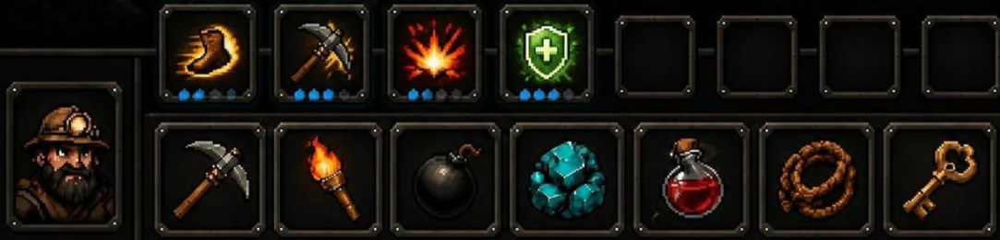

# DungeonEclipse

2D-рогалик-платформер (вид сбоку, пиксель-арт, тёмное фэнтези) на **Godot 4.3+ / GDScript**.
Каждый забег — новое процедурное подземелье; смерть героя заканчивает забег (permadeath).



## Запуск

1. Откройте папку проекта в Godot 4.3 или новее (Project → Import → `project.godot`).
2. Нажмите F5. Главная сцена — `scenes/ui/main_menu.tscn`.
3. Сцену `scenes/game/game.tscn` можно запускать напрямую (F6): герой создаётся из первой расы и первого класса.

Проверка без окна: `godot --headless --editor --quit` (импорт + проверка парсинга всех скриптов).

Сквозной тест: `godot --path . res://tests/smoke_test.tscn` — данные, генератор уровней,
инвентарь, оружие, звук и сценарий игры со скриншотами в `user://smoke_shots/`
(код выхода 0 = всё прошло; записывает один завершённый забег в мета-статистику).

## Управление (всё через InputMap, Project Settings → Input Map)

| Действие | Клавиатура / мышь | Геймпад |
|---|---|---|
| Ходьба | A / D, ← / → | левый стик, крестовина |
| Прыжок (coyote time + jump buffer, высота зависит от удержания) | Space, W, ↑ | A |
| Лестница / верёвка: лезть | W / ↑ (вверх), S / ↓ (вниз) | стик / крестовина |
| Спуск сквозь одностороннюю платформу | S / ↓ | стик вниз |
| Атака ближнего боя | J или ЛКМ (по игровому полю) | X |
| Предметы быстрого доступа | 1–7 | B — 5-й слот |
| Навыки (8 слотов) | Q, E, R, F, Z, X, C, V | LB, RB, LT, RT (слоты 1–4) |
| Дерево навыков | K | правый стик (нажатие) |
| Взаимодействие (сундук, дверь, подобрать) | E или F | Y |
| Инвентарь | I или Tab | Back |
| Пауза / настройки / закрыть книгу | Esc | Start |
| Карта этажа | M | левый стик (нажатие) |
| Отладка ИИ монстров (пути, зрение, состояния) | F3 | — |

Все клавиши клавиатуры и мыши переназначаются в «Настройки → Управление» (главное меню или
пауза) и сохраняются в `user://settings.cfg`, секция `[input]`. События геймпада заданы в
`project.godot` и при переназначении не меняются. Меню и книги навигируются стрелками /
крестовиной (встроенные `ui_*`); перетаскивание в инвентаре — только мышью.

**E и F** одновременно отвечают за взаимодействие и за 2-й/4-й навыки. Если рядом есть сундук,
предмет или дверь, срабатывает взаимодействие, иначе навык.

## Игровой процесс

- **Меню → создание героя**: раса (Человек, Гном, Эльф) и класс (Воин, Разбойник, Маг).
  Справа видно, как будет выглядеть портрет, итоговые характеристики, навыки и стартовые предметы.
- **Подземелье**: сетка комнат как в Spelunky. Гарантированный путь из верхней комнаты в нижнюю
  (проёмы в стенах и шахты с лестницами), боковые комнаты, замурованные «тайники» (туда нужно
  прокопаться киркой или бомбой, внутри всегда железный или золотой сундук), односторонние
  платформы, кирпичные столбы. Всё, кроме внешней рамки, — разрушаемый кирпич.
  Выход — фиолетовая дверь (E). С каждым этажом карта растёт, монстров становится больше, они
  сильнее (+30% HP и +18% урона за этаж), а в луте чаще попадаются редкие и эпические вещи.
- **Сундуки**: деревянный, железный, золотой (заперт, тратит ключ). Лут берётся из
  `data/loot_tables/chest_*.tres`.
- **Монстры**: слизень (прыгает), скелет (наносит удар с выпадом), летучая мышь (пикирует),
  культист Затмения (стреляет, появляется со 2-го этажа). Состояния ИИ: патруль → преследование
  (при прямой видимости) → атака с замахом. После смерти монстр даёт опыт и иногда лут.
- **Бой**: удар оружием (урон × 0.85–1.15, крит ×2), навыки, бомбы. Броня снижает урон:
  `урон × 100 / (100 + броня × 4)`. Числа урона всплывают над целью.
- **Прогрессия**: опыт → уровень → рост характеристик по `growth_per_level` класса, полное
  лечение, +1 очко навыка. Очко тратится кликом по навыку на HUD (синие точки под иконкой —
  уровень навыка).
- **Смерть**: экран итогов → главное меню. Лучший этаж, число забегов и убийств сохраняются.

## Интерфейс

- **HUD** (внизу, в стиле книги): портрет (раса + головной убор класса), 8 слотов навыков с
  точками уровня и затемнением перезарядки, 7 быстрых слотов с количеством, полоски HP, маны и опыта.
  При наведении на портрет показываются все характеристики.
- **Инвентарь-книга** (`assets/ui/book.png`): на левой странице кукла со слотами экипировки и
  характеристиками, которые обновляются сразу; на правой — рюкзак 6×5. Игра на паузе.
  - перетаскивание: рюкзак ↔ экипировка ↔ быстрые слоты (HUD остаётся доступным под книгой);
  - ПКМ или двойной клик — надеть, снять или использовать;
  - предмет, брошенный за пределы книги, выпадает на пол; быстрый слот при этом очищается;
  - в подсказке видны редкость, описание, бонусы и сравнение с надетым предметом (+ зелёным, − красным).

## Структура проекта

```
assets/            картинки (заглушки), ui/ — книга, рамки, тема
data/              ВСЕ игровые данные в .tres
  items/{equipment,usable,materials}/
  races/  classes/  skills/  enemies/  loot_tables/  animations/  affixes/  biomes/
  traps/  bosses/  elites/  events/  meta/ (Святилище)  achievements/
  equipment_layout.tres   список слотов экипировки
scenes/            player/ enemies/ levels/ world/ ui/ game/
scripts/
  autoload/        EventBus, SaveManager, ItemDatabase, MetaProgress, Codex, GameState, Tooltip, AudioManager
  core/            Stats, Inventory, Equipment, QuickBar, SkillSet, Hero, AssetPaths, StatTypes,
                   ItemFactory, InputBindings, Leaderboard
  data/            классы ресурсов: ItemData, EquipmentItemData, UsableItemData, RaceData, ClassData,
                   SkillData, EnemyData, LootTable, LootEntry, EquipSlotDef, EquipmentLayout
  effects/         эффекты предметов (ItemEffect и наследники)
  skills/          эффекты навыков (SkillEffect и наследники)
  level/           LevelGenerator (чистые данные) → LevelLayout → DungeonLevel (TileMapLayer)
  player/ enemies/ world/ ui/ game/
tools/gen_placeholders.py  генератор пиксельных заглушек (Pillow)
```

### Архитектура

- **Hero** (`scripts/core/hero.gd`) — всё, что живёт весь забег: раса, класс, `Stats`, `Inventory`,
  `Equipment`, `QuickBar`, `SkillSet`, опыт. Узел `Player` — только тело героя в мире; при переходе
  на новый этаж пересоздаётся уровень, а `Hero` остаётся тем же.
- **Stats**: итог = база класса + рост за уровни + бонусы расы + сумма модификаторов
  (`"equipment"`, баффы навыков). При каждом `Equipment.changed` пересчитывается заново и посылает
  `stats_changed`. Производные значения: HP = 40 + Вын×8, мана = 20 + Инт×6,
  урон = базовый урон класса + главный атрибут×0.8, броня = Вын×0.5,
  скорость = 110 + Лов×1.5, крит = 5% + Лов×0.6%. К каждому из них предметы могут прибавлять напрямую.
- **Inventory / Equipment / QuickBar** — логика без UI, только сигналы `changed`; UI на них подписан.
  Быстрый слот хранит ссылку на предмет, количество берётся из рюкзака.
- **EventBus** — глобальные сигналы: всплывающий текст, сообщения, выпадение лута, смерть, смена
  этажа, тряска экрана.
- **ItemDatabase** при старте загружает все `.tres` из папок `data/...`, поэтому новый файл
  подхватывается без правки кода.
- **SaveManager**: `user://settings.cfg` (громкость, полный экран) и `user://meta.cfg`
  (лучший этаж, забеги, убийства). Сам забег не сохраняется.

## Как добавить контент

Всё делается в инспекторе Godot: ПКМ по папке → *New Resource…* → нужный класс, либо
*Duplicate* существующего `.tres` и правка полей.

### Новый предмет
- **Снаряжение**: `EquipmentItemData` в `data/items/equipment/`. Заполните `id` (уникальный),
  `display_name`, `description`, `icon`, `rarity`, `slot_type` (`weapon`, `helmet`, `chest`,
  `gloves`, `boots`, `ring`, `amulet`) и `stat_bonuses`, например
  `{"strength": 2, "armor": 5, "crit_chance": 0.05}`. Ключи перечислены в `scripts/core/stat_types.gd`.
- **Используемый**: `UsableItemData` в `data/items/usable/`. В `effects` добавьте один или несколько
  эффектов: `HealEffect`, `ManaEffect`, `ThrowBombEffect`, `RopeEffect`, `DigEffect`,
  `UnlockEffect`. Флаг `consume_on_use` тратит предмет при использовании, `cooldown` — задержка
  между использованиями.
- **Свой эффект**: создайте скрипт `extends ItemEffect` с `class_name`, переопределите
  `apply(user) -> bool` (`user` — это `Player`) и `describe()`. После этого эффект появится в
  инспекторе, ядро трогать не нужно.
- **Ресурс**: обычный `ItemData` с `item_type = MATERIAL` в `data/items/materials/`.
- Чтобы предмет выпадал, добавьте `LootEntry` в нужную таблицу в `data/loot_tables/`.

### Новое оружие
`WeaponItemData` в `data/items/equipment/` (ПКМ → New Resource → WeaponItemData или Duplicate
любого `*_sword.tres`):
- `weapon_type` — меч, топор, копьё, кинжал, лук, посох, булава; от него по умолчанию зависят
  анимация героя (`attack_animation` можно задать вручную) и `attack_pattern`
  (ARC — удар дугой, THRUST — выпад, SHOOT — выстрел снарядом, THROW — бросок);
- `base_damage`, `attack_speed` (ударов в секунду), `reach` (дальность в пикселях, у луков и
  посохов — дальность полёта), `knockback`, `two_handed`, `damage_type` (физический, огонь,
  лёд, яд, магия — задаёт цвет следа и вспышки; сопротивления появятся вместе со статусами);
- `projectile_*` — текстура, скорость, пробивание, радиус взрыва (для SHOOT/THROW);
- `on_hit_effects` — `StatusHitEffect` (яд, горение, кровотечение, оглушение, замедление) или
  `LifeStealHitEffect`; свой эффект — скрипт `extends HitEffect` с `on_hit(attacker, target, damage)`;
- `held_texture` / `held_angle` / `grip_pixel` — как оружие лежит в руке (по умолчанию иконка,
  остриём вверх-вправо, рукоять в (3, 12));
- `gender` (m/f/n) — род названия, чтобы префикс аффикса согласовался («Острая секира»);
- `has_durability` / `max_durability` — износ (по 1 за попадание).
Затем добавьте `LootEntry` в нужные таблицы лута. Какие типы оружия «родные» для класса —
`ClassData.allowed_weapon_types`; чужое оружие работает со штрафом −40% урона и −25% скорости
(видно в подсказке).

### Новый аффикс оружия
`AffixData` в `data/affixes/`: префикс (`prefix_forms` = {m, f, n}) или суффикс (`suffix`,
«… пламени»), `min_rarity`, `weight`, `allowed_types`, и эффекты: `stat_bonuses`,
`damage_mult`, `speed_mult`, `reach_add`, `knockback_add`, `damage_type`, `hit_effects`.
Редкое оружие получает 1 аффикс, эпическое — 2 (префикс + суффикс).

### Новый биом
`BiomeData` в `data/biomes/`: тайлсет (формат атласа — в docs/ANIMATION_GUIDE.md), три слоя
параллакса, палитра (`ambient` — мягкий общий свет для CanvasModulate, цвет задней стены, свечение настенных факелов,
пыли), туман и цветокоррекция (`fog_*`, `grade_tint`, `saturation`, `contrast`),
декорации (`DecorData`: текстура, пол/потолок, вес, свечение, покачивание), плотность
декораций, шанс и предмет рудных жил. Биомы чередуются по `order` каждые 3 этажа.
`EnemyData.biomes` ограничивает монстра нужными биомами (пусто — везде).

### Новый звук / музыка
Подробно — [docs/AUDIO_LIST.md](docs/AUDIO_LIST.md). Файл кладётся в `assets/audio/sfx/` или
`assets/audio/music/`, id и путь добавляются в `AssetPaths.SFX` / `AssetPaths.MUSIC`, затем id
указывается в данных (`UsableItemData.use_sound`, `EnemyData.sound_hurt/sound_death/sound_attack`,
`BiomeData.music`, `BiomeData.step_sound`) или вызывается из кода
`AudioManager.play_sfx(id, позиция)` / `play_ui(id)` / `play_music(id)`.

**Музыка по ситуации.** Меню → `menu`. Этаж → трек биома. Вход в арену → `BossData.music`
(у каждого босса своя тема, запасной вариант — `boss` через `AssetPaths.MUSIC_FALLBACK`).
Победа → короткая фанфара `victory`, затем возврат к биому. Гибель → `death`. Переходы —
кросс-фейд 1.5 с. Одноразовые треки играют через `AudioManager.play_sting(id, затем_id)` и
перечислены в `AssetPaths.MUSIC_ONE_SHOT`. Если файлов музыки нет совсем, игра работает в
тишине без ошибок. Музыку для нового босса задайте в его `.tres` (`music = &"мой_id"`) и
добавьте id в `AssetPaths.MUSIC`.

### Статус-эффекты и стихии
Компонент `StatusEffects` есть у героя и у монстров: яд, горение, кровотечение (урон каждые
0.5 с, без учёта брони), оглушение, замедление, регенерация, щит (поглощает урон), проклятие.
Иконки — над головой и в строке над HUD (негативные — в красной рамке).
- Стихии: огонь растапливает лёд (снимает замедление), лёд гасит огонь; яд вдвое ослабляет регенерацию.
- Сопротивления: у героя — статы `res_fire/res_ice/res_poison/res_magic` (бонусы предметов и рас),
  у монстра — `EnemyData.resistances`; они режут стихийный урон и длительность статусов.
  `EnemyData.status_immunities` — полный иммунитет (скелеты не травятся).
- Источники: `on_hit_effects` оружия и аффиксов, `EnemyData.on_hit_effects` (монстры → герой),
  предметы (`StatusSelfEffect`, `CureEffect` — противоядие), навыки (`StatusSkill`).
- Новый статус: строка в `StatusEffects.INFO` + иконка `assets/ui/status/<id>.png` (8×8).

### Новая ловушка
`TrapData` в `data/traps/`: `kind` задаёт поведение (SPIKES — шипы выезжают, когда на них
наступили; FALLING_ROCK — камень трескается и падает, когда герой под ним; ARROW_WALL —
стреляет вдоль ряда, когда герой на линии; ACID_POOL — урон и яд, пока стоишь в луже;
PRESSURE_PLATE — запускает связанную стреляющую стену или камнепад). Остальное — данные: урон и
его рост за этаж (`damage_per_floor`), тип урона, эффекты при попадании, перезарядка, дальность,
снаряд, сложность обезвреживания, лист анимации, `min_floor`, `weight`, `biomes`. Так сделаны
«Ядовитые шипы» и «Огненная стена». Ловушку можно перепрыгнуть или обезвредить клавишей E
(шанс = 1 − сложность + Ловкость × 2%, при неудаче она срабатывает).

### Золото и торговец
Золото — валюта (предмет с `currency_value > 0`, например `gold_coin`, при подборе превращается в
золото кошелька). Его дают монстры (`EnemyData.gold_min/max`), сундуки (`LootTable.gold_min/max`,
+25% за этаж) и продажа. С шансом 40% на этаже есть комната торговца: он продаёт базовые
расходники и товары из `data/loot_tables/merchant.tres`, покупает предметы за 40% цены,
чинит снаряжение и лечит. Цена предмета — `ItemData.price` (0 = автоматически по типу и редкости;
аффиксы и износ меняют цену экземпляра).

### Новый босс
`BossData` в `data/bosses/` (наследник `EnemyData`: все поля монстра + `title`, `order`, `music`,
`glow_color`, `reward_items`). Боссы ходят по очереди по `order`: этаж 5 — первый, 10 — второй,
15 — снова первый (сильнее). Поведение — список фаз `BossPhase` (порог HP, пауза между атаками,
скорость, оттенок, сообщение), в каждой — набор `BossAttack`:
CHARGE (рывок вдоль пола), JUMP_SLAM (прыжок с ударной волной), PROJECTILE_FAN (веер снарядов),
SUMMON (призыв монстров), TELEPORT (исчезает и появляется рядом, стреляя), FIRE_RAIN (огненный
дождь по отмеченным точкам). Перед каждой атакой есть телеграф: красное свечение и метки на полу
(`windup` секунд). Арена — один зал; после победы появляются дверь, эпический сундук и
«Печать Стража».

### Случайные события и комнаты
Генератор резервирует на каждом этаже 1–2 боковые комнаты под события; какое именно —
выбирается по весу из `data/events/*.tres` (`RoomEventData`: название, сцена, вес, `min_floor`).
Есть: кровавый алтарь (−20% HP за сокровище, +2 к случайной характеристике или золото),
целебный фонтан (полное исцеление и снятие негативных статусов), проклятый сундук (двойной
эпический лут + проклятие и засада), комната рун (рычаги нужно потянуть в порядке, показанном
на табличке, — тогда исчезает барьер перед золотым сундуком; ошибка бьёт током и сбрасывает
рычаги) и узник в клетке (награда или, в 15% случаев, ловушка). Новое событие — сцена с
`setup_event(level, info)` (удобно наследовать `EventObject`) и `.tres` в `data/events/`.

### Мини-карта
Этаж открывается по мере исследования (радиус 7 клеток вокруг героя). Маленькая карта всегда
в правом верхнем углу, большая — по M. Метки: герой, выход, неоткрытые сундуки, торговец,
события, элиты и босс. «Карта этажа» (свиток, `RevealMapEffect`) открывает весь этаж.

### Святилище Затмения (мета-прогрессия)
Кнопка в главном меню. Валюта — **осколки Затмения** (падают с элит и стражей; «Печать Стража»
в рюкзаке = 5 осколков) и **золото казны**. В конце забега (смерть или выход в меню)
`MetaProgress.finish_run` начисляет: осколки из рюкзака (`ItemData.shard_value`), 1 осколок за
каждые 2 этажа, 3 за каждого стража, и 25% собранного золота. Всё хранится в секции
`[sanctum]` файла `user://meta.cfg` (рекорды — в секции `[meta]`).

- **Новое улучшение**: `MetaUpgradeData` в `data/meta/` — `max_level`, `shard_costs` /
  `gold_costs` (цена каждого уровня), эффект за уровень: `stat_bonuses`, `start_gold`,
  `starting_items` (так же открываются стартовые предметы). Применяется к новому герою
  модификатором Stats `"meta"`.
- **Закрытая раса/класс**: задайте `unlock_shards` / `unlock_gold` в `RaceData` / `ClassData`;
  они появятся в Святилище, а в создании героя будут видны, но недоступны до покупки.
  Пример: орк (15 осколков) и паладин (20 осколков + 300 золота).

### Достижения, бестиарий, энциклопедия предметов («Летопись»)
Кнопка «Летопись» в главном меню: три вкладки книги. Всё считает autoload `Codex`, который
только слушает сигналы EventBus (убийства, элиты, боссы, этажи, сундуки, находки, золото,
ловушки, события, покупки, смерти) — игровой код о нём не знает. Хранится в секции `[codex]`
файла `user://meta.cfg`.

- **Новое достижение**: `AchievementData` в `data/achievements/` — `counter` (один из
  `Codex.COUNTERS`: kills, elites, bosses, floor, chests, epic_items, gold, traps, events,
  purchases, deaths, bestiary, items_known, runs), `target`, `reward_shards` (осколки в
  Святилище), `hidden` (до получения показывается «???»), `icon`. При получении сверху
  выезжает карточка (`AchievementToast`).
- **Бестиарий** заполняется сам: каждый `EnemyData`/`BossData` открывается после первой победы.
  Текст — `EnemyData.description`, остальное (HP, повадки, особенности, иммунитеты, где
  встречается) берётся из данных монстра. Миниатюра — первый кадр анимации `idle`.
- **Энциклопедия предметов**: все предметы из `data/items` (кроме монет); открываются при
  подборе или покупке, описание — та же подсказка, что в инвентаре.

### Ежедневный забег
Кнопка «Ежедневный забег» в главном меню. Дата (локальная, `YYYY-MM-DD`) превращается в зерно
и героя дня (`GameState.daily_setup`): раса и класс выбираются только из открытых изначально.
Каждый этаж дополнительно засевает глобальный генератор (`seed(floor_seed)`), поэтому добыча и
броски монстров тоже совпадают. Улучшения Святилища не действуют. Очки
(`Leaderboard.score`): этаж ×100, страж ×300, враг ×5, половина золота, уровень ×20.
Локальная таблица — секция `[daily]` в `user://meta.cfg`, по 10 лучших результатов на день.

### ИИ монстров
- **Навигация** (`scripts/ai/level_nav.gd`, `LevelNav`): строится из `LevelLayout` при создании
  этажа и перестраивается (не чаще раза за кадр), когда ломается кирпич или вешается верёвка.
  - Ходячие: граф платформ `GroundGraph` (AStar2D с типами рёбер: ходьба, прыжок до 3 клеток
    вверх и 3 в сторону с проверкой дуги, падение не глубже 6 клеток — глубже считается
    пропастью, спуск сквозь платформу, лестница/верёвка). Два варианта графа: для тел в 1 и
    2 клетки высотой (`EnemyData.collision_size`).
  - Летающие: A* по свободным клеткам (`AStarGrid2D`, диагонали только мимо свободных углов) +
    три луча-«уса» против стен. Сквозь платформы летают. Призраки (`phases_through_walls`)
    летят напрямую.
  - Ловушки помечаются при генерации (`DungeonLevel._mark_trap_danger`): на шипы, кислоту и
    нажимные плиты монстр не наступает никогда (но может перепрыгнуть), линии стрел и
    камнепады дают большую стоимость. Новый тип ловушки — добавьте его в `_mark_trap_danger`.
- **Состояния** (`Enemy.State`): патруль → «!» заметил → преследование → атака → поиск
  («?», идёт к последнему месту, где видел/слышал героя, осматривается) → возврат домой → патруль.
  Зрение — луч по слою стен (кирпич заслоняет), в патруле только вперёд (кроме вплотную),
  память о герое 4 с. Слух: `EventBus.noise(pos, radius)` — бой (150 px), взрывы (260 px),
  удар голема. Новый источник шума — просто вызовите этот сигнал.
- **Бой**: стрелки держат дистанцию и отходят, если герой близко; ближний бой бьёт только при
  прямой видимости и на одном уровне; после удара героя ходячие отступают на 0.35 с, летучие —
  вверх на 0.4 с; монстры не стоят друг в друге (расходятся, когда ждут). Удары, удар по
  площади и выстрелы врагов проверяют линию до героя — сквозь стену не бьют и не стреляют.
- **Координация** (`Enemy.coordination()`, 0 до 2-го этажа → 1 к 10-му): заметивший зовёт
  соседей, монстры заходят с менее занятой стороны героя, на глубине не лезут по одному, а
  ждут стаю. Без читерства: только то, что монстр видит, слышит или узнал от соседа.
- **Антизастревание**: нет продвижения 1.2 с → новый путь → прыжок с разворотом → телепорт в
  ближайшую безопасную клетку графа. Всё пишется в `AIDebug` (счётчики) и в консоль при F3.
- **Отладка F3**: путь каждого монстра, радиус зрения, линия к герою (зелёная — видит),
  последнее известное место героя, состояние над головой.
- **Тесты ИИ** (headless):
  - `godot --headless --fixed-fps 60 --path . res://tests/ai_sim.tscn -- --levels=50 --seconds=25`
    — 50 случайных этажей с «бродячим» бессмертным героем; печатает срабатывания
    антизастревания, застрявших > 10 с, время на клетках ловушек. Последний прогон:
    1195 монстров, застрявших > 10 с — 0 (худший 3.8 с), на ловушках — 0 с,
    антизастревание: 42 новых пути, 14 манёвров, 6 телепортов.
  - `godot --headless --fixed-fps 60 --path . res://tests/ai_behaviour_test.tscn` — сценарии
    на маленьких уровнях: прыжок через шипы, на уступ, лестница, стена закрывает обзор,
    память → поиск → возврат, слух, перестройка графа, облёт стены, отход стрелка, нет удара
    сквозь стену, зов союзников, цепочка антизастревания.

### Никаких ударов сквозь стены
Одно правило для всех (`scripts/combat/line_of_sight.gd`, `LineOfSight`): между атакующим и
целью не должно быть кирпича или скалы. Платформы и лестницы обзор не закрывают.
- Ближний бой героя: хитбокс оружия обрезается о первую стену (искры и звук удара о камень),
  цель засчитывается, только если видна из рук героя (центр или верх тела).
- Навыки: «Мощный удар», удар по области, рывок с уроном — урон только по видимым целям;
  кирпич ломается уже после расчёта урона, поэтому стена прикрывает того, кто за ней.
- Снаряды (стрелы, магия, ножи, выстрелы врагов, стрелы ловушек, огонь босса): каждый кадр луч
  по пути снаряда — о кирпич он гаснет, сквозь не пролетает; точка вылета никогда не внутри
  кирпича. Взрыв снаряда задевает только тех, кого видно из точки взрыва.
- Бомбы: урон — по видимым из точки взрыва (стены как до взрыва), кирпичи в радиусе ломаются.
- Монстры и боссы: удар, удар по площади, ударная волна, касание и выстрел — только при
  прямой видимости героя.
- Новый вид атаки: проверяйте цель через `LineOfSight.can_hit(node, from, target)`, точку
  появления снаряда — через `LineOfSight.safe_point`.
- Тесты: сценарии «hero melee does not pass walls», «weapon stops at the wall», «skills and
  bombs do not pass walls», «projectiles stop at bricks» в `tests/ai_behaviour_test.tscn`.

### Свет
Подземелья светлые и ровно освещённые. Нет круга света вокруг героя, нет виньетки и
темноты по краям. Общий свет задаёт биом (`BiomeData.ambient`, мягкий оттенок для
CanvasModulate). Объём дают только чуть более тёмные задняя стена и дальние слои параллакса.
Настенные факелы остаются декорацией с тёплым свечением и на видимость не влияют. Светятся
элиты, руда, снаряды и предметы на полу. Ползунок «Яркость» в настройках (0.6–1.5)
умножает картинку мира в шейдере постобработки; HUD он не меняет. Значение хранится в
`settings.cfg`, секция `[video]`. Предмета «Факел» в игре больше нет.

### Каталог предметов, сеты, реликвии
**Генератор.** Сейчас в игре 142 предмета. 91 новый описан в `tools/gen_items.py`: один
список, из которого создаются `.tres` и иконки-заглушки. После правки списка запустите
`cd tools && python3 gen_items.py && python3 gen_loot_tables.py`. Новый предмет можно сделать
и вручную в редакторе — генератор трогает только те `.tres`, что перечислены в его списке.

**Что добавлено:**
- **Оружие — 28 новых видов.**
  - Новые типы оружия: арбалет (`CROSSBOW`, разбойник) и жезл (`WAND`, маг).
  - Элементальное оружие: огонь, лёд, яд, магия; вампирский «Кровопийца».
  - Легендарные уникальные (`unique`): «Солнечный клинок», «Сердце стужи», «Жало гадюки»,
    «Кровопийца».
- **Броня — 20 вещей**, от ткани и кожи до лат, с акцентами: ловкость, броня, интеллект,
  сопротивления.
- **Кольца и амулеты — 8**: крит, регенерация, скорость, добыча золота, сопротивление огню
  и яду, лишний прыжок.
- **Расходники — 22:**
  - зелья: малое лечение, мана, скорость, сила, защита, невидимость;
  - свитки: телепорт, возврат к выходу, огненный шар, обнаружение, исцеление;
  - бомбы: огненная, ледяная, ядовитая, липкая;
  - еда, отмычки, длинная верёвка, стальная и мифриловая кирки.
- **Реликвии — 5.** Ресурсы для крафта и продажи — 8.

**Новые характеристики** (`StatTypes.SPECIAL`): `hp_regen` (HP в секунду), `gold_find`
(доля доп. золота с монстров), `extra_jumps` (прыжки в воздухе). Их можно указывать в
`stat_bonuses` любого предмета.

**Сет.** `ItemSetData` в `data/sets/`: `id`, `display_name`, `items` (id частей) и `bonuses`
вида `{2: {...}, 3: {...}, 4: {...}}` — бонусы достигнутых порогов складываются. Частям
нужно указать `set_id`. Подсказка показывает части комплекта (надетые — ярче) и бонусы
(достигнутые — зелёным). Сейчас четыре сета: «Странник», «Страж», «Чародей», «Затмение».

**Реликвия.** `RelicItemData` (тип «Реликвия», папка `data/items/relics/`). Действует просто
из рюкзака, особый слот не нужен; одна копия каждой реликвии считается один раз. Поля:
- `stat_bonuses` — бонусы к характеристикам;
- `heal_on_kill` — лечение за каждое убийство;
- `second_chance` и `revive_percent` — при гибели герой встаёт, реликвия сгорает.

**Новые эффекты расходников:**
- `BuffItemEffect` — временные бонусы;
- `TeleportEffect` — телепорт (`to_exit` — к выходу);
- `CastSkillEffect` — заклинание из свитка, любой `SkillEffect` без маны;
- `DetectEffect` — карта и подсветка ловушек;
- `ThrowBombEffect` — теперь с `damage_type`, статусом, `sticky`, `breaks_tiles`;
- `UnlockEffect.success_chance` — отмычки;
- `DigEffect.bricks_per_use` — кирки лучше.

**Невидимость** — статус `invisible`: монстры не видят героя дальше 14 px, атака её снимает.

### Лут по этажам и баланс
- **Редкости**: обычная, редкая, эпическая, легендарная (`ItemData.Rarity`). У каждого предмета
  есть `item_level` (1 — стартовое снаряжение, 6–8 — топовые эпики) и `unique`: уникальные и
  легендарные предметы выпадают только с боссов, из особых комнат и с глубоких этажей (8+).
- **Таблица лута** (`LootTable`):
  - `rarity_weights` — вес каждой редкости на 1-м этаже;
  - `rarity_per_floor` — прирост веса за каждый этаж;
  - `rarity_min_floor` — с какого этажа редкость вообще возможна;
  - `item_level_base + item_level_per_floor × этаж + item_level_bonus` — потолок уровня предмета;
  - `rolls_min/max`;
  - `extra_tables` — отдельные броски, например расходники;
  - `gold_min/max`.
- **Запись** (`LootEntry`): `weight`, `min/max_count`, `min_floor`, `max_floor`.
- **Тип сундука** повышает шансы редкостей и даёт +0/+1/+2 к потолку уровня, но этаж всё
  равно ограничивает лут. Деревянный сундук даёт 1–2 предмета, железный — 1–3, золотой — 2–3.
  Золото и расходники выпадают отдельно от снаряжения.
- **Таблицы генерирует** `tools/gen_loot_tables.py` — там все числа баланса:
  - `chest_common/rare/epic` — сундуки;
  - `enemy_common/rare` — монстры, элита берёт лут из `enemy_rare`;
  - `merchant` — торговец;
  - `boss` — сундук за босса;
  - `special` — особые комнаты;
  - `supplies(_small)` — расходники.
- **Новый предмет** попадает в нужные таблицы автоматически: задайте ему `rarity`,
  `item_level` (и `unique` для легендарного) и запустите `python3 tools/gen_loot_tables.py`.
- **Проверка баланса**: `godot --headless --path . res://tests/loot_sim.tscn`. Симулятор
  открывает каждую таблицу 1000 раз на этажах 1, 3, 5, 8 и 12, проверяет цели и пишет
  отчёт в [docs/BALANCE.md](docs/BALANCE.md). Цели:
  - на 1-м этаже эпических меньше 1%, и сундук не даёт предметов выше 3-го уровня;
  - к 8-му этажу эпические — регулярная находка;
  - стартовое снаряжение всех классов — обычное, 1-го уровня.
- **Монстры**:
  - HP +40% и урон +22% за каждый этаж;
  - число монстров 3 + 2.4 × этаж + комнаты / 2;
  - шанс элиты 6% на 1-м этаже, +2.5% за этаж, максимум 35%;
  - новый аффикс элиты «Щитоносный» — щит, который поглощает урон.

### Производительность
- Монстры дальше 520 px от героя, которые просто патрулируют, «спят»: не думают и не считают
  физику. Будят их приближение героя, шум (`EventBus.noise`) и урон.
- Список монстров берётся из дерева сцены один раз за физический кадр (`Enemy.all_enemies()`),
  а не каждым монстром заново.
- Граф навигации перестраивается через 0.2 с после последнего разрушения: взрыв на десять
  кирпичей стоит одной перестройки.
- Мини-карта перерисовывает только изменившиеся клетки (`DungeonLevel.changed_cells`), метки —
  10 раз в секунду.
- У снарядов нет собственного источника света. Лежащие предметы считают физику дважды в
  секунду, а не каждый кадр.

### Монстры с замедлением
«Ледяной бесёнок» (снежки) и «Болотный плевун» (липкая грязь) держатся на расстоянии и
кидают снаряды со статусом «Замедление» (`StatusHitEffect` со статусом `slow` в
`on_hit_effects`). Появляются со 2-го и 3-го этажа. Спрайты — перекрашенные культист и
слизень (`tools/gen_mechanics.py`, `slow_throwers()`).

### Удобство (QoL)
- **Пауза** (Esc / Start): продолжить, настройки, дерево навыков, выход в меню.
- **Настройки** (`SettingsBook`, общая для меню и паузы): громкость 4 шин, яркость, размер
  нижней панели (60–100%, панель сжимается к нижнему краю), полный экран,
  числа урона вкл/выкл, подсказки новичку вкл/выкл и «показать заново», переназначение клавиш
  (`InputBindings`: клик по клавише → нажмите новую; Esc — отмена; конфликтующая клавиша
  снимается с другого действия; «Клавиши по умолчанию»). Подписи клавиш в HUD обновляются.
- **Подсказки новичку** (`HintManager`): каждая показывается один раз в нужный момент
  (первый этаж, первый сундук, первый предмет, уровень, мало HP, статус, карта, страж, торговец).
  Новая подсказка — строка в `HintManager.HINTS` (`{action}` заменяется на текущую клавишу) и
  подключение к сигналу в `setup()`.
- **Экран смерти**: этаж, время, убийства, элиты и стражи, собранное золото, находки по
  редкостям, награды Святилища и результат ежедневного забега.

### Новая раса
`RaceData` в `data/races/`: `id`, `display_name`, `order` (место в списке), `description`,
`portrait` (лицо 32×32), `stat_bonuses`, `body_sheet`, `sprite_scale`, `unlock_shards`/`unlock_gold`.

### Новый класс
`ClassData` в `data/classes/`: базовые и растущие за уровень характеристики, `main_attribute`
(атрибут, от которого зависит урон), `sprite`, `portrait_overlay` (головной убор поверх лица),
`starting_items` (`{&"id": количество}`), `starting_equipment`, `starting_quick_bar`, `skills`.

### Новый навык
`SkillData` в `data/skills/` + эффект: `DashSkill`, `ProjectileSkill`, `AreaBlastSkill`,
`BuffSkill`, `PowerStrikeSkill`, `StatusSkill`, `PassiveSkill` (пассивный: `bonuses`,
`bonuses_per_level`, `hit_effect` с шансом при ударе) или свой скрипт `extends SkillEffect`
с `execute(caster, level)`. Затем добавьте навык в `skills` класса — это дерево, размер не ограничен.

**Дерево навыков** (клавиша K, книга): `required_level` — уровень героя, `requires` — навыки,
которые нужно изучить раньше, `tree_row` — ярус дерева (колонки раскладываются по порядку в
`ClassData.skills`, поэтому один навык может быть у нескольких классов). Изучение и каждое
улучшение стоят 1 очко навыков (1 очко за уровень героя). Навыки с `required_level <= 1` и без
`requires` известны с начала. Изученные активные навыки встают в свободные слоты HUD:
Q/E/R/F и Z/X/C/V (8 слотов); пассивные действуют всегда (модификатор Stats `"passives"`).

**Синергия с оружием**: `synergy_weapons` (типы `WeaponItemData.WeaponType`) и
`synergy_power` (по умолчанию +30%). С подходящим оружием в руке урон навыка, размер баффа,
щита и бонусы пассивок умножаются на `1 + synergy_power` (`SkillData.power_with`, в эффектах —
`caster.skill_power`). Сейчас у каждого класса 8 навыков: 4 стартовых, 2 пассивных и 2 активных
в дереве; синергии: меч/топор/булава — воин и паладин, кинжал/лук — разбойник, посох — маг.

### Новый монстр
`EnemyData` в `data/enemies/`: `behavior` (WALKER, FLYER, RANGED), `texture`/`sheet`/`sheet_layout`,
`collision_size`, HP, урон, броня, скорости, дальности, `xp_reward`, `loot_table`, `loot_chance`,
золото, `min_floor`, `spawn_weight`, `biomes`, `resistances`, `status_immunities`,
`on_hit_effects`, звуки, `gender` (для имён элиты). Особые умения включаются флагами:
`phases_through_walls` (призрак), `ceiling_ambush` (паук ждёт на потолке), `aoe_radius`
(удар по площади, голем), `summon` + `max_summons` (некромант). Отдельная сцена не нужна:
все монстры используют `scenes/enemies/enemy.tscn`.

### Элитные монстры
`EliteAffixData` в `data/elites/`: префикс по родам, множители HP/урона/скорости/перезарядки,
броня, сопротивления, иммунитеты, эффекты при ударе, постоянный статус (регенерация), кража
жизни, цвет свечения, множители опыта и золота, `min_floor`. Шанс элиты — 5% на 1-м этаже,
+2% за этаж (максимум 30%); элита крупнее, светится, подписана («Огненный каменный голем») и
всегда роняет лут.

### Новый слот экипировки
Добавьте `EquipSlotDef` в `data/equipment_layout.tres`: `id`, `slot_type`, `label`, `placeholder`,
`page_position` (координаты на левой странице книги). Логика и UI подхватят слот сами.

### Замена графики
Все картинки — заглушки из `tools/gen_placeholders.py`. Положите свой PNG с тем же именем на
место старого, и он подменится везде. Пути, которые использует код (UI, тайлы, эффекты), собраны
в `scripts/core/asset_paths.gd`, иконки и спрайты данных хранятся в `.tres`. Тайлсет — полоска
16×16 в `assets/sprites/tiles/dungeon_tiles.png`: камень-рамка, кирпич, платформа, лестница,
задняя стена. Фильтр текстур Nearest включён в настройках проекта.

### Анимация (спрайт-листы)
Подробно — в [docs/ANIMATION_GUIDE.md](docs/ANIMATION_GUIDE.md). Коротко:
- лист — PNG-сетка «строка = анимация, столбец = кадр», раскладка лежит в `data/animations/*.tres`
  (`SpriteSheetLayout`: размер кадра, origin, fps, loop, точки руки героя);
- замена: свой PNG с тем же именем и размерами кадров поверх плейсхолдера;
- герой — 4 слоя одной раскладки: тело расы (`RaceData.body_sheet`), одежда класса
  (`ClassData.outfit_sheet`), броня (`EquipmentItemData.visual_sheet`, `visual_layer = "armor"`),
  голова (шлем с `visual_layer = "head"` или `ClassData.head_sheet`);
- монстр — `EnemyData.sheet` + `EnemyData.sheet_layout`, строки idle, walk|fly, windup, attack, hurt, death;
- анимация использования предмета — `UsableItemData.use_animation`, каста навыка — `SkillData.cast_animation`.

### Шаблоны и экземпляры предметов
`.tres` предмета — неизменяемый **шаблон**. Когда выпадает снаряжение с прочностью или редкое/
эпическое оружие, `ItemFactory.create()` делает **экземпляр** — runtime-копию шаблона
(`item.template` указывает на `.tres`), в которую «запекаются» аффиксы, итоговые значения,
имя и текущая прочность. Расходники остаются общими шаблонами и стакаются как раньше.

## Принятые решения (где задание допускало варианты)

- Базовое разрешение 640×360 (окно 1280×720), stretch `canvas_items`, aspect `expand`, рендер Compatibility.
- Атака: J или ЛКМ. В задании клавиша не указана; клик по UI атакой не считается.
- Подбор предметов — по E/F. Собираются сразу все предметы рядом.
- Быстрые слоты ссылаются на предметы в рюкзаке, а не хранят их отдельно.
- Ключ тратится автоматически при открытии золотого сундука. Использованный вручную, он открывает
  ближайший запертый сундук.
- Кирка — инструмент: не расходуется и копает вбок, вниз (с S) или вверх (с W).
  Верёвка вешает лестницу от героя до потолка.
- Навыки качаются за очки, которые даются за уровень (клик по навыку в HUD). Их уровень показывают синие точки.
- Подсказка (tooltip) сделана как autoload `Tooltip`, чтобы работать на паузе и в любом меню.
- Добавлены autoload `SaveManager` (настройки и рекорды), `Tooltip`, `AudioManager`, `MetaProgress` (Святилище) и `Codex` (летопись), помимо GameState, EventBus и ItemDatabase.
- Анимация героя — конечный автомат в коде (`scripts/anim/hero_animator.gd`) поверх
  AnimatedSprite2D-слоёв (`HeroVisual`), а не AnimationTree: слоёв несколько, и их проще
  синхронизировать по кадру тела.
- Рост расы — масштаб спрайта (`RaceData.sprite_scale`), а не отдельный скелет, чтобы слои одежды
  и шлемов подходили всем расам.
- Hit-stop делается через `Engine.time_scale` на 30–70 мс реального времени.
- Экземпляр предмета — это копия `ItemData` (а не отдельный класс-обёртка): так весь
  существующий код (инвентарь, слоты, подсказки) работает с ним без изменений.
- Урон героя = (урон оружия + плоские бонусы «Урон») × (1 + главный атрибут × 0.08) × штраф
  класса; затем крит ×2 и броня врага (как раньше). Без оружия — `ClassData.base_damage`.
- Стрелы у луков бесконечные. Сломанное оружие бьёт вполовину, сломанные доспехи не дают
  бонусов; чинит точильный камень (а позже — торговец).
- Износ: оружие −1 за попадание, случайный надетый доспех −1 за полученный удар.
- Биомы: Катакомбы → Грибные пещеры → Руины → Лавовые глубины, по 3 этажа, потом по кругу
  (сложность продолжает расти с номером этажа).
- Параллакс виден сквозь «дыры» в задней стене (шум FastNoiseLite), иначе его бы закрывала стена.
- Цветокоррекция, туман и виньетка — один шейдер на отдельном CanvasLayer над миром, HUD их
  не затрагивает.
- Звуки — синтезированные заглушки (`tools/gen_audio.py`), а не тишина: так сразу слышно, где
  какой звук. Шины Music/SFX/UI создаёт `AudioManager` при запуске (отдельный bus layout не нужен).
- Шаги: дерево на платформах и лестницах, иначе звук шага биома (мох в Грибных пещерах).
- Ловушек нет ближе 8 клеток от старта; их число растёт с этажом (2 + номер этажа).
- Боссы не отлетают от ударов и почти не оглушаются (30% длительности), чтобы бой не ломался
  контролем; их HP и урон растут с этажом как у обычных монстров.
- Мета-награда начисляется при любом завершении забега (смерть или выход в меню), поэтому
  осколки выгодно носить в рюкзаке, а Печать Стража можно либо продать торговцу (150 з.),
  либо сохранить на 5 осколков. Банковская доля золота — 25%.
- Бестиарий открывает существо после первой победы над ним (а не при встрече), а предмет —
  при подборе или покупке; неоткрытые записи показаны тёмными силуэтами.
- Ежедневный забег можно перепроходить сколько угодно — в таблицу идёт каждый результат,
  первое место — лучший. Осколки и золото в Святилище за него начисляются как обычно, но
  улучшения на нём не действуют (равный старт).
- Дерево навыков — отдельная книга (K), а не вкладка инвентаря: у неё своя раскладка и
  кнопка «Изучить». Клик по слоту HUD по-прежнему улучшает уже изученный навык.
- Переназначается только клавиатура/мышь; раскладка геймпада фиксирована (Xbox-обозначения),
  чтобы не строить отдельный экран захвата стиков и триггеров.
- E и F по умолчанию заняты дважды (взаимодействие и навыки 2/4). При переназначении клавиша
  снимается с других действий, поэтому такой дубль можно убрать в настройках.
- Подсказки помнятся между запусками (`seen_hints`), их можно показать заново из настроек.
- Ловушки не ранят монстров («они знают своё подземелье»), а ИИ всё равно их обходит.
  Так враги не погибают на своих же шипах, а заманить их туда нельзя.
- Падение глубже 6 клеток монстр считает пропастью и туда не прыгает.
- Факел удалён целиком: подземелья светлые, расширять круг света больше незачем. Старые
  сохранения (летопись) с id `torch` ошибок не дают: энциклопедия перечисляет только
  существующие предметы.
- Уровень предмета виден в подсказке («ур. N»). Голем стал чуть уже (15 px вместо 18),
  чтобы проходить коридоры шириной в клетку.
- Мета-улучшения небольшие (например, +8 HP за уровень), чтобы не ломать баланс ранних этажей.

## Этапы

1. ✅ Проект, InputMap, игрок (ходьба, прыжок с coyote/buffer, спуск сквозь платформы, лестницы, камера)
2. ✅ Процедурная генерация, переход между этажами
3. ✅ Расы, классы, Stats, меню выбора
4. ✅ Предметы, Inventory, Equipment, ItemDatabase, примеры
5. ✅ HUD по референсу
6. ✅ Инвентарь-книга с drag & drop и tooltip
7. ✅ Сундуки и таблицы лута
8. ✅ Монстры, бой, числа урона, лут, опыт
9. ✅ Навыки классов, смерть, возврат в меню, полировка (свет, частицы, тряска экрана)
10. ✅ README
11. ✅ Анимации: слоёный герой (17 анимаций, конечный автомат, squash & stretch, предмет в руке),
    4 монстра × 6 анимаций с белой вспышкой и смертью, факелы, сундуки, портал, капли, взрывы,
    осколки, пыль; анимированный UI и game feel
12. ✅ Оружие: 7 типов (19 видов), видно в руке, свои анимации, хитбоксы и след удара,
    снаряды, эффекты при попадании, аффиксы, прочность, допуск по классу, DPS в подсказке
13. ✅ Детализация: 4 биома (тайлсеты с автотайлингом краёв, вариантами и рудой, параллакс,
    декорации, свет, туман, цветокоррекция, виньетка), тени, слои сапог/перчаток,
    клёпки и строка эффектов в HUD
14. ✅ Звук: AudioManager (шины Music/SFX/UI, громкость в меню), 38 звуков и 6 музыкальных
    петель-заглушек, шаги по типу тайла, удары по типу оружия, лут по редкости, музыка по биомам
15. ✅ Механики: ✅ статусы и стихии, ✅ ловушки, ✅ золото и торговец, ✅ боссы каждые 5 этажей,
    ✅ новые монстры и элиты, ✅ события, ✅ мини-карта, ✅ Святилище Затмения (мета-прогрессия),
    ✅ достижения, бестиарий и энциклопедия, ✅ ежедневный забег, ✅ дерево навыков (8 навыков на класс, пассивки, синергии), ✅ QoL (пауза с настройками, переназначение клавиш, геймпад, подсказки, числа урона, экран смерти)
